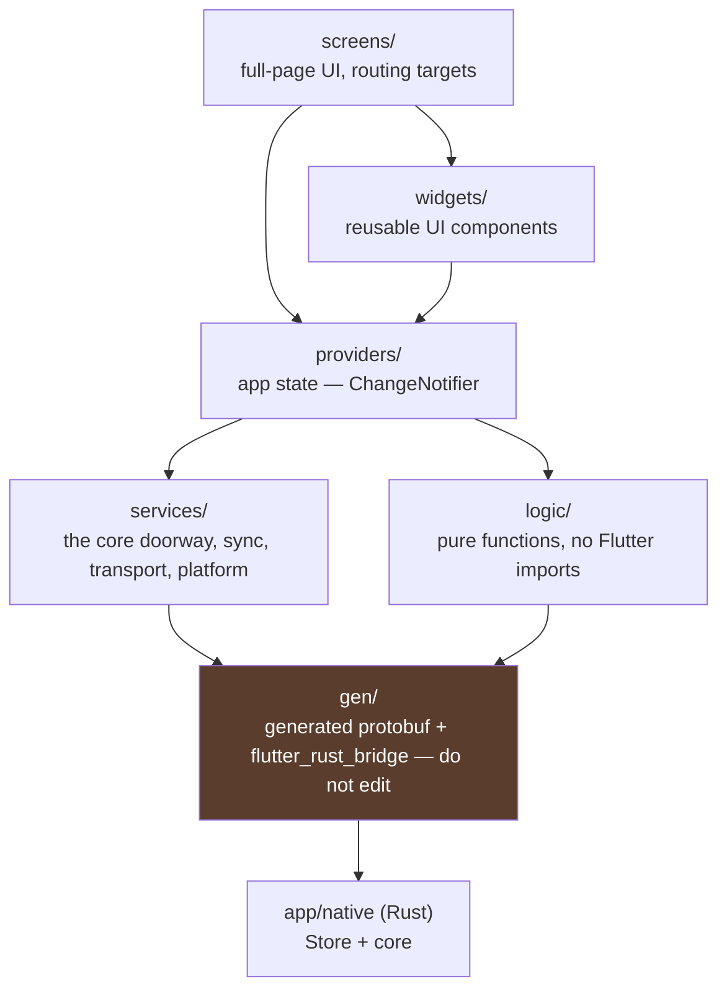
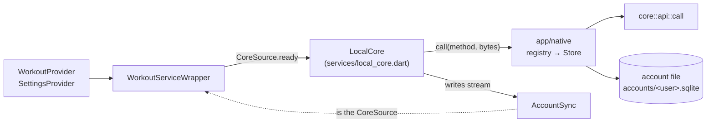
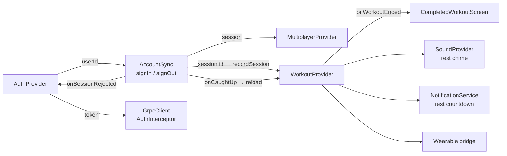
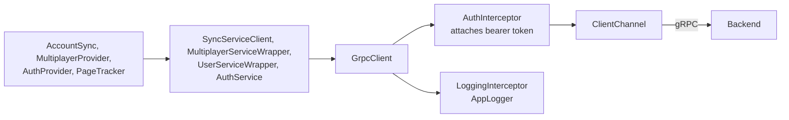
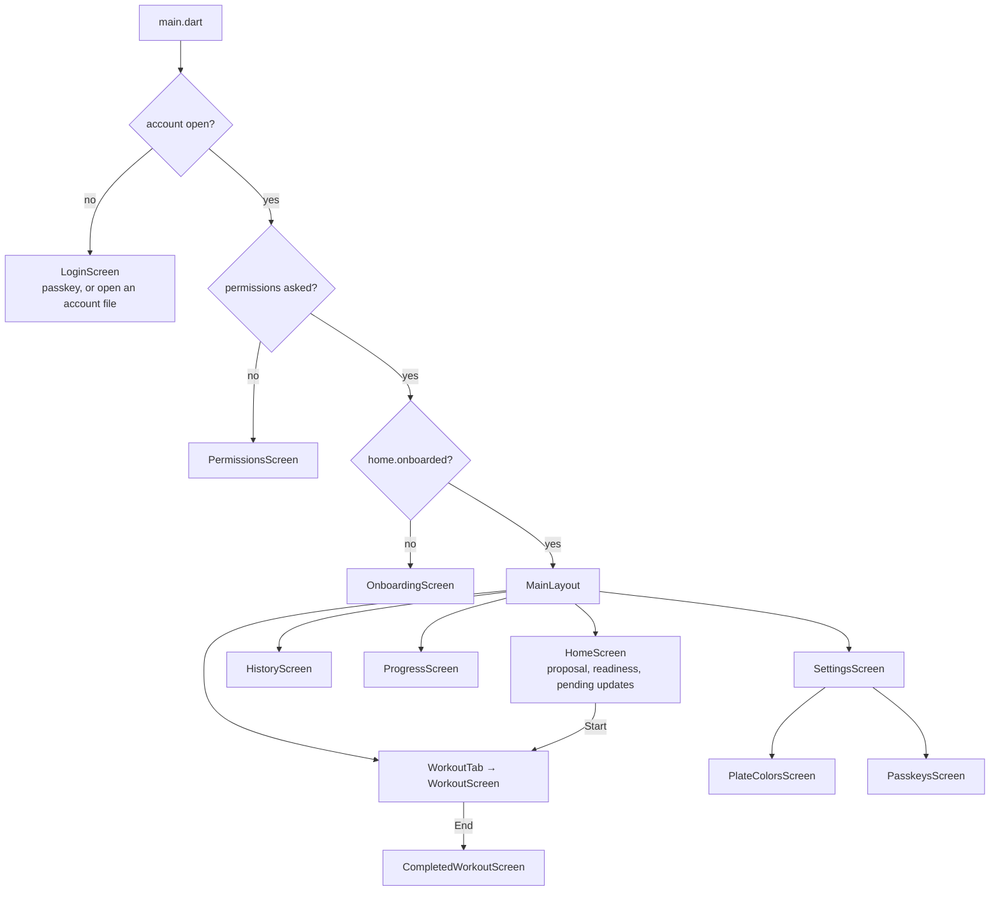
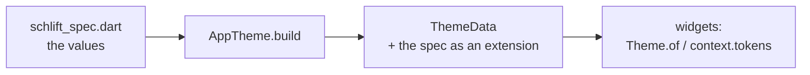

# Flutter App

`app/lib/` is a Provider-based Flutter app targeting iOS and Android, with
companion apps for Wear OS and Apple Watch. The account lives on the phone:
the Rust core runs inside the app (`app/native`) and answers every workout,
template and settings call locally. See [local-first.md](local-first.md).

## Layers



The rules that matter:

- **No domain rules in Dart.** Planning, the set state machine, progression,
  summaries, volume and the home's suggestion are the core's. A provider
  makes one call and shows the answer.
- **`logic/` must not import Flutter.** It is display-side helpers only —
  plate maths for the bar picture, unit formatting, grouping sets into
  exercise blocks — testable without a widget harness.

## The core on the phone



- `LocalCore` (`services/local_core.dart`) is the Dart doorway to the core:
  `call(method, request, parse)` sends proto bytes and parses the answer,
  plus `outbox` / `acked` / `restore` / `export` for sync and files. Errors
  come back as `CoreException` with a code (`invalid_argument`, `not_found`,
  `failed_precondition`, `storage`).
- `app/native` keeps open accounts in a registry keyed by an integer
  handle; `LocalCore` holds the handle. `LocalCore.memory` opens an
  in-memory account (the tutorial, tests).
- `WorkoutServiceWrapper` (`services/workout_service.dart`) is the app's
  typed API over a `CoreSource` — anything that can produce an open
  `LocalCore`. `AccountSync` is the signed-in user's source; `FixedCore`
  wraps one already open (the tutorial, tests).
- `AccountSync` (`services/account_sync.dart`) opens the signed-in user's
  file, restores it from the server on a fresh install, and holds the Sync
  stream. Its `session` and `joinRequests` are what the stream brought down.

The bindings are generated: after changing `app/native/src/api/`, run
`flutter_rust_bridge_codegen generate` in `app/` (it writes
`app/lib/gen/native/` and `app/native/src/frb_generated.rs`). cargokit
(`app/rust_builder`) builds `app/native` into the app for each platform.

## Providers

Registered in `app/lib/main.dart`, which also wires the cross-provider callbacks.

| Provider | Owns | Notes |
|---|---|---|
| `AuthProvider` | User id, name, server session token, profile | `isLoggedIn`: an account is open on the phone. `hasServerSession`: the server knows this phone |
| `AccountSync` | The open account and the Sync stream | A `ChangeNotifier`; also the `CoreSource` |
| `WorkoutProvider` | The workout on screen, the home | A view over the core; no rules |
| `MultiplayerProvider` | Session, participants, join requests, invite token | Fed by `AccountSync`; makes the online-only calls |
| `SettingsProvider` | Weight unit, plate colours | Settings are part of the account |
| `SoundProvider` | Rest-timer sound preset | |



These callbacks are assigned in `main.dart` rather than injected, so providers
don't depend on each other's types. It keeps coupling loose but means the wiring
is invisible from the provider source — check `main.dart` when tracing a
cross-provider effect.

Opening the account and talking to the server are separate. When
`AuthProvider.userId` appears, `main.dart` opens the account
(`AccountSync.signIn`) and loads settings and the workout from it. When
`hasServerSession` becomes true, it redials the stream and starts
multiplayer. A lapsed server session (`onSessionRejected`) only clears the
token: the account stays open and usable, and `/login` is how you sign in
again to sync.

### WorkoutProvider

Each action is one core call (`StartWorkout`, `AppendWorkoutMutations` with
one mutation, `EndWorkout`, …) and the response is the new state. There is
no optimistic layer, no mutation queue and no copy of the reducer: the core
answers in-process, offline or not. The provider keeps the derived view
(exercise blocks), the rest timer and its sound, lifecycle observation,
heart-rate batching (written to the account every 5 s) and the wearable
snapshot. When a rest runs out it asks the core again rather than deriving
the next state itself.

## Transport

The server is for sync, auth, multiplayer, the profile and analytics:



Short reads (`retryReadAfterReconnect`) reset the channel and retry **once**
on a deadline or unavailable error; other errors propagate untouched
(`app/test/grpc_recovery_test.dart`). The Sync stream does its own
reconnecting: a heartbeat every 5 s, redial after 15 s of silence, backoff
to 10 s.

## Screens and routing



`OnboardingScreen` is three steps (marker, unit, optional bodyweight and
experience) ending in `CompleteOnboarding`, which the core applies on the
phone: it seeds the trackers and the chosen library templates. An account
counts as onboarded once it has any templates or workouts
(`GetHomeResponse.onboarded`).

Settings → Export your data shares the account file whole; Settings →
Import a file replaces this phone's copy with an export of the same
account. On the login screen, "Open an account file" opens an export with
no server at all; signing in later lets it sync again (see
[auth.md](auth.md#the-account-and-the-server-session)).

## Health and sensors

### Permissions: one screen, once

Right after sign-in, once per install, the router shows `PermissionsScreen`
(`/permissions`, before onboarding). Its one button runs
`PermissionsService.requestAll()`, which asks for everything the phone app
uses, one system UI after the other:

| | iOS | Android |
|---|---|---|
| 1. Notifications | Alert + sound alert | `POST_NOTIFICATIONS` dialog (13+) |
| 2. Health | One HealthKit sheet, every type | One Health Connect screen, every type |
| 3. Exact alarms | n/a | "Alarms & reminders" settings page (14+, skipped when already held) |

Neither OS can merge these into a single dialog; one tap runs them back to
back. Whatever the user declines stays declined until they change it in system
settings: nothing else in the app prompts. `NotificationService.init()` asks
for nothing, every Health read and write just attempts the operation, and the
Apple Watch shares the phone's HealthKit grant. The Wear OS app asks for its
own sensor permissions on the watch, because they belong to that device.

`HealthService.requestWorkoutHealthPermissions()` is the single Health
request, for the full union of types.

> Do not add a second `requestAuthorization` path, or any other prompt outside
> `PermissionsService`. iOS shows the permission sheet once per permission
> set; a second partial request produces a sheet the user has no reason to
> expect and can silently fail. iOS also hides read status (`hasPermissions`
> is null for reads), so reads treat null as "try it" and get nothing back
> when declined.

Calorie estimation uses a MET-based formula (`_strengthTrainingMet = 3.5`) with a
flat `_fallbackKcalPerMin = 5.0` when body weight is unknown. Derivation is in
[`docs/calorie_maths.md`](../calorie_maths.md).

## Theming

Every colour, font, text size, weight and radius comes from one `ThemeSpec`
(`lib/theme/theme_spec.dart`), and the app's values are in
`lib/theme/schlift_spec.dart`: warm grey, signal orange, Space Grotesk and
Space Mono, the stacked SCH/LIFT wordmark (`Wordmark`), Phosphor icons
(`AppIcons`, `lib/theme/app_icons.dart`), corners mostly squared off.



`AppTheme.build` maps the spec onto Material's components and attaches the
spec as a `ThemeExtension`, so widgets read `context.tokens`:

| Token | For |
|---|---|
| `tokens.size.caption` … `tokens.size.giant` | Every text size (a 12-step scale; nothing under 12pt) |
| `tokens.weight.regular/medium/bold/heavy` | Every font weight |
| `tokens.resting`, `tokens.primary`, … | Colours beyond the colour scheme |
| `tokens.br(n)` / `tokens.radius(n)` | Corners, scaled by `cornerScale` (pills become rectangles) |
| `tokens.mono(style)` / `tokens.wordmark(style)` | Counting numbers; the SCHLIFT wordmark |

> Never hard-code a colour, font family, text size, weight or radius in a
> widget; if a token is missing, add it to `ThemeSpec`. Code without a
> `BuildContext` takes the colours or the spec as a parameter; native UI
> with no widget tree (Fluttertoast) reads `schliftSpec` directly. Data
> colours a user picks (plate and profile colours) are the exception, and so
> is the debug-only wordmark lab, which compares fonts on purpose.

Fonts come from Google Fonts and are bundled in `assets/google_fonts/`
(Space Grotesk and Space Mono, static weights with their OFL
licences), so they work offline and in tests. A new family needs its files
bundled the same way.

Debug builds have a wordmark lab (Settings → Wordmark lab, `/wordmarks`):
SCHLIFT banner candidates in a mock app bar.

## Component layout

Screens with real surface area are folders, one component per file, all public:

```
screens/home/          home_screen, home_selection (model), readiness_banner,
                       group_grid, exercise_config_details
screens/onboarding/    onboarding_screen + steps/ (one file per step)
                       + widgets/ (form fields, cards, profile marker)
screens/workout/       workout_screen, current_exercise_card,
                       exercise_list_card, exschplanation_page, workout_panels
widgets/workout_bar/   workout_bottom_bar, bar_controls, session_cards
widgets/heart_rate/    heart_rate_chart, models (zones/viewport — pure),
                       zone_summary, trend_painter, legend
widgets/exercise_editor/  add/edit dialogs, chip selector, per-exercise
                       config, group settings
widgets/dialogs/       end-workout, participant viewer, health dialogs
widgets/common/        section_header, weight_picker, rainbow_shimmer_text,
                       horizontal_shaker — generic, screen-agnostic
```

The rule of thumb: a widget goes in `widgets/common/` only when nothing about
it is specific to one screen; otherwise it lives with its screen.

## Testing

- `test/providers/` — `WorkoutProvider` and auth startup against the
  **real core**: `test/support/provider_harness.dart` loads the host build
  of `app/native` (`target/debug/libschlift_native.so`) and opens an
  in-memory account. Build it first: `make test-app` does
  `cargo build -p schlift_native` then `flutter test`.
- `test/logic/` — the display helpers: plate calculator, weight units,
  exercise blocks, prescriptions, starting weights.
- `test/screenshots/` — real screens at phone size; see
  [`docs/testing/app-harness.md`](../testing/app-harness.md).
- `test/grpc_recovery_test.dart` — channel reset/retry behaviour.

The rules themselves are tested in Rust; see [testing.md](testing.md).

```bash
make test-app
cd app && flutter analyze
```

## Notification sounds

The rest-over sounds are real recordings (Pixabay, no attribution needed;
`app/assets/sounds/SOURCES.md` lists each), one WAV per preset in
`app/assets/sounds/sound_<id>.wav`, mono 44.1 kHz, at most five seconds,
loudness-normalised. The picker's list and names come from `sounds:` in
`app/copy.yaml`; the first entry is the default, and an id stored by an
older install that no longer exists falls back to it. Previews play the
Flutter asset with just_audio. The OS notification systems can't read
Flutter assets, so `make sounds` (`scripts/sync_sounds.py`) mirrors the
files into `android/app/src/main/res/raw/` and `ios/Runner/sounds/` and
rewrites the Xcode project entries; CI fails if the mirrors are stale or
the YAML and the files disagree. To add a sound: drop the WAV in
`assets/sounds`, list it in `copy.yaml`, run `make copy sounds`.

## Copy in YAML

User-facing text is moving out of the Dart files and into `app/copy.yaml`,
one key per string, grouped by screen. `make copy` runs
`scripts/gen_copy.py`, which generates `app/lib/gen/copy.dart`: one
`const copy = Copy(...)` tree of classes with a field per key, so a string
the code uses but the YAML lost is a compile error, and a stale generated
file fails CI (`gen_copy.py --check` in the tests workflow). Lists of maps
(the tutorial's `pages`) become a list of a generated item class.

Migrated so far: the tutorial (`tutorial:`), whose pages are driven entirely
by the YAML list. Rename nothing in the YAML; reword anything.

