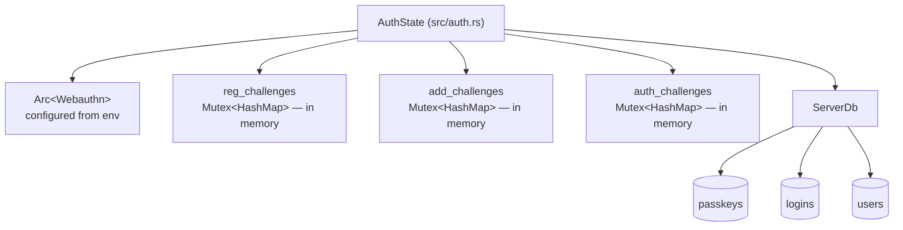
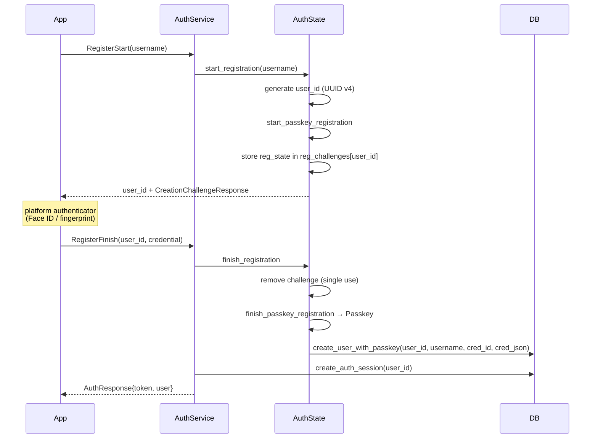
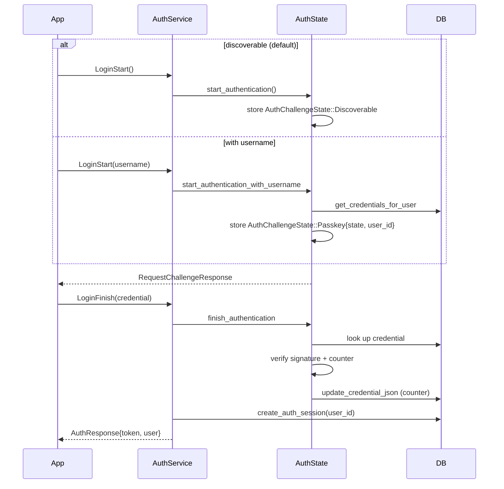
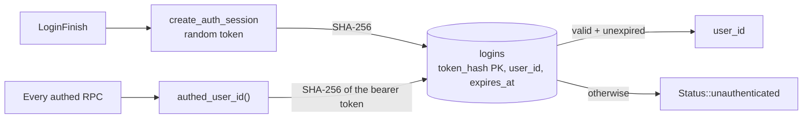

# Authentication

Schlift uses **passkeys (WebAuthn) only**. There are no passwords, no email, and
no password reset flow. `webauthn-rs` handles the protocol; `src/auth.rs` holds
the state and `src/server/auth.rs` exposes the RPCs.

## Pieces



Configuration comes from environment variables, read once at construction:

| Variable | Purpose | Default |
|---|---|---|
| `WEBAUTHN_RP_ID` | Relying party id (the domain) | `localhost` |
| `WEBAUTHN_RP_ORIGIN` | Expected origin | `http://localhost:5173` |
| `WEBAUTHN_ANDROID_ORIGINS` | Comma-separated `android:apk-key-hash:…` origins | — |

Android apps present an APK-signing-key-hash origin rather than a URL, so every
signing key that ships (debug, upload, Play signing) needs its hash listed or
login fails on that build. Hashes are printed by `make print-cert-hashes`.

> These are `expect()`ed at startup — a malformed origin **panics the server on
> boot** rather than degrading. That is deliberate: a misconfigured RP silently
> accepting the wrong origin would be worse.

## Registration



Note the ordering: **the user row is created in `finish_registration`, not
`start`**, in one transaction with its passkey. An abandoned registration
leaves nothing behind except an in-memory challenge that expires, and a
failed one leaves no account without a passkey holding the name.

Challenges are single-use — `finish` removes the entry before verifying, so a
replayed `RegisterFinish` finds no challenge. Its attempt's verdict stands:
`finish_auth_attempt` never rewrites an earlier one. Add-passkey challenges
are kept apart from sign-ups (`add_challenges`), so an unauthenticated
`RegisterFinish` naming a user's id can't spend theirs.

## Login

Two paths. Discoverable (usernameless) is the default; the username path exists
for authenticators that need a credential hint.



`AuthChallengeState` is an enum over the two flows so a single challenge map can
serve both. The signature counter is written back on every successful login —
`webauthn-rs` uses it to detect cloned authenticators. A failure to write it
is logged at `warn`; the login still succeeds.

## Sessions



The token is a bearer token in gRPC metadata, attached client-side by
`AuthInterceptor` (`app/lib/services/grpc_client.dart`). The server stores
only its SHA-256 (`token_hash`, `src/db/migrate.rs`), so the table never
holds a token that would let someone in; the token itself exists only on the
phone and in the response that hands it over. Creating a login deletes every
expired one.

`authed_user_id` is called **explicitly at the top of each handler** — there is
no interceptor or middleware enforcing it. A new handler that omits the call is
unauthenticated, and nothing will flag that. Copy an existing handler when adding
one.

`Logout` deletes the row. `DeleteAccount` deletes the user's row
(`delete_user_account_and_data`, `src/db/auth.rs`); every table with a
`user_id` references `users(id) ON DELETE CASCADE`, so the account's event
log, passkeys, logins, session memberships and page views go with it. It
also deletes the registration's `auth_attempts` row and drops any join
requests to or from it; the streams of those it asked, and of its session's
other members, hear the change.

## The account and the server session

Signing in to the server and having the account are two different things on
the phone (`AuthProvider`):

- `isLoggedIn` — an account is open on this phone (a user id is known).
  Everything works from here: the account file is on the phone.
- `hasServerSession` — the server knows this phone (a session token). Sync,
  multiplayer and the profile need it.

A passkey sign-in sets both: the token, and the user id whose file
`AccountSync` then opens (pulling the log from the server first on a fresh
install). A login stays signed in while it is used: each
use slides its expiry to 30 days out (`validate_auth_session`, written at most
once a day), so only a login left unused for 30 days lapses. If
the server refuses the token (lapsed, its passkey deleted, the account
deleted), `expireSession` clears only the token; the account stays open and
usable. While an account is open with no session (this, or one opened from a
file), `SessionExpiredBanner` sits over the app's pages (around `MainLayout`
in the shell route: not over `/login`, onboarding or the tutorial, and not
while the update banner shows) with a sign-in button to `/login`; signing in
there resumes sync, and the login screen's back arrow returns home without
signing in.

"Open an account file" on the login screen opens an exported account with no
server at all (`AuthProvider.openLocalAccount`): the file names its owner, so
the user id comes from it. Signing in as that user later lets it sync again.
A file belonging to a different account than the one open is refused.

## Challenge lifetime

Pending challenges live in process memory with a 300-second TTL
(`CHALLENGE_TTL_SECS`). Expired entries are swept lazily on the next
`start_registration` / `start_authentication`, not by a background task — so a
quiet server holds expired challenges until the next login attempt. Bounded by
traffic, not by time: a start is refused once its client (the address, or an
IPv6 /64) holds `MAX_PENDING_PER_CLIENT` unexpired ceremonies of that kind, or
everyone together holds `MAX_PENDING_CHALLENGES`.

**This makes the backend single-instance.** A challenge issued by one process
cannot be completed by another, so the service cannot be horizontally scaled or
restarted mid-handshake without users retrying. Any move to multiple instances
needs challenges in shared storage.

## Managing passkeys

| RPC | Effect |
|---|---|
| `AddPasskeyStart` / `AddPasskeyFinish` | Register an extra passkey for the logged-in user; excludes already-registered credentials |
| `ListPasskeys` | Metadata only — created-at, IP, optional `cred_name` |
| `DeletePasskey` | Removes one credential and signs out every other login of the user (logins aren't tied to a passkey; the caller's stays); the last one is refused (`FailedPrecondition`), and `PasskeysScreen` disables it |

A friendly name is stored by injecting a `cred_name` key into the serialised
credential JSON rather than as its own column
(`stored_passkey_json` in `src/auth.rs`). It travels with the credential, but it is not queryable.

> You cannot delete your last passkey, but losing every device or password
> manager that holds one still locks you out: there is no self-serve recovery
> (`LostPasskeyScreen` points the user to the owner).

## Test login

`TestLogin(username)` bypasses WebAuthn entirely: it calls
`get_or_create_user_with_auth_session`, which returns an existing account if the
username matches and issues a 30-day session token for it. **It is an account
takeover primitive by design** and exists only for emulator development, the
e2e scenarios' API peers and the server's own tests.

It is gated behind the `test-auth` Cargo feature:

```rust
#[cfg(not(feature = "test-auth"))]
async fn test_login(...) -> Result<Response<AuthResponse>, Status> {
    Err(Status::permission_denied("test login is not enabled"))
}
```

| Build | Command | `TestLogin` |
|---|---|---|
| Production | `cargo build --release --bin schlift` | Refused |
| Dev / emulator | `make run-backend` (passes `--features test-auth`) | Enabled |

Both branches are covered by `test_login_gate_tests` in `src/server/auth.rs`, so
the gate cannot regress unnoticed.

> **History:** the feature existed in `Cargo.toml` and the Makefile dev targets
> passed `--features test-auth`, but no `#[cfg]` ever referenced it — so the
> bypass was compiled into production builds and reachable at
> `POST /workout.v1.AuthService/TestLogin`. If you are adding a similar
> dev-only affordance, add the `#[cfg]` *and* a test asserting the disabled
> branch; a declared-but-unused Cargo feature gates nothing.

## Local development

Passkeys need a valid RP configuration even locally. See
[`docs/android_dev.md`](../android_dev.md) for connecting an emulator to a local
backend, and [`docs/releasing.md`](../releasing.md) for the production
`.well-known/assetlinks.json` and `apple-app-site-association` values — both
served by `src/main.rs` and routed by Caddy.
