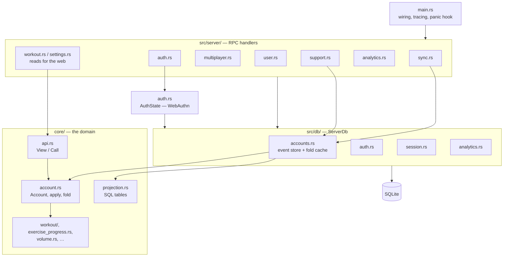
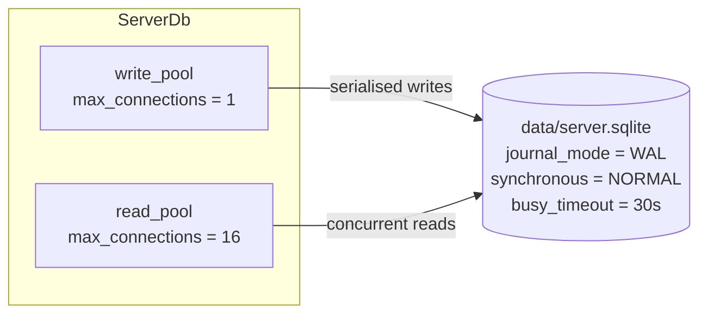
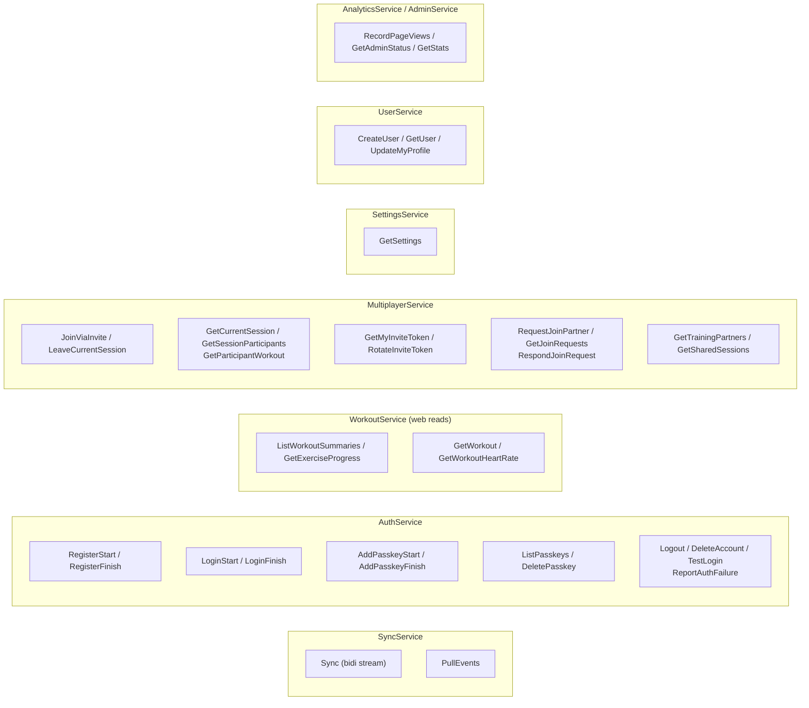

# Backend

A single Rust binary (`src/main.rs`) serving eight gRPC services over tonic,
with `tonic-web` for browser clients and a small axum health endpoint. The
domain lives in the `core/` crate, which the phone runs too; the backend
stores each account's event log, folds it with the same core, and handles
what needs a server: auth, multiplayer, the web's reads and analytics.

## Module map

### Responsibilities

| Module | Owns |
|---|---|
| `server/sync.rs` | `SyncService`: the bidirectional `Sync` stream (events up, acks and session down) and `PullEvents` |
| `server/workout.rs` | `WorkoutService`: four reads for the web, answered by the core's `View` |
| `server/settings.rs` | `SettingsService.GetSettings`, the same way |
| `server/multiplayer.rs` | Sessions, invites, join requests, training partners |
| `server/support.rs` | `authed_user_id`, `read_api`, participant status from the fold, the app-version gate |
| `server/user.rs` | User CRUD, profile |
| `server/auth.rs` | Passkey RPC surface (delegates to `auth.rs`) |
| `server/analytics.rs` | Page views, admin stats |
| `db/accounts.rs` | `account_events`, the folded-account cache, projecting pushed workouts |
| `db/` | All SQL. No SQL exists outside this directory and `core/src/projection.rs`. |
| `demo_seed.rs` | Demo accounts (`SEED_DEMO_USER`, `test-auth` builds only), written through the core's API and `ImportHistory` |

The rules — planning, the reducer, progression, volume, summaries — are in
`core/`; see [local-first.md](local-first.md) and
[workout-lifecycle.md](workout-lifecycle.md).

## The event store

`account_events(user_id, seq, event_blob)` is every account's log.
`ServerDb::push_events` (`src/db/accounts.rs`):

1. Takes the account's lock. Folded accounts are cached in memory, one
   `Mutex` each, least recently used dropped past 256; a dropped account is
   refolded from its log when next needed.
2. Checks the first pushed event it already holds against the stored one. A
   different id there means another device recorded this account:
   `account_diverged`, nothing stored.
3. Skips seqs already held, takes the rest while they carry on from the head
   without a gap.
4. Replays each into the fold. An event that doesn't apply still takes its
   place (it applied on the phone, under the phone's rules).
5. In one transaction: inserts the events and rewrites the projected rows
   (`core/src/projection.rs`) of every workout they touched. If that fails,
   the cached fold is dropped so the next read refolds from what was written.

Reads (`read_account`, `read_api`) take the same lock and look at the fold.

## Database access model

There is **no write-worker thread and no channel**. `ServerDb` holds two sqlx
pools against the same WAL-mode file:

Defined in `ServerDb::new_in_dir` (`src/db/mod.rs`).

- **Writes serialise** through the single write connection.
- **Reads run concurrently** (16 connections) and, under WAL, never block writes.
- Writes to one account are also serialised by its lock in the fold cache,
  so two pushes for the same account cannot interleave.

### Change broadcast

`ServerDb` carries a `tokio::sync::broadcast` of `Change`
(`Session(id)`, `Membership(user)`, `JoinRequests(user)`). The session DB
calls in `src/db/session.rs` publish them; every open Sync stream
subscribes (`ServerDb::subscribe`) and re-sends what concerns its user.
In-process only, which is one more reason the backend is single-instance.

### Blob columns

`users_current.user_blob`, `session_participants_current.participant_blob`
and `account_events.event_blob` are protobuf. The scalar columns beside them
exist to index and filter; the blob is the truth.

> **Consequence:** adding a proto field is transparent, but you cannot query on
> it until you also promote it to a real column.

### Schema changes

There is no migration framework. `SERVER_SCHEMA` (`src/db/mod.rs`) and
`core::projection::WORKOUT_SCHEMA` are `CREATE TABLE IF NOT EXISTS` blocks
run at startup. Adding a column to a table that already exists in production
needs an idempotent `ALTER TABLE` next to them.

The projected workout tables can always be rebuilt: they are rewritten from
the fold, and the log is the truth.

## Service surface

There are no per-write workout RPCs: every write to an account is an `Event`
that arrives over `Sync`.

Every RPC except the auth handshake and `ReportAuthFailure` begins with
`authed_user_id(&request, &self.db)`, which validates the bearer token against
`auth_sessions`. There is no middleware doing this — it is called explicitly in
each handler, so **a new handler that forgets the call is unauthenticated**.
`Sync` authenticates on the stream's headers before reading anything.

`SessionStatus` has `next_up_user_id`, `next_up_set`, `next_up_rest_until`
and `currently_lifting_user_id`; the server leaves them empty
(`current_session` in `src/server/multiplayer.rs`). "Who's up next" is
derived on the client from the participants. Do not build on those fields.

## Error handling

The core returns `CoreError` (`InvalidArgument` / `NotFound` /
`FailedPrecondition`, with a message); `core_status` in `support.rs` maps it to
a gRPC `Status`. Inside the reducer, `WorkoutError` (`core/src/workout/mod.rs`)
carries a `&'static str` and converts into `CoreError`. `internal_error` maps
DB errors to `Status::internal`.

## Observability

`tracing` with JSON output, flattened events, filtered by `RUST_LOG`
(default `warn`). Each handler emits one `info!` on entry with the RPC name and
user id; a Sync stream logs its open and close. An event the server's fold
could not apply is logged at `warn` with its seq. A panic hook logs location
and message before unwinding.

## Tests

- `src/server/sync_tests.rs` — over a real server on a local port: events
  pushed and folded, the projections they leave, divergence refused, and the
  Sync stream carrying one partner's progress to the other.
- `src/server/multiplayer_tests.rs` — session roster and training-together
  history through the real handlers.
- `src/db/auth.rs` — account deletion covers every table with a `user_id`.

The domain's own tests are in `core/`; see [testing.md](testing.md). Run
everything with `cargo test --workspace --all-targets`.
