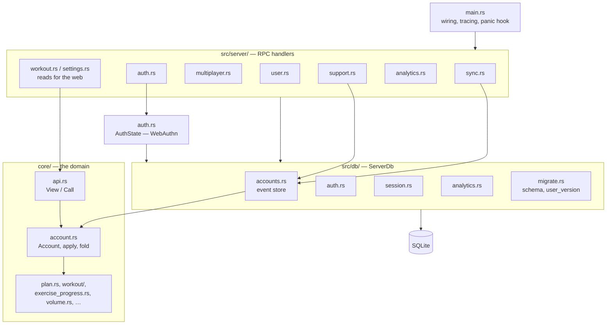
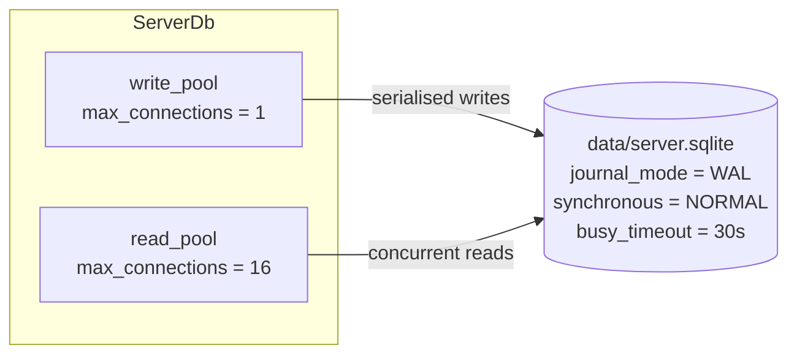
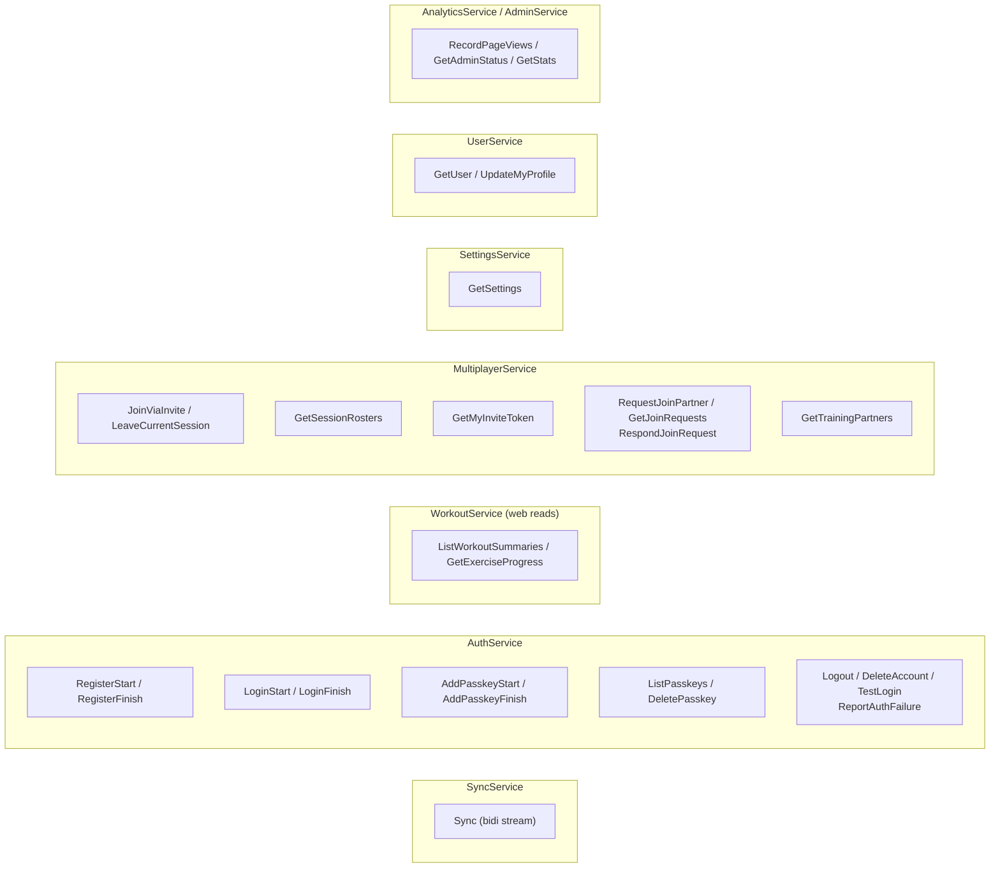

# Backend

A single Rust binary (`src/main.rs`) serving eight gRPC services over tonic,
with `tonic-web` for browser clients and a small axum health endpoint. The
domain lives in the `core/` crate, which the phone runs too; the backend
stores each account's event log, folds it with the same core, and handles
what needs a server: auth, multiplayer, the web's reads and analytics.

## Module map

### Responsibilities

| Module | Owns |
|---|---|
| `server/sync.rs` | `SyncService`: the bidirectional `Sync` stream (a device's events up; every placed event, the head and the session down) |
| `server/workout.rs` | `WorkoutService`: two reads for the web (`ListWorkoutSummaries`, `GetExerciseProgress`), answered by the core's `View` |
| `server/settings.rs` | `SettingsService.GetSettings`, the same way |
| `server/multiplayer.rs` | Sessions, invites, join requests, training partners |
| `server/support.rs` | `authed_user_id` / `authed_admin_id`, `read_api`, error mapping, the app-version gate |
| `server/user.rs` | `GetUser`, `UpdateMyProfile` |
| `server/auth.rs` | Passkey RPC surface (delegates to `auth.rs`) |
| `server/analytics.rs` | Page views, admin stats |
| `db/accounts.rs` | `account_events`: placing pushes, reading history, folding on request |
| `db/changes.rs` | Changes told to the streams they concern, by user or session |
| `db/session.rs` | `session_members`, invite tokens, join requests (in memory) |
| `db/migrate.rs` | The schema, one version at a time (`PRAGMA user_version`) |
| `db/` | All of the server's SQL. The only other SQL is `core/src/projection.rs`, which writes the phone's export. |
| `demo_seed.rs` | Demo accounts (`SEED_DEMO_USER`, `test-auth` builds only): plain rising sessions imported with `ImportHistory` (`HistoryImported`) (the core's walk works out each lift's max), a live session through the real start |

The rules — the plan, the reducer, volume, summaries — are in
`core/`; see [local-first.md](local-first.md) and
[workout-lifecycle.md](workout-lifecycle.md).

## The event store

`account_events(user_id, seq, id, event)` is every account's history, in the
server's order, and the only place the server keeps anything the core
folds. `event` is the whole event as JSON (`core/src/events.rs`); `id` is
copied out, unique per account, so a resent event is found. Nothing about a
workout, set, template or setting is copied into a table: the server answers
by folding the history when asked. Nothing of an account is kept in memory.
`ServerDb::push_events` (`src/db/accounts.rs`) places what a device sends,
folding nothing, in one transaction on the one write connection — so pushes
are placed one at a time, each after the last:

1. Skips events it already holds, by id (a device resends until it hears
   back).
2. Reads the head and gives the rest the next seqs, in the order sent.
3. Inserts them. One racing the account's deletion fails on the foreign key.
4. Tells that account's streams the placed events (`Change::Account`): to
   the pushing device its events come back placed; its other devices fold
   them in; its session partners' streams forward the workout ones.

Reads (`read_account`, `read_api`: the website's) fold the account from its
history, without heart rate (`Account::fold_without_heart_rate`), answer,
and keep nothing. Partners' live status is never computed here: each phone
folds it (see [multiplayer.md](multiplayer.md)).

## Database access model

There is **no write-worker thread and no channel**. `ServerDb` holds two sqlx
pools against the same WAL-mode file:

Defined in `ServerDb::new_in_dir` (`src/db/mod.rs`).

- **Writes serialise** through the single write connection.
- **Reads run concurrently** (16 connections) and, under WAL, never block writes.

### Changes

`ServerDb::watch(topic)` (`src/db/changes.rs`) hears the changes that
concern a `Topic`: a user (`Account(events)`, `Membership`,
`JoinRequests`) or a session (`Session`). Each topic has its own channel,
made by its first watcher and dropped once nobody watches, so a change wakes
only the streams it concerns, however many are open. A Sync stream watches
its user, and the session its user's pointer names, moving with the
pointer. In-process only, which is one more reason the backend is
single-instance.

### Storage follows authority

What the phone makes is account events: `account_events.event` is the
event as JSON, stored as placed and never interpreted by SQL. What
the server owns (users, passkeys, logins, who trained together, telemetry)
is plain columns, with no proto blobs, and every `user_id` references
`users(id) ON DELETE CASCADE`. What only matters while the server runs
(join requests, which stream watches whom) is in memory. Partners' live
status is not on the server at all. See
[data-model.md](data-model.md#server-tables).

### Schema changes

`src/db/migrate.rs` holds the schema, one version at a time. `PRAGMA
user_version` is the version a database is at; `migrate` runs every step
past it, in order, each in its own transaction, at startup (from
`ServerDb::new_in_dir`). A schema change is a new `if version < N` block at
the end; a step that has shipped is never edited.

Step 1 creates the schema in an empty database, or converts one from before
versions (it has `users_current`): users out of their proto blob into
columns (admins onto the row), live login tokens hashed, passkeys and page
views copied, events copied byte for byte, each user's open session
memberships closed but the current one; then the old copies of the events
(the workout tables), the live-status cache, `join_requests` and eight
tables left from older designs are dropped, and the file is vacuumed.

Step 2 makes `account_events` hold facts: `(user_id, seq, id, event)`, the
event as JSON. It converts nothing: a database whose events are still the
requests that made them (proto blobs) is refused, and is converted out of
band first by folding every account both ways, with the core that wrote it
and this one, and writing the facts only if each comes out the same.

## Service surface

There are no per-write workout RPCs: every write to an account is an event
that arrives over `Sync`, and a device catches up over the same stream.

Every RPC except the auth handshake, `ReportAuthFailure` and `Logout` (which
only deletes the token it is sent) begins with
`authed_user_id(&request, &self.db)`, which validates the bearer token against
`logins` (by the token's SHA-256). There is no middleware doing this — it is called explicitly in
each handler, so **a new handler that forgets the call is unauthenticated**.
`Sync` authenticates on the stream's headers before reading anything.

`Session` (`current_session` in `src/server/multiplayer.rs`) carries who
else is in the caller's session. "Who's up next" is derived on the client from
them.

## Error handling

The core returns `CoreError` (`InvalidArgument` / `NotFound` /
`FailedPrecondition`, with a message); `core_status` in `support.rs` maps it to
a gRPC `Status`. Inside the reducer, `WorkoutError` (`core/src/workout/mod.rs`)
carries a `&'static str` and converts into `CoreError`. `internal_error` maps
DB errors to `Status::internal`.

## Observability

`tracing` with JSON output, flattened events, filtered by `RUST_LOG`
(default `warn`). Each handler emits one `info!` on entry with the RPC name and
user id; a Sync stream logs its open and close. A panic hook logs location
and message before unwinding.

## Tests

- `src/server/sync_tests.rs` — pushed events folding into the same
  account, a resent batch placed once, two devices' events placed in the
  order they arrive, a push after deletion storing nothing, events read back
  as they were pushed; and over a real server on a local port, the Sync
  stream: a partner's progress as it happens, a late partner getting the
  workout so far (and only the workout), discarding the workout leaving the
  session, a heartbeat answered, a deleted account unable to push, a
  signed-out stream sent nothing more, a deleted partner out of the
  session, a new profile to partners without the body weight, a device
  catching up and hearing the others, and a stranger turned away.
- `src/db/migrate.rs` — a fresh database starts at the latest version, and
  one from before versions is converted.
- `src/demo_seed.rs` — both demo users seed, and the walk over their
  history rises.
- `src/server/multiplayer_tests.rs` — session roster and training-together
  history through the real handlers.
- `src/server/auth.rs` — the passkey ceremonies with a software passkey
  (each challenge spent once, add-passkey, the last passkey kept), TestLogin
  gated on its feature, the per-client cap on ceremonies, and auth-attempt
  tracking.
- `src/server/analytics.rs` — page views and the admin stats.
- `src/db/auth.rs` — logins are stored hashed; a sign-up is the account and
  its passkey or nothing; every table with a `user_id` cascades from
  `users`, and deleting an account leaves nothing of it.

The domain's own tests are in `core/`; see [testing.md](testing.md). Run
everything with `cargo test --workspace --all-targets`.
