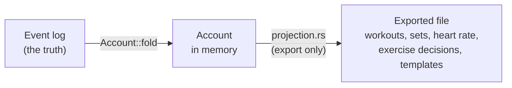
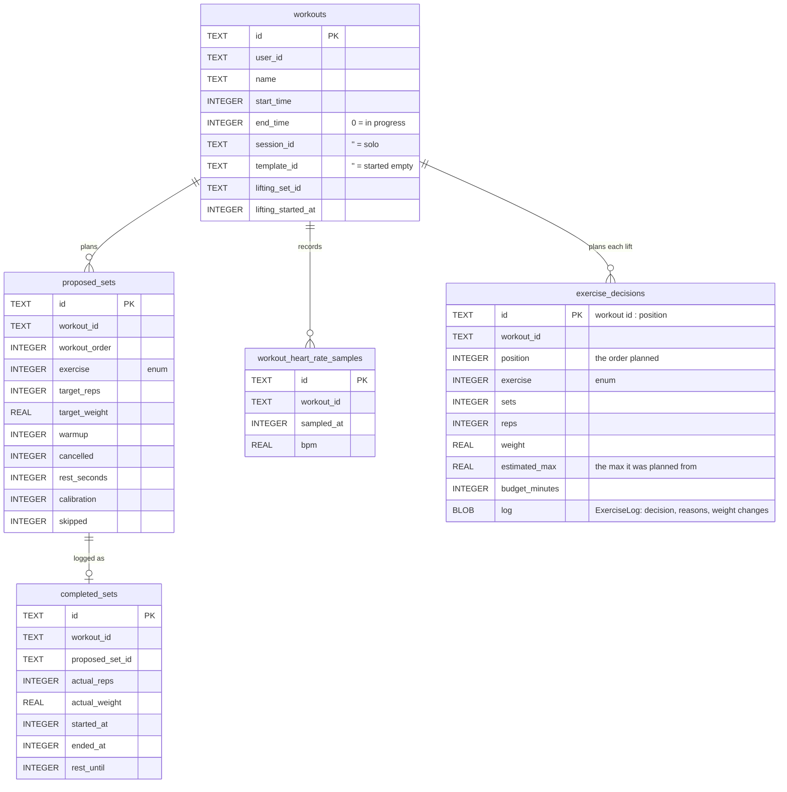
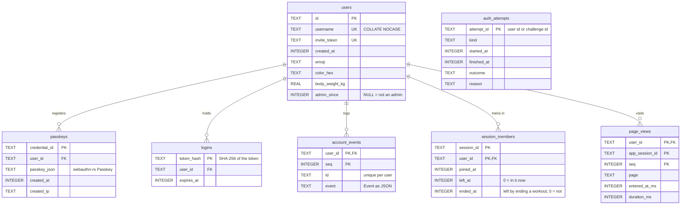

# Data Model

An account is a log of events; everything else about it is derived. The log
lives in two SQLite files — the account file on the phone and
`data/server.sqlite` on the server — and both fold it in memory with the same
core. Readable tables exist only in an exported file
(`core/src/projection.rs`). See [local-first.md](local-first.md) for how the
log is made and synced.

## The event log

| Where | Table | |
|---|---|---|
| Phone | `events(seq PK, id UNIQUE, event)` | The history the server has placed, in its order |
| Phone | `pending(n PK, id UNIQUE, event)` | Events recorded here that the server hasn't placed yet, oldest first |
| Phone | `meta(key PK, value)` | Whose account (user id, name) |
| Phone | `heart_rate(workout_id, sampled_at, bpm)` | Heart rate of a workout under way, never synced: recorded as one `HeartRateRecorded` when it ends |
| Server | `account_events(user_id, seq, id, event)`, PK `(user_id, seq)`, `UNIQUE (user_id, id)` | Every account's history, as placed |

`event` is an `Event` as JSON (`core/src/events.rs`): `seq`, `id`, `at` and
one fact — `WorkoutStarted` (with each lift's decision), `SetStarted`,
`SetCompleted`, `SetEdited`, `SetUndone`, `RungAnswered`, `WarmupsSkipped`,
`ExercisesAdded`, `ExerciseAdjusted`, `ExerciseRemoved`,
`ExercisesReordered`, `SessionSet`, `WorkoutEnded`, `HeartRateRecorded`,
`TemplateSaved`, `TemplateDeleted`, `TemplatesReordered`,
`LibraryTemplatesAdded`, `Onboarded`, `SettingUpdated`, `HistoryImported`,
`OverrideSet`, `WorkoutDiscarded`, `WorkoutEndMoved`. A kind this version
doesn't know is kept and folds as nothing.

`seq` runs 1, 2, 3… with no gaps, given by the server; a pending event has
none yet. Ids the event creates (the workout, its sets, a template) derive
from the event's `id` (`core/src/ids.rs`), so a replay rebuilds them
exactly. Facts are only added to, never renamed: see
[local-first.md](local-first.md#the-account-is-a-fold-of-events).

## The account

`Account` (`core/src/account.rs`) is what the fold produces: settings,
templates, the starting weights (per lift, from onboarding or imported
history), the user's overrides (per lift: weight, reps, maybe sets, and
when), every workout (`WorkoutRecord`: the workout, its proposed and
completed sets, heart rate, and per lift its `ExerciseLog` — the decision
it was laid out from and every weight change since), and the active
workout's id. Nothing else is kept: each lift's estimated max is walked
from the workouts whenever a plan is made (`core/src/plan.rs`). The
account is never stored whole; the phone holds it in memory while the
account is open, and the server folds it from its history only when the
website asks, keeping nothing.

## Exported tables

An exported account file (`Store::export`, `app/native/src/store.rs`) has
the log and, beside it, the account as plain tables, written from the fold
into the empty file so it reads as everything the app knows. Nothing reads
them back into the account, and no live file holds them: not the phone's,
not the server's.

`WORKOUT_SCHEMA` (above) and `ACCOUNT_SCHEMA` (`workout_templates`) are
what an export contains. The phone's live file holds only `meta`, `events`,
`pending` and `library`; the server's holds only `account_events` for the account.

- **`end_time = 0` means in progress.** There is no status column;
  zero-as-null is the convention.
- **`completed_sets` has a row once a set is done.** A started set is the
  workout's lifting marker (`lifting_set_id`), not a row.
- **`proposed_sets.calibration`** marks a calibration rung; rungs count as
  warmups for volume.
- **`exercise_decisions`** is one row per lift per workout: the decision's
  numbers as columns for SQL, and `log`, the whole `ExerciseLog` (reasons
  and weight changes) as a proto blob.
- **`proposed_sets.cancelled`** is a soft delete (an exercise removed
  mid-workout), so ordering and history stay stable. `skipped` marks warmups
  skipped with "Skip".
- **`workouts.session_id`** is the session the phone recorded on the
  workout (`SetWorkoutSession`); `''` if it never joined one.

### Template library

`templates/library.yaml` is the source of truth for the templates everyone
can pick from: `groups` (key + label, in display order) and `templates`
(stable `id`, `name`, `group`, `blurb`, optional `default: true`, and the
exercises as `Exercise` enum names without the `EXERCISE_` prefix), and
`plans`: ready-made rotations (stable `id`, `name`, `blurb`, and
`templates`, a list of template ids). The core embeds the file at build
time (`core/src/template_library.rs`; `cargo test` fails on an unknown
exercise name, or a plan naming an unknown or repeated template).

**Editing the defaults:** change the YAML and deploy the backend. The server
sends its library down every Sync stream on connect; the phone keeps it in
its account file (`library` table) and the core reads it from there. Until
the first sync, the copy built into the app stands in.

- A library template in a user's list is **coupled** (`coupled = true`,
  `library_id` = the entry): its name and exercises are the library's
  current ones (`View::resolved`). The stored name and exercises are only a
  fallback for an entry the server no longer has.
- **The fold never reads the library.** Writes that use it record what they
  used: `AddLibraryTemplates.entries`, `CompleteOnboarding.library_entries`,
  and a coupled start carries its exercises in `StartWorkout.exercises`.
  So the phone and the server fold the same log to the same account
  whatever library each has.
- A `SaveTemplate` that changes a coupled template's name or exercises
  makes it the user's own **in place** (same id, so the workouts recorded
  against it stay with it): it stops following the library. So does one
  with `unlink` (the app's Clone: the editor opens on the template and Save
  records it as the user's own, changed or not; backing out records
  nothing); saved unchanged without it, it stays coupled. A `CloneTemplate`
  event in a log folds the same way as `unlink`. Templates made
  from scratch are never coupled.
- `origin_library_id` is the entry a template was added from, and unlike
  `library_id` it is kept when the template becomes the user's own. A user
  **has** an entry when a template follows it or was made from it
  (`Account::has_library_entry`); `AddLibraryTemplates` drops such an
  entry before it records the event, so no entry is added twice. The fold
  itself skips only an entry a template still follows, so older logs fold
  as they did.
- Every workout keeps its own exercises and sets plus `template_id`, so a
  change to a default never rewrites a past session.
- In the app's Manage sheet a library workout the user does not have is
  added to the rotation with + (`AddLibraryTemplates`, `in_rotation`;
  without it an entry is added as a reserve); the user's own are dragged
  within or between the rotation and the reserves (one
  `ReorderTemplates` with `rotation_count`: the order, and where the
  rotation ends), opened in the editor, or deleted.
- A ready-made plan is applied with `ApplyLibraryPlan(plan_id)`, which
  records existing events, no kind of its own: an `AddLibraryTemplates`
  (as reserves) for the plan's entries the user does not have, then one
  `ReorderTemplates` whose first `rotation_count` ids are the user's
  template for each entry in the plan's order (one already in the
  rotation first, else the first following or made from it, so a
  personalised copy is used rather than a second one), and after them
  every other template, the old rotation first, as reserves. Nothing is
  deleted. Plans come from the copy built into the core, not the
  server's sync; `ListTemplateLibrary` lists those whose every entry the
  library in use has.
  Never reuse or rename an id in the YAML.
- The website's `/routines` page is rendered from the same YAML at build
  time (`web/scripts/sync-content.mjs`), not from an RPC.

## Server tables

What the server owns, as plain columns: who people are, how they sign in,
who trained together, and telemetry. The schema is `src/db/migrate.rs`, one
version at a time (see [backend.md](backend.md#schema-changes)).

| Table | Purpose |
|---|---|
| `users` | One row per user: profile, the invite token, and `admin_since` (set by `schlift admin add`). `username` is unique ignoring case. See [analytics.md](analytics.md#admins-and-the-stats-page) |
| `passkeys`, `logins` | See [auth.md](auth.md). A login is stored as its token's SHA-256, never the token |
| `account_events` | Every account's log. See [above](#the-event-log) |
| `session_members` | Every `(session, user)` that joined. The current session is the row with `left_at = 0`, at most one per user (a partial unique index). See [multiplayer.md](multiplayer.md) |
| `page_views` | One row per screen visit, keyed `(user_id, app_session_id, seq)` so a retried upload is ignored. See [analytics.md](analytics.md) |
| `auth_attempts` | One row per passkey ceremony the server started; `outcome` is `started` / `ok` / `rejected` / `client_error`. No username, no `user_id` |

Not stored, only in memory:

- **Which stream watches whom**: each Sync stream watches its own account,
  its session, and its partners' accounts (`src/db/changes.rs`).
- **Join requests**: `JoinRequests` in `src/db/session.rs`, answerable for two
  minutes.

## Referential integrity

Every table with a `user_id` column references `users(id) ON DELETE
CASCADE`. Deleting an account (`delete_user_account_and_data`,
`src/db/auth.rs`) is `DELETE FROM users WHERE id = ?` plus the account's
registration row in `auth_attempts` (keyed by the user id it created); the
cascade takes the events, passkeys, logins, session memberships and page
views. A test discovers every table with a `user_id` column and fails if one
does not cascade.
