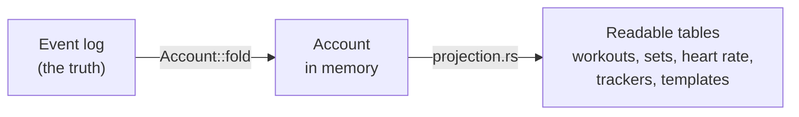
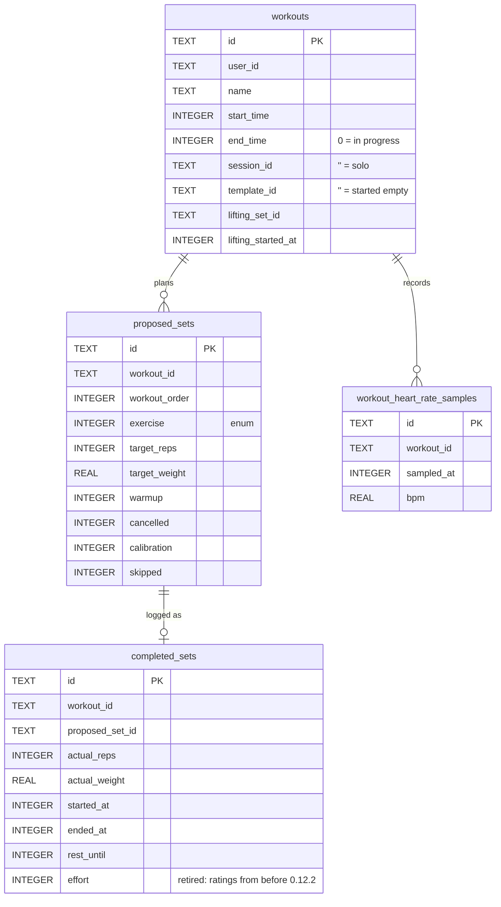
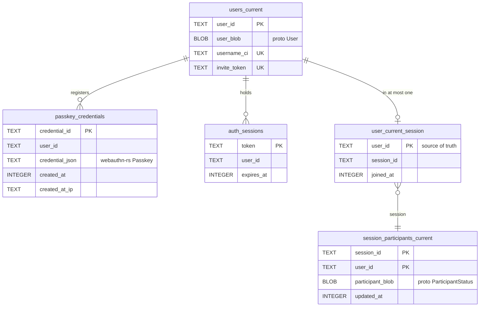

# Data Model

An account is a log of events; everything else about it is derived. The log
lives in two SQLite files — the account file on the phone and
`data/server.sqlite` on the server — and both derive readable tables from it
with the same statements (`core/src/projection.rs`). See
[local-first.md](local-first.md) for how the log is made and synced.

## The event log

| Where | Table | |
|---|---|---|
| Phone | `events(seq PK, id, at, event_blob)` | `id` and `at` copied out so the file is readable |
| Phone | `meta(key PK, value)` | Whose account (user id, name) and the last seq the server acknowledged |
| Server | `account_events(user_id, seq, event_blob)`, PK `(user_id, seq)` | Every account's log |

`event_blob` is an `Event` (`proto/workout/v1/account.proto`): `seq`, `id`,
`at` and one `kind` — `start_workout`, `workout` (a `WorkoutMutation`:
complete/edit/delete a set, start a set, skip warmups, add/adjust/remove/
reorder exercises, rate, set the session, end), `heart_rate`,
`save_template`, `delete_template`, `reorder_templates`,
`add_library_templates`, `set_exercise_tracker`, `complete_onboarding`,
`update_setting`, `dismiss_user_messages`, `import_history`.

`seq` runs 1, 2, 3… with no gaps. Ids the event creates (the workout, its
sets, a template) derive from the event's `id` (`core/src/ids.rs`), so a
replay rebuilds them exactly.

## The account

`Account` (`core/src/account.rs`) is what the fold produces: settings,
templates, trackers (one per exercise), every workout (`WorkoutRecord`:
the workout, its proposed and completed sets, heart rate), the active
workout's id and the coaching messages. It is never stored whole; the phone
holds it in memory while the account is open, the server caches recently
used ones.

## Projected tables

Rewritten from the fold as events land, so they can be dropped and rebuilt
at any time. Nothing reads them back into the account.

`WORKOUT_SCHEMA` (above) is on both the phone and the server; the server's
analytics and multiplayer history ("trained with") read it.
`ACCOUNT_SCHEMA` — `exercise_trackers` and `workout_templates` — is on the
phone only, so an exported file reads as everything the app knows; the
server keeps those in the fold.

- **`end_time = 0` means in progress.** There is no status column;
  zero-as-null is the convention.
- **`completed_sets` has a row once a set is done.** A started set is the
  workout's lifting marker (`lifting_set_id`), not a row.
- **`proposed_sets.calibration`** marks a calibration rung; rungs count as
  warmups for volume.
- **`proposed_sets.cancelled`** is a soft delete (an exercise removed
  mid-workout), so ordering and history stay stable. `skipped` marks warmups
  skipped with "Skip".
- **`workouts.session_id`** on the server is the session the phone recorded
  on the workout (`SetWorkoutSession`); until it has, a workout keeps the
  session it was first seen in, or one it was joined to since
  (`store_events` in `src/db/accounts.rs`).

### Template library

`templates/library.yaml` is the source of truth for the templates everyone
can pick from: `groups` (key + label, in display order) and `templates`
(stable `id`, `name`, `group`, `blurb`, optional `default: true`, and the
exercises as `Exercise` enum names without the `EXERCISE_` prefix). The core
embeds the file at build time (`core/src/template_library.rs`; `cargo test`
fails on an unknown exercise name).

**Editing the defaults:** change the YAML and deploy the backend. The server
sends its library down every Sync stream on connect; the phone keeps it in
its account file (`library` table) and the core reads it from there. Until
the first sync, the copy built into the app stands in.

- A library template in a user's list is **coupled** (`coupled = true`,
  `library_id` = the entry): its name and exercises are the library's
  current ones (`View::resolved`). The stored name and exercises are only a
  fallback for an entry the server no longer has.
- **The fold never reads the library.** Writes that use it record what they
  used: `AddLibraryTemplates.entries`, `CompleteOnboarding.library_entries`,
  and a coupled start carries its exercises in `StartWorkout.exercises`.
  So the phone and the server fold the same log to the same account
  whatever library each has.
- `CloneTemplate` makes a coupled template the user's own **in place**
  (same id, so the workouts recorded against it stay with it): it stops
  following the library. A `SaveTemplate` that changes a coupled
  template's name or exercises does the same; saved unchanged it stays
  coupled. Templates made from scratch are never coupled.
- Every workout keeps its own exercises and sets plus `template_id`, so a
  change to a default never rewrites a past session.
- In the app's Edit sheet library workouts are ticked in and out
  (`AddLibraryTemplates` / `DeleteTemplate`); the user's own are edited or
  deleted. Never reuse or rename an id in the YAML.
- The website's `/routines` page is rendered from the same YAML at build
  time (`web/scripts/sync-content.mjs`), not from an RPC.

## Server-only tables

`SERVER_SCHEMA` (`src/db/mod.rs`), created at startup alongside
`WORKOUT_SCHEMA`.

| Table | Purpose |
|---|---|
| `users_current` | One row per user: the `User` proto, the case-folded name, the invite token |
| `auth_sessions`, `passkey_credentials` | See [auth.md](auth.md) |
| `user_current_session` | Which session a user is in now; `user_id` PK, so at most one. See [multiplayer.md](multiplayer.md) |
| `session_participants_current` | Each member's live status, rebuilt from their fold after every push |
| `session_members` | Durable roster: every `(session, user)` that ever joined, never deleted. Backs training partners and shared sessions |
| `join_requests` | Pending "train together" asks, deleted once answered |
| `page_views` | One row per screen visit, keyed `(user_id, app_session_id, seq)` so a retried upload is ignored. See [analytics.md](analytics.md) |
| `auth_attempts` | One row per passkey ceremony the server started; `outcome` is `started` / `ok` / `rejected` / `client_error`. No username |
| `admins` | Who may call `AdminService.GetStats`. Keyed by `user_id`, never by name |

`_current` means one row per key holding the latest value, overwritten in
place.

## Referential integrity

There are **no `FOREIGN KEY` constraints**. Relationships in the diagrams are
logical. Account deletion is done by hand in `delete_user_account_and_data`
(`src/db/auth.rs`): a table keyed by `user_id` must be added there, or
deletion orphans rows. A test discovers every table with a `user_id` column
and fails if one is missed.
