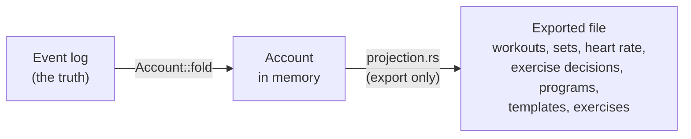
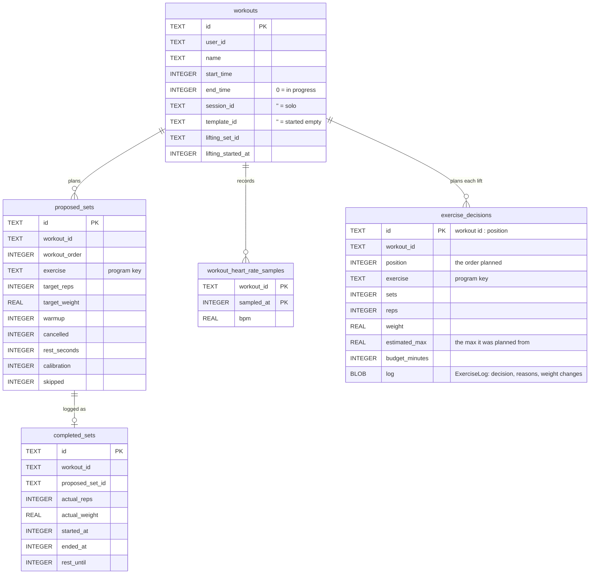

# Data Model

An account is a log of events; everything else about it is derived. The log
lives in two SQLite files — the account file on the phone and
`data/server.sqlite` on the server — and both fold it in memory with the same
core. Readable tables exist only in an exported file
(`core/src/projection.rs`). See [local-first.md](local-first.md) for how the
log is made and synced.

## The event log

| Where | Table | |
|---|---|---|
| Phone | `base(id = 1, seq, fold, state)` | The account as placed up to `seq`, written down (`schlift_core::snapshot`) |
| Phone | `placed(seq PK, id UNIQUE, event)` | Events the server placed after the base, in its order; folded into it every `FOLD_PLACED_AT` |
| Phone | `pending(n PK, id UNIQUE, event)` | Events recorded here that the server hasn't placed yet, oldest first |
| Phone | `meta(key PK, value)` | Whose account (user id, name), the last placed event's id |
| Phone | `heart_rate(workout_id, sampled_at, bpm)` | Heart rate of a workout under way, never synced: recorded as one `HeartRateRecorded` when it ends |
| Server | `events/date=…/hour=…/*.parquet`: `user_id, seq, id, at, kind, workout_id, heart_rate, event` | Every account's history, as placed, in the ledger's batch files (merged by hour and day) |
| Server | `event_files(file, user_id, min_seq, max_seq, events)` | Which files hold each account's events |
| Server | `account_snapshots(user_id PK, seq, fold, state, recent_ids, active_workout)` | Each account folded as of its last written event: its head |
| Server | `heart_rate/…/*.parquet` and `heart_rate_files(user_id, workout_id, file)` | Each finished workout's heart rate, typed, found by workout |

`event` is an `Event` as JSON (`core/src/events.rs`): `seq`, `id`, `at` and
one fact — `WorkoutStarted` (with each lift's decision), `SetStarted`,
`SetCompleted`, `SetEdited`, `SetUndone`, `RungAnswered`, `WarmupsSkipped`,
`ExercisesAdded`, `ExerciseAdjusted`, `ExerciseRemoved`,
`ExercisesReordered`, `SessionSet`, `WorkoutEnded`, `HeartRateRecorded`,
`ProgramSet` (the whole program document), `ProgramEdited` (one app edit
to its workouts), `Onboarded` (with the workouts it copies in),
`SettingUpdated`, `HistoryImported`, `OverrideSet`, `WorkoutDiscarded`,
`WorkoutEndMoved`. A kind this version doesn't know is kept and folds as
nothing. Exercises are named everywhere by their program key (`squat`,
`bench_press`), a string; see
[local-first.md](local-first.md#the-program-in-the-log) for the program
facts.

`seq` runs 1, 2, 3… with no gaps, given by the server; a pending event has
none yet. Ids the event creates (the workout, its sets, a copied workout) derive
from the event's `id` (`core/src/ids.rs`), so a replay rebuilds them
exactly. Facts are only added to, never renamed: see
[local-first.md](local-first.md#the-account-is-a-fold-of-events).

## The account

`Account` (`core/src/account.rs`) is what the fold produces: settings,
the program that plans and every program set before it (`programs`, by
event id; the workouts, i.e. the templates, are part of the program), the
starting weights (per lift, from onboarding or imported
history), the user's overrides (per lift: weight, reps, maybe sets, and
when), every workout (`WorkoutRecord`: the workout, its proposed and
completed sets, heart rate, and per lift its `ExerciseLog` — the decision
it was laid out from and every weight change since), and the active
workout's id. Each `WorkoutRecord` also holds the program its sets were
laid out by (from the start's recorded `rules`). Nothing else is kept: each lift's estimated max is walked
from the workouts whenever a plan is made (`core/src/plan.rs`). The
account is never the stored truth; the phone holds it in memory while the
account is open, and the server folds it when the website or an assistant
asks, from its snapshot (`account_snapshots`, see
[local-first.md](local-first.md#on-the-server)) and the events it holds
not yet written. A snapshot can always be folded again from the event
files.

## Exported tables

An exported account file (`Store::export`, `app/native/src/store.rs`) has
the log and, beside it, the account as plain tables, written from the fold
into the empty file so it reads as everything the app knows. Nothing reads
them back into the account, and no live file holds them: not the phone's,
not the server's. Heart rate is most of it (years of readings every second
or two), so its table is a reading a row keyed by workout and time, with no
other index; the app shares the file gzipped.

`WORKOUT_SCHEMA` (above) and `ACCOUNT_SCHEMA` are what an export
contains. `ACCOUNT_SCHEMA` is `programs` (every program the account has
had: id, when, author, note, `current`, and the document as JSON),
`workout_templates` (the current program's workouts in order, with
`in_rotation` and `from_library`) and `exercises` (the current program's
exercises: key, names, equipment, muscles, class, progression). The
phone's live file holds only `meta`, `base`, `placed`, `pending` and
`heart_rate`; the server holds the account's events in its files, their
index, and its snapshot.

- **`end_time = 0` means in progress.** There is no status column;
  zero-as-null is the convention.
- **`completed_sets` has a row once a set is done.** A started set is the
  workout's lifting marker (`lifting_set_id`), not a row.
- **`proposed_sets.calibration`** marks a calibration rung; rungs count as
  warmups for volume.
- **`exercise_decisions`** is one row per lift per workout: the decision's
  numbers as columns for SQL, and `log`, the whole `ExerciseLog` (reasons
  and weight changes) as a proto blob.
- **`proposed_sets.cancelled`** is a soft delete (an exercise removed
  mid-workout), so ordering and history stay stable. `skipped` marks warmups
  skipped with "Skip".
- **`workouts.session_id`** is the session the phone recorded on the
  workout (`SetWorkoutSession`); `''` if it never joined one.

### Template library

`templates/library.yaml` is the source of truth for the workouts everyone
can copy: `groups` (key + label, in display order) and `templates`
(stable `id`, `name`, `group`, `blurb`, optional `default: true`, and the
exercises as keys of the built-in program, `core/programs/default.json`),
and `plans`: ready-made rotations (stable `id`, `name`, `blurb`, and
`templates`, a list of template ids). The core embeds the file at build
time (`core/src/template_library.rs`; `cargo test` fails on an unknown
exercise key, or a plan naming an unknown or repeated template).

**Editing the defaults:** change the YAML and release the app; the
website's `/routines` picks it up on its next build. Nothing of the
library is synced: the server does not send it, and the phone stores none
of it.

- **A library entry is copied, never followed.** Copying one makes a
  workout of the user's program (`WorkoutDef`) with the entry's name and
  exercises and `from_library` (`WorkoutTemplate.origin_library_id`) set
  to the entry's id. From then on it is the user's own: renaming it or
  changing its lifts is an ordinary `SaveTemplate`, and a later change to
  the YAML never reaches it.
- **The fold never reads the library.** The copies are on the events:
  `Onboarded.workouts` and `ProgramEdited`'s `add` op hold the workouts
  whole. So the phone and the server fold the same log to the same
  account whatever library each build has.
- A user **has** an entry when a workout of theirs was copied from it
  (`from_library`). `AddLibraryTemplates` skips such an entry, so none is
  added twice; the fold's `add` skips a workout whose id the program has.
- Every workout keeps its own exercises and sets plus `template_id`, so a
  change to a template never rewrites a past session.
- In the app's Manage sheet a library workout the user does not have is
  added to the rotation with + (`AddLibraryTemplates`, `in_rotation`;
  without it an entry is added as a reserve); the user's own are dragged
  within or between the rotation and the reserves (one
  `ReorderTemplates` with `rotation_count`: the order, and where the
  rotation ends), opened in the editor, or deleted.
- A ready-made plan is applied with `ApplyLibraryPlan(plan_id)`: an `add`
  (as reserves) for the plan's entries the user does not have, then one
  `reorder` whose first `rotation_count` ids are the user's workout for
  each entry in the plan's order (one already in the rotation first, else
  the first copied from it), and after them every other workout, the old
  rotation first, as reserves. Nothing is deleted.
  Never reuse or rename an id in the YAML.
- The website's `/routines` page is rendered from the same YAML at build
  time (`web/scripts/sync-content.mjs`, which names the lifts from
  `core/programs/default.json`), not from an RPC.

## Migration to programs

Accounts recorded before programs were moved once, by the server's
schema step 6 (`src/db/migrate.rs`), which runs `core/src/migrate.rs` over
each account's stored JSON:

- exercise enum numbers become the built-in program's keys, everywhere;
- the template facts (`TemplateSaved`, `TemplateDeleted`,
  `TemplatesReordered`, `LibraryTemplatesAdded`, and `Onboarded`'s
  `library_entries`) are folded the old way, coupled templates resolved
  against the library built in, and become one `ProgramSet` (the built-in
  rules with those workouts, author `migration`) where the first of them
  was;
- an event that would not read even moved is dropped, as the old fold
  dropped it, and seqs are renumbered from 1.

There is no compatibility layer. The phone's store `FORMAT` went to 2, so
every phone drops its local log and pulls the moved one; `MIN_APP_VERSION`
refuses older apps. `core/tests/testdata/stored_events_before_programs.json`
is the old corpus the migration is tested on.

## Server tables

What the server owns, as plain columns: who people are, how they sign in,
who trained together, and telemetry. The schema is `src/db/migrate.rs`, one
version at a time (see [backend.md](backend.md#schema-changes)).

```mermaid
erDiagram
    users ||--o{ passkeys : "registers"
    users ||--o{ logins : "holds"
    users ||--o{ passkey_recoveries : "is asked for"
    users ||--o{ event_files : "logs"
    users ||--|| account_snapshots : "is folded as"
    users ||--o{ heart_rate_files : "records"
    users ||--o{ session_members : "trains in"
    users ||--o{ page_views : "visits"
    users ||--o{ assistant_grants : "allows"
    assistant_clients ||--o{ assistant_grants : "is granted"
    assistant_grants ||--o{ assistant_tokens : "holds"

    users {
        TEXT id PK
        TEXT username UK "COLLATE NOCASE"
        TEXT invite_token UK
        INTEGER created_at
        TEXT emoji
        TEXT color_hex
        REAL body_weight_kg
        INTEGER admin_since "NULL = not an admin"
    }
    passkeys {
        TEXT credential_id PK
        TEXT user_id FK
        TEXT passkey_json "webauthn-rs Passkey"
        INTEGER created_at
        TEXT created_ip
    }
    logins {
        TEXT token_hash PK "SHA-256 of the token"
        TEXT user_id FK
        INTEGER expires_at
    }
    passkey_recoveries {
        TEXT request_id PK
        TEXT user_id FK "NULL: nobody holds asked_username"
        TEXT asked_username "as typed"
        TEXT code UK "what an admin approves"
        TEXT credential_id
        TEXT passkey_json "emptied once decided"
        INTEGER created_at
        TEXT created_ip
        TEXT platform
        TEXT status "pending / approved / denied"
        INTEGER decided_at
    }
    event_files {
        TEXT user_id PK, FK
        TEXT file PK "Parquet, under events/"
        INTEGER min_seq
        INTEGER max_seq
        INTEGER events
    }
    account_snapshots {
        TEXT user_id PK, FK
        INTEGER seq "its head"
        TEXT fold "the rules it was folded by"
        BLOB state "schlift_core::snapshot"
        TEXT recent_ids "its latest event ids"
        TEXT active_workout
    }
    heart_rate_files {
        TEXT user_id PK, FK
        TEXT workout_id PK
        TEXT file "Parquet, under heart_rate/"
    }
    session_members {
        TEXT session_id PK
        TEXT user_id PK, FK
        INTEGER joined_at
        INTEGER left_at "0 = in it now"
        INTEGER ended_at "left by ending a workout; 0 = not"
    }
    page_views {
        TEXT user_id PK, FK
        TEXT app_session_id PK
        INTEGER seq PK
        TEXT page
        INTEGER entered_at_ms
        INTEGER duration_ms
    }
    assistant_clients {
        TEXT client_id PK
        TEXT client_name
        TEXT redirect_uris "JSON array"
        INTEGER created_at
    }
    assistant_grants {
        TEXT grant_id PK
        TEXT user_id FK
        TEXT client_id FK
        TEXT scope
        INTEGER created_at
        INTEGER last_used_at
    }
    assistant_tokens {
        TEXT token_hash PK "SHA-256 of the token"
        TEXT grant_id FK
        TEXT kind "access / refresh"
        INTEGER expires_at
    }
    auth_attempts {
        TEXT attempt_id PK "user id or challenge id"
        TEXT kind
        INTEGER started_at
        INTEGER finished_at
        TEXT outcome
        TEXT reason
    }
```

| Table | Purpose |
|---|---|
| `users` | One row per user: profile, the invite token, and `admin_since` (set by `schlift admin add`). `username` is unique ignoring case. See [analytics.md](analytics.md#admins-and-the-stats-page) |
| `passkeys`, `logins` | See [auth.md](auth.md). A login is stored as its token's SHA-256, never the token |
| `passkey_recoveries` | Passkeys made for accounts whose owner lost theirs, held until an admin approves the code. Waiting ones lapse after 7 days; decided ones are kept 30. See [auth.md](auth.md#getting-back-in-without-a-passkey) |
| `event_files`, `account_snapshots`, `heart_rate_files` | Where each account's events and heart rate are, and the account folded as of its last. See [above](#the-event-log) and [local-first.md](local-first.md#on-the-server) |
| `session_members` | Every `(session, user)` that joined. The current session is the row with `left_at = 0`, at most one per user (a partial unique index). See [multiplayer.md](multiplayer.md) |
| `page_views` | One row per screen visit, keyed `(user_id, app_session_id, seq)` so a retried upload is ignored. See [analytics.md](analytics.md) |
| `assistant_clients`, `assistant_codes`, `assistant_grants`, `assistant_tokens` | Assistants connected over MCP (`src/db/assistants.rs`, schema step 7): the OAuth clients that registered (or, keyed by its URL, one that connected by its client ID metadata document, as that document last said), the one-use codes a consent issued (bound to the PKCE challenge, 10 minutes), the grants a person made, and each grant's access (1 hour) and refresh (60 days, replaced on each use) tokens. Codes and tokens are stored as their SHA-256. See [backend.md](backend.md#mcp-assistants) |
| `auth_attempts` | One row per passkey ceremony the server started (`kind`: `register` / `login` / `recovery`); `outcome` is `started` / `ok` / `rejected` / `client_error`. No username, no `user_id` |

Not stored, only in memory:

- **Which stream watches whom**: each Sync stream watches its own account,
  its session, and its partners' accounts (`src/db/changes.rs`).
- **Join requests**: `JoinRequests` in `src/db/session.rs`, answerable for two
  minutes.

## Referential integrity

Every table with a `user_id` column references `users(id) ON DELETE
CASCADE`. Deleting an account (`delete_user_account_and_data`,
`src/db/auth.rs`) is `DELETE FROM users WHERE id = ?` plus the account's
registration row in `auth_attempts` (keyed by the user id it created); the
cascade takes the events, passkeys, logins, recovery requests, session
memberships, page views, and assistant codes and grants (a grant's
tokens go with it). A test discovers every table with a `user_id` column and fails if one
does not cascade.
