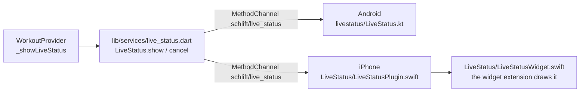

# Live status

The workout in hand, shown by the phone itself while the app is out of sight:
the stage (Ready, Lifting, Resting, Yapping), the set in hand, and the stage's
clock. It is the app's status box, drawn by the system.

| | Where it shows | Drawn by |
|---|---|---|
| Android | A notification that stays up. On Android 16 and later a Live Update: top of the shade, the lock screen, and a chip in the status bar with the clock. | `app/android/app/src/main/kotlin/com/brensch/schlift/livestatus/LiveStatus.kt` |
| iPhone | A Live Activity: a card on the lock screen and, on phones with one, the Dynamic Island ("Rest 1:23"). iOS 16.2 and later. | `app/ios/LiveStatus/` |

The two cannot share a folder (Gradle and Xcode each compile their own), so
they share a name: **live status**, `livestatus` / `LiveStatus` everywhere.

## One message, three places

`WorkoutProvider` calls `LiveStatus.show` every time the workout's state is
applied (and when the app comes back to the front), and `LiveStatus.cancel`
when there is no live workout. The message is the same on both platforms:

- `now`: a phase: `stage`, `short` (the stage in a word: "Rest"), `exercise`,
  `detail` ("100 kg × 5 · Set 2 of 5"), `color` and `ink` (0xAARRGGBB),
  `clockMs` (the moment the clock counts up from, or down to; 0 for none),
  `countDown`, and `title` (Android's one-line heading).
- `then` and `thenAtMs`: only while resting: the phase that replaces `now`
  when the rest runs out (Yapping, counting up from that moment).

## Nothing has to be running

Both platforms tick the clock themselves, so the app only speaks when the
state changes. The one change nobody taps for is a rest running out, and
each platform is told about it ahead of time:

- **Android**: an alarm (`AlarmManager`) for `thenAtMs` carries `then` to
  `LiveStatusReceiver`, which posts it.
- **iPhone**: `thenAtMs` is the activity's stale date. When it passes, iOS
  draws the card again with `isStale` set, and the widget draws `then`.

No server push is involved. A change made on the watch reaches the card
because the watch's message wakes the phone app, which then calls
`LiveStatus.show` as usual. An iPhone can only *start* a Live Activity with
the app in front, so a workout started from the watch gets its card the next
time the app is opened.

## The iPhone's files

`app/ios/LiveStatus/` is a widget extension target (`LiveStatus.appex`,
`com.brensch.schlift.LiveStatus`), embedded in Runner before the Thin Binary
phase.

| File | In target | What |
|---|---|---|
| `LiveStatusAttributes.swift` | Runner and LiveStatus | The activity's content: `now` and `then` |
| `LiveStatusPlugin.swift` | Runner | The channel: starts, updates and ends the activity |
| `LiveStatusWidget.swift` | LiveStatus | The lock screen card and the Dynamic Island |

The extension is signed with its own App Store provisioning profile
(`IOS_LIVE_STATUS_PROVISION_PROFILE_BASE64`, see
[`docs/releasing.md`](../releasing.md)). Swift cannot be compiled on the
development machine: check it with
`gh workflow run ios-debug-compile.yml --ref <branch>`.
