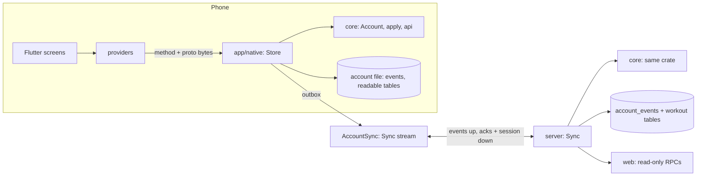

# Local-first: the account on the phone

The app works fully offline. The account lives on the phone, in one SQLite
file, and the phone runs every rule itself: the Rust core (`core/`) is linked
into the app. The server keeps a copy of each account for multiplayer, the web
and analytics, and runs the same core over it. Only multiplayer needs the
network.

## The account is a fold of events

`core/src/account.rs`. Every write the app makes is an `Event`
(`proto/workout/v1/account.proto`): start a workout, a set done, a template
saved, a setting changed. An event carries:

- `seq` — its place in the account's log: 1, 2, 3…, no gaps. One phone
  records an account, so its numbering is the order. There is no merging.
- `id` — random, made by the phone. Every id the event creates (the workout,
  its sets, a template) is derived from it (`core/src/ids.rs`).
- `at` — the phone's clock when it happened. The fold never reads a clock.

So `Account::fold(events)` is deterministic: the phone and the server build
the same account from the same log, ids and times included. Every test in
`core/tests/api.rs` and every user in the fuzzer (`core/examples/fuzz.rs`)
checks that replaying the recorded log rebuilds exactly the account the calls
left behind.

`Account::apply` changes the account by one event, all of it or (on an error)
none of it. `Account::replay` folds in an event already in the log: it takes
its place whether or not it applies (an event made by different rules is a
no-op, never a gap).

`ImportHistory` brings history in as it was (finished workouts, trackers):
how accounts that predate the log were converted, and how the tutorial and the
demo accounts are seeded.

## The API

`core/src/api.rs` answers the app's RPCs from an `Account`, with the existing
request and response protos. `View` is every read (home, a workout, history,
progress, settings); `Call` adds the writes, each of which records one event
(a batch of workout mutations records one each) and answers from the account
after it. `api::call(call, "StartWorkout", bytes)` dispatches by gRPC method
name, so the app keeps its generated types and only the transport changed.

## On the phone

- `app/native` is the core's host shim, built into the app by cargokit
  (`app/rust_builder`) and bridged by flutter_rust_bridge (generated Dart in
  `app/lib/gen/native`, regenerate with `flutter_rust_bridge_codegen
  generate` in `app/`). Its `Store` keeps the account in memory and the file
  on disk: `events` (the log), `meta` (whose account, what the server has
  acknowledged) and the readable tables of `core/src/projection.rs`, rewritten
  as events land. A write is in the file before the app is answered.
- The file is the user's: Settings → Export gives them it whole (every
  workout, set and tracker as plain tables, next to the log).
- `app/lib/services/local_core.dart` is the Dart doorway; `WorkoutServiceWrapper`
  makes the app's calls through it. Providers hold no rules: each action is one
  call, and what's on screen is the core's answer.
- The tutorial runs on an in-memory account (`app/lib/tutorial/tutorial_account.dart`)
  built through the same API; the Dart tests run on in-memory accounts too,
  against the host build of `app/native`.

## Sync

`AccountSync` (`app/lib/services/account_sync.dart`) holds one bidirectional
stream open while the app can (`SyncService.Sync`):

- **Up:** the outbox — every event after the last one the server
  acknowledged — packed with zstd (`core/src/sync.rs`), sent after each write
  and on every (re)connect.
- **Down:** the head the server holds (the ack), and, whole each time, the
  caller's session and requests to join them — on connect, on every change,
  and re-checked every 20 s (sent only when different from the last).

The stream is only the fast path. An event leaves the outbox when the server
acknowledges its seq, and is sent again after any reconnect; the server skips
seqs it already holds. Every down message is whole, so a dropped one is healed
by the next. The phone heartbeats every 5 s and redials (fresh channel,
backoff to 10 s) when nothing has come back for 15 s — a half-open link on bad
wifi is found in seconds. Both ends run HTTP/2 keepalive pings too.

A fresh install pulls the account's log first (`PullEvents`) and only then
opens for use, so it carries on the server's history rather than starting
one of its own. If a phone ever pushes a log that disagrees with the server's
on a seq both hold (two phones recorded the account), the server refuses it
(`account_diverged`); nothing is merged.

## On the server

- `account_events` is the log. `src/db/accounts.rs` folds it (cached in
  memory, least recently used dropped past 256 accounts) and on every push
  rewrites the workout tables (`core/src/projection.rs`) for the workouts the
  events touched — the SQL that analytics and multiplayer history read.
- The workout reads the web makes (`WorkoutService`, `SettingsService`) are
  answered by the core's `View` over the fold — the same code as the phone.
- Multiplayer: after a push, the caller's participant status is rebuilt from
  their fold and stored; the change is broadcast in-process to every Sync
  stream whose session it is. A pushed EndWorkout takes the caller out of
  their session. Membership, invites and join requests stay server-side
  RPCs: they need the network anyway.
- A workout's session is recorded on it by the phone (`SetWorkoutSession`)
  when the stream reports one, so "trained with" works from the account.
