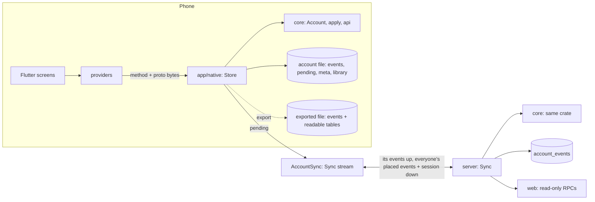

# Local-first: the account on the phone

The app works fully offline. The account lives on the phone, in one SQLite
file, and the phone runs every rule itself: the Rust core (`core/`) is linked
into the app. The server keeps a copy of each account for multiplayer, the web
and analytics, and runs the same core over it. Only multiplayer needs the
network.



## The account is a fold of events

`core/src/account.rs`. Every write the app makes records an `Event`
(`core/src/events.rs`): a workout started, a set done, a template saved, a
setting changed. An event is a fact, stored and synced as JSON:

```json
{"seq":12,"id":"9b1c…","at":1793680431,"SetCompleted":{"workout_id":"…","proposed_set_id":"…","actual_reps":5,"actual_weight":135.0,"completed_at":1793680431}}
```

- `seq` — its place in the account's history, given by the server: 1, 2,
  3…, no gaps. 0 while it is only on the device that recorded it.
- `id` — random, made by the device. Every id the event creates (the
  workout, its sets, a template) is derived from it (`core/src/ids.rs`).
- `at` — the device's clock when it happened. The fold never reads a clock.
- the fact — one of the `Fact` variants, named by its key.

A fact is what the rules decided, never the request that led to it:
`WorkoutStarted` carries every lift's decision (sets, reps, weight, the max
and the reasons), `Onboarded` the starting weights and the library entries
as they were, every time is filled in. The fold lays those out; it never
plans and never consults the library, so a change to the rules, or to the
app's requests, changes nothing already recorded. The protos are only the
API: facts hold proto messages (a template, a decision) but are not
messages themselves.

Facts are only ever added to. A field may be added (old events take its
default); one renamed or removed — in a fact, or in a proto message a fact
holds — would stop stored events reading, and `core/tests/stored_events.rs`
fails on it: it reads `core/tests/testdata/stored_events.json`, one of every
fact as an earlier core wrote it, and needs a new fact added there.

A new kind of fact is safe for older apps: one they don't know is kept as it
came (`Fact::Unknown`) and folds as nothing, so they carry on syncing and
fold it once updated. Before anything depends on the new kind — before the
server or a tool writes one into accounts — require the app that knows it
(`MIN_APP_VERSION`).

`WorkoutDiscarded` throws a workout away, under way or finished: the fold
removes it, so it is gone from history, plans and maxes as if it never
happened, while its events stay in the log.

So `Account::fold(events)` is deterministic: the phone and the server build
the same account from the same history, ids and times included. Every test
in `core/tests/api.rs` and every user in the fuzzer (`core/examples/fuzz.rs`)
checks that replaying the recorded events rebuilds exactly the account the
calls left behind.

`Account::apply` changes the account by one event, all of it or (on an error)
none of it. `Account::replay` folds in an event already in the log: it takes
its place whether or not it applies (an event made by different rules is a
no-op, never a gap). A start or an add that names a lift without its
recorded decision is refused, so a log without decisions can't fold into
empty workouts.

`HistoryImported` brings history in as it was: finished workouts with their
sets, and the starting weights of lifts never done. The plan walks
imported workouts like any others. It is how the tutorial and the demo
accounts are seeded, and how existing accounts were brought into this
log's shape.

## The API

`core/src/api.rs` answers the app's RPCs from an `Account`, with the existing
request and response protos. `View` is every read (home, a workout, history,
progress, settings); `Call` adds the writes, each of which decides its fact,
records it as one event (a batch of workout mutations records one each) and
answers from the account after it. `api::call(call, "StartWorkout", bytes)` dispatches by gRPC method
name, so the app keeps its generated types and only the transport changed.

## On the phone

- `app/native` is the core's host shim, built into the app by cargokit
  (`app/rust_builder`) and bridged by flutter_rust_bridge (generated Dart in
  `app/lib/gen/native`, regenerate with `flutter_rust_bridge_codegen
  generate` in `app/`). Its `Store` keeps the account in memory and the file
  on disk: `events` (the history the server has placed, by seq),
  `pending` (this device's events it hasn't placed yet, in the order they
  were recorded), `meta` (whose account) and `library` (the template library
  the server last sent). The account is the history folded, with what's
  pending on top. A write is in the file before the app is answered.
- Heart rate is gathered in the file's own `heart_rate` table while a
  workout runs, and recorded once it ends: one `HeartRateRecorded` with
  every reading, compact (the first time, the gaps, the bpms). It is most of
  what an account holds, so a workout is one such event, not hundreds.
- A file from before facts (`PRAGMA user_version` below the store's
  `FORMAT`) has its events dropped on opening: the server sends them again.
- The account is the user's: Settings → Export writes the log with the
  readable tables of `core/src/projection.rs` beside it (every workout, set
  and lift's decision as plain tables). Only an export has those tables.
- The account files (`accounts/<user>.sqlite` in the app's support
  directory) are kept out of Android Auto Backup and device transfer
  (`app/android/app/src/main/res/xml/`): a new install always pulls the
  account from the server.
- `app/lib/services/local_core.dart` is the Dart doorway; `WorkoutServiceWrapper`
  makes the app's calls through it. Providers hold no rules: each action is one
  call, and what's on screen is the core's answer.
- The tutorial runs on an in-memory account (`app/lib/tutorial/tutorial_account.dart`)
  built through the same API; the Dart tests run on in-memory accounts too,
  against the host build of `app/native`.

## Sync

`AccountSync` (`app/lib/services/account_sync.dart`) holds one bidirectional
stream open while the app can (`SyncService.Sync`). The server decides the
order of an account's events; the phone records without waiting for it.

- **Open:** the phone says the last seq it holds (`after_seq`) and the
  server sends every event after it, in chunks of 500, then its head. A
  phone that holds everything still hears the head, so it knows it has
  caught up. A fresh install opens for use only once it has.
- **Up:** the pending events — packed as zstd JSON (`core/src/sync.rs`),
  sent after each write and on every (re)connect.
- **Server:** each pushed event it doesn't already hold (by id: a resend
  is skipped) is given the next seq and stored, and sent down every
  stream of that account, the pusher's included.
- **Down:** those events, from whichever device, in the server's order; the
  head, answering a heartbeat; whole each time, on connect and on every
  change, who is in the caller's session and the requests to join them;
  and each session partner's workout as events, folded on this phone
  ([multiplayer.md](multiplayer.md)).
- **Phone:** `Store::receive` takes the events in order. Its own leave
  `pending`; when another device's arrive, the account is refolded, theirs
  then whatever is still pending on top. Two phones on one account both
  keep everything, in the order the server gave it. If the server holds
  less than the phone (an older export opened, or the server restored from
  an older backup), what it lacks goes back to `pending`, ahead of what
  was waiting, and is placed again. The server tells such a phone its head
  and ends the stream without reading it: what the phone pushed on opening,
  before it heard, would otherwise be placed ahead of those older events.
  It dials again from the head.

The stream is only the fast path. A pending event is resent after any
reconnect until it comes back placed, and every down message is either
events after the last the phone holds or whole, so a dropped one is healed
by the next. The phone heartbeats every 5 s and redials (fresh channel,
backoff to 10 s) when nothing has come back for 15 s — a half-open link on
bad wifi is found in seconds. The phone also sends HTTP/2 keepalive pings.

## On the server

- `account_events` is the history, `(user_id, seq, id, event)` with the
  event as JSON, and the only place the server keeps the account: it
  places and appends what is pushed, folding nothing (`src/db/accounts.rs`).
  No workout, set or template is copied into a table, and nothing of an
  account is held in memory.
- The workout reads the web makes (`WorkoutService`, `SettingsService`) are
  answered by the core's `View` over the account folded from its history
  then — the same code as the phone.
- Changes are told only to the streams they concern (`src/db/changes.rs`):
  an account's new events, membership and join requests to that user's
  streams, a session's to its members' — however many are connected, a
  stream wakes only for its own.
- Multiplayer: the server routes each member's workout events to the
  others' streams and keeps only who is in which session; every phone
  folds its partners' status itself. A pushed EndWorkout takes the caller
  out of their session, their result still on show. Membership, invites
  and join requests stay server-side RPCs: they need the network anyway.
- A workout's session is recorded on it by the phone (`SetWorkoutSession`)
  when the stream reports one, so "trained with" works from the account.
