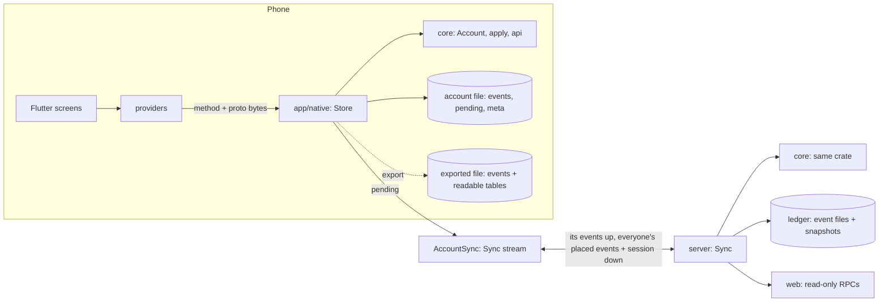

# Local-first: the account on the phone

The app works fully offline. The account lives on the phone, in one SQLite
file, and the phone runs every rule itself: the Rust core (`core/`) is linked
into the app. The server keeps a copy of each account for multiplayer, the web
and analytics, and runs the same core over it. Only multiplayer needs the
network.



## The account is a fold of events

`core/src/account.rs`. Every write the app makes records an `Event`
(`core/src/events.rs`): a workout started, a set done, a program set or a
template edited, a setting changed. An event is a fact, stored and synced as JSON:

```json
{"seq":12,"id":"9b1c…","at":1793680431,"SetCompleted":{"workout_id":"…","proposed_set_id":"…","actual_reps":5,"actual_weight":135.0,"completed_at":1793680431}}
```

- `seq` — its place in the account's history, given by the server: 1, 2,
  3…, no gaps. 0 while it is only on the device that recorded it.
- `id` — random, made by the device. Every id the event creates (the
  workout, its sets, a template) is derived from it (`core/src/ids.rs`).
- `at` — the device's clock when it happened. The fold never reads a clock.
- the fact — one of the `Fact` variants, named by its key.

A fact is what the rules decided, never the request that led to it:
`WorkoutStarted` carries every lift's decision (sets, reps, weight, the max
and the reasons) and the program's rules it lays its sets out by,
`Onboarded` the starting weights and the workouts copied from the library
as they were, `ProgramSet` the whole program document, every time is
filled in. The fold lays those out; it never plans and never consults the
library, so a change to the rules, or to the app's requests, changes
nothing already recorded. The protos are only the API: facts hold proto
messages (a decision, a starting weight) but are not messages themselves.

### The program in the log

The account's training rules are its program (see
[workout-lifecycle.md](workout-lifecycle.md#the-program)). Two facts change
it:

- **`ProgramSet { program, author, note }`** — the whole document, inline as
  JSON, validated when it was recorded. `author` is `app`, `migration` or
  `mcp:<client>`. The latest one plans; the account keeps every one by its
  event id (`Account::programs`), so the history can be shown and an older
  one set again. With none, the built-in program (`core/programs/default.json`,
  no workouts) plans.
- **`ProgramEdited { edit }`** — one change the app made to the program's
  workouts (`save`, `delete`, `reorder` with an optional `rotation_count`,
  `add` library copies). It is an op, not a document: it applies to
  whatever program is current when it folds, so an edit made offline lands
  on a program an assistant set meanwhile instead of undoing it. One that
  would leave the program invalid folds as nothing.

A workout records the program it was planned under: `WorkoutStarted`
carries `program_id` (the `ProgramSet` event's id, `""` for the built-in)
and `rules`, the part of that program laying its sets out reads (the
estimate, warmups, calibration, equipment and the workout's own exercise
definitions). `ExercisesAdded` carries the added lifts' `definitions` the
same way. So a workout folds the same on a session partner's phone, which
holds only that workout's events, and on a replay where a program set
elsewhere was placed before a workout started offline.

Facts are only ever added to. A field may be added (old events take its
default); one renamed or removed — in a fact, or in a proto message a fact
holds — would stop stored events reading, and `core/tests/stored_events.rs`
fails on it: it reads `core/tests/testdata/stored_events.json`, one of every
fact as an earlier core wrote it, and needs a new fact added there.

A new kind of fact is safe for older apps: one they don't know is kept as it
came (`Fact::Unknown`) and folds as nothing, so they carry on syncing and
fold it once updated. Before anything depends on the new kind — before the
server or a tool writes one into accounts — require the app that knows it
(`MIN_APP_VERSION`).

`WorkoutDiscarded` throws a workout away, under way or finished: the fold
removes it, so it is gone from history, plans and maxes as if it never
happened, while its events stay in the log.

So `Account::fold(events)` is deterministic: the phone and the server build
the same account from the same history, ids and times included. Every test
in `core/tests/api.rs` and every user in the fuzzer (`core/examples/fuzz.rs`)
checks that replaying the recorded events rebuilds exactly the account the
calls left behind.

`Account::apply` changes the account by one event, all of it or (on an error)
none of it. `Account::replay` folds in an event already in the log: it takes
its place whether or not it applies (an event made by different rules is a
no-op, never a gap). A start or an add that names a lift without its
recorded decision is refused, so a log without decisions can't fold into
empty workouts.

`HistoryImported` brings history in as it was: finished workouts with their
sets, and the starting weights of lifts never done. The plan walks
imported workouts like any others. It is how the tutorial and the demo
accounts are seeded, and how existing accounts were brought into this
log's shape.

## The API

`core/src/api.rs` answers the app's RPCs from an `Account`, with the existing
request and response protos. `View` is every read (home, a workout, history,
progress, settings, the program); `Call` adds the writes, each of which decides its fact,
records it as one event (a batch of workout mutations records one each) and
answers from the account after it. `api::call(call, "StartWorkout", bytes)` dispatches by gRPC method
name, so the app keeps its generated types and only the transport changed.

The program's RPCs are core-only (the phone and the server's MCP tools call
them; no gRPC service exposes them): `GetProgram` (the current program's
summary and JSON, the earlier ones, the guide), `GetProgramVersion` (one
earlier document), `SetProgram` (validate against the account, then record
`ProgramSet`), `ResetProgram` (the built-in rules, or with `to` an earlier program's, with the current workouts
and any of the program's own lifts they or the history name),
`ValidateProgram` (a draft's problems, each with its path),
`SimulateProgram` (`core/src/simulate.rs`: a draft run over the recorded
history and forward N sessions; nothing is recorded) and `ListExercises`
(the program's exercises as the app shows them). The template RPCs
(`SaveTemplate`, `DeleteTemplate`, `ReorderTemplates`,
`AddLibraryTemplates`, `ApplyLibraryPlan`) record `ProgramEdited`.

## On the phone

- `app/native` is the core's host shim, built into the app by cargokit
  (`app/rust_builder`) and bridged by flutter_rust_bridge (generated Dart in
  `app/lib/gen/native`, regenerate with `flutter_rust_bridge_codegen
  generate` in `app/`). Its `Store` (`app/native/src/store.rs`) keeps the
  account in memory and the file on disk: `base` (the account as placed up
  to a seq, written down with `schlift_core::snapshot`), `placed` (events
  the server placed after the base, folded into it every
  `FOLD_PLACED_AT` and deleted), `pending` (this device's events not placed
  yet, in the order recorded) and `meta` (whose account, the id of the last
  placed event). The account shown is the base, the placed and the pending
  folded on. The template library is built into the core
  (`templates/library.yaml`); nothing of it is synced or stored. A write is
  in the file before the app is answered.
- The account's past workouts are shared (`Arc`) between the placed account
  and the one shown, so refolding after a write copies only what changed.
- Heart rate is gathered in the file's own `heart_rate` table while a
  workout runs, and recorded once it ends: one `HeartRateRecorded` with
  every reading, packed by the core (gaps and bpm deltas as varints,
  zstd). The server's account (and so a base the server sent) leaves heart
  rate out; a finished workout's chart the phone has none for comes from
  `WorkoutService.GetWorkoutHeartRate`.
- A file from an earlier format (`PRAGMA user_version` below the store's
  `FORMAT`) is moved forward on opening (see `Store::open`).
- The account is the user's: Settings → Export writes the file with the
  readable tables of `core/src/projection.rs` beside it (every workout, set
  and lift's decision as plain tables). Only an export has those tables.
- The account files (`accounts/<user>.sqlite` in the app's support
  directory) are kept out of Android Auto Backup and device transfer
  (`app/android/app/src/main/res/xml/`): a new install always pulls the
  account from the server.
- `app/lib/services/local_core.dart` is the Dart doorway; `WorkoutServiceWrapper`
  makes the app's calls through it. Providers hold no rules: each action is one
  call, and what's on screen is the core's answer.
- The tutorial runs on an in-memory account (`app/lib/tutorial/tutorial_account.dart`)
  built through the same API; the Dart tests run on in-memory accounts too,
  against the host build of `app/native`.

## Sync

`AccountSync` (`app/lib/services/account_sync.dart`) holds one bidirectional
stream open while the app can (`SyncService.Sync`), straight to the server's
own TLS listener (`schlift.com:8443`, `src/tls.rs`). The server decides the
order of an account's events; the phone records without waiting for it.

- **Open:** `SyncOpen` says where the phone is: the last seq it holds, the
  id of the event there, the rules it folds by (`schlift_core::FOLD`) and
  the ids of its pending events. Other rules than the server's: told
  `app_update_required` (one version at a time). The same last event:
  nothing to send but the head. Anything else (new, behind, or a history
  that parted from the server's): the account whole (`AccountState`: the
  snapshot, its seq and last id, and which of the phone's pending the
  server has written already, which leave `pending`). Nothing is read from
  the event files to answer an open.
- **Up:** the pending events, packed as zstd JSON (`core/src/sync.rs`),
  after each write and on every new stream.
- **Server:** each pushed event it doesn't hold (by id, against what it
  holds and, on a stream's first push, what it wrote while the phone was
  away) is held in memory and sent at once, unplaced, to the account's
  session partners (`Change::Live`). The account is written when its
  workout ends, with the next batch (every 2 s); a workout abandoned is
  written after 30 min without an event, and a write outside a workout
  once quiet for 90 s. Then its devices hear the events placed: that is
  the ack. A write no phone holds (an assistant's, a friend's suggestion)
  is written at once.
- **Down:** placed events, from whichever device, in the server's order;
  the head, answering a heartbeat; the account whole when the phone fell
  behind; whole each time, on connect and on every change, who is in the
  caller's session and the requests to join them; and each session
  partner's workout as events, folded on this phone
  ([multiplayer.md](multiplayer.md)).
- **Phone:** `Store::receive` takes placed events in order and its own
  leave `pending`; `Store::receive_account` takes the account whole as its
  base and keeps what is still pending on top. A phone shows itself
  unsynced only for events waiting over two minutes outside a workout
  under way.
- **Import:** an export only adds. A phone holding nothing placed takes the
  export's base and placed as they are; otherwise each event the phone
  holds neither placed nor pending goes to `pending`, and the server skips
  any it has written. A damaged file is refused whole.

The stream is only the fast path. A pending event is resent on every new
stream until it comes back placed. The phone heartbeats every 30 s and
redials when nothing has come back for 75 s; HTTP/2 keepalive pings every
60 s keep NATs from idling the link out.

## On the server

The ledger (`src/db/ledger/`) keeps the accounts:

- **In memory, per account in use:** only the events a phone sent that
  aren't written yet, its head and last id, and the workout under way. No
  folded account. Past a memory budget (`LEDGER_MEMORY_MB`) the workouts
  held longest are written early.
- **Written together, every couple of seconds:** the events of every
  account due a write go into one Parquet file (`events/date=…/hour=…/`,
  sorted by account and seq, with `kind` and `workout_id` columns), their
  heart rate into one typed file (`heart_rate/…`: user, workout, times,
  bpm), and each account's new snapshot (`account_snapshots`: the old one
  with the events folded on) into SQLite, with the files' index
  (`event_files`, `heart_rate_files`), in one transaction. A file the index
  doesn't name is a write that never committed, set aside at start.
- **Reads** (the website's `WorkoutService` and `SettingsService`, an
  assistant's MCP tools, the admin page) restore the snapshot, fold the
  events held on top, answer with the core's `View` (the same code as the
  phone) and drop it: a set done a moment ago is in the answer.
  `set_program` writes through the core's `Call` like a phone.
- **The event files** are read only to fold an account again after a
  release changes the rules (its snapshot is by other ones), for apps from
  before snapshots catching up, and by compaction, which merges a closed
  hour's batch files into one and a closed day's into one
  (`src/db/ledger/compact.rs`). The layout is Hive's, so DuckDB reads it
  as it is: `read_parquet('events/**/*.parquet', hive_partitioning=true)`.
- A pushed event is checked first (`Event::plans_are_sane`): a
  `ProgramSet` must hold a program with no errors, since every device
  folds it.
- Changes are told only to the streams they concern (`src/db/changes.rs`):
  an account's new events, membership and join requests to that user's
  streams, a session's to its members' — however many are connected, a
  stream wakes only for its own.
- Multiplayer: the server routes each member's workout events to the
  others' streams and keeps only who is in which session; every phone
  folds its partners' status itself. A pushed EndWorkout takes the caller
  out of their session, their result still on show. Membership, invites
  and join requests stay server-side RPCs: they need the network anyway.
- A workout's session is recorded on it by the phone (`SetWorkoutSession`)
  when the stream reports one, so "trained with" works from the account.
