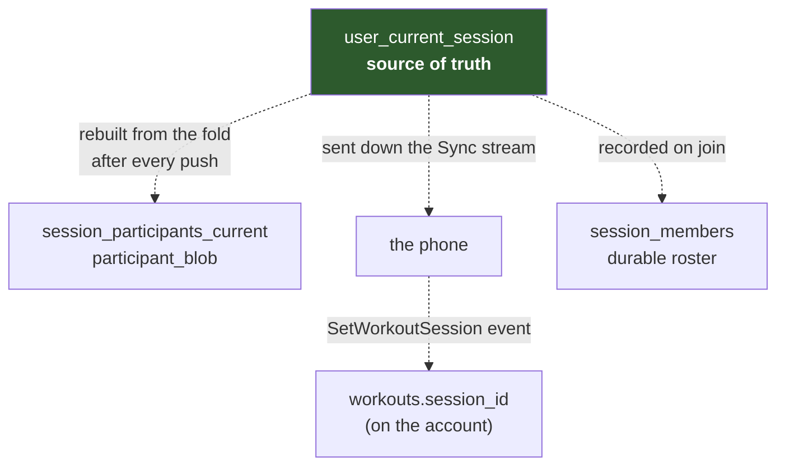
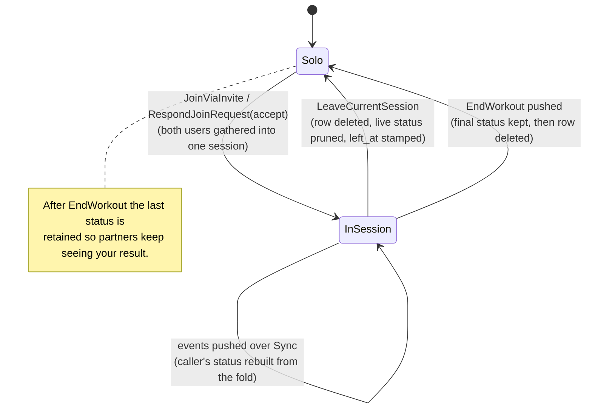
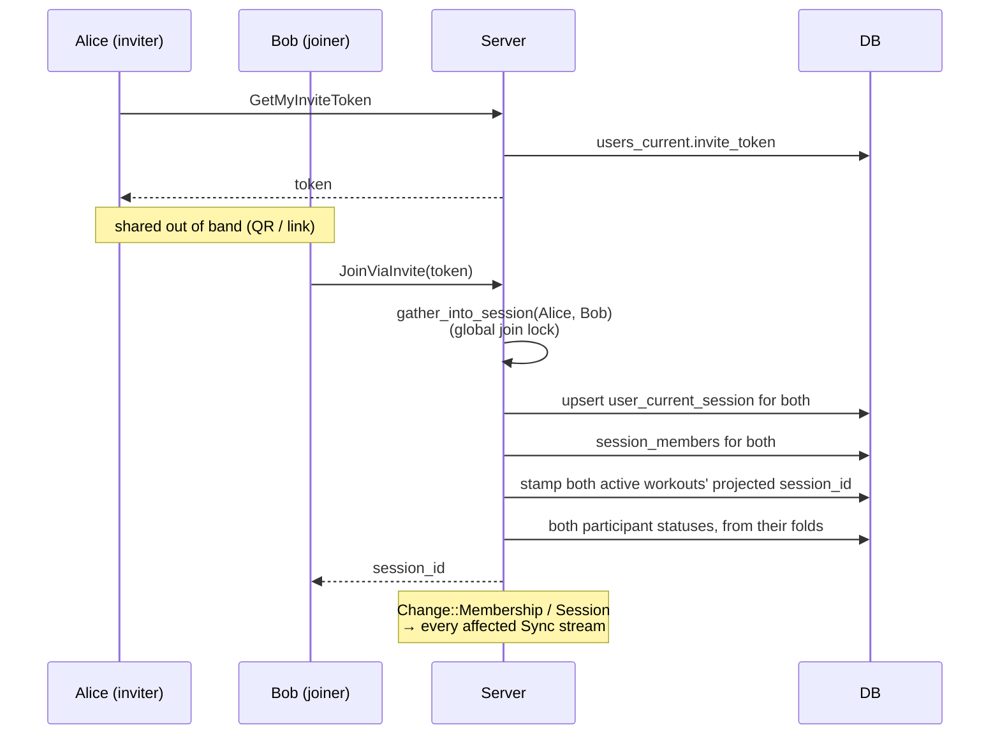
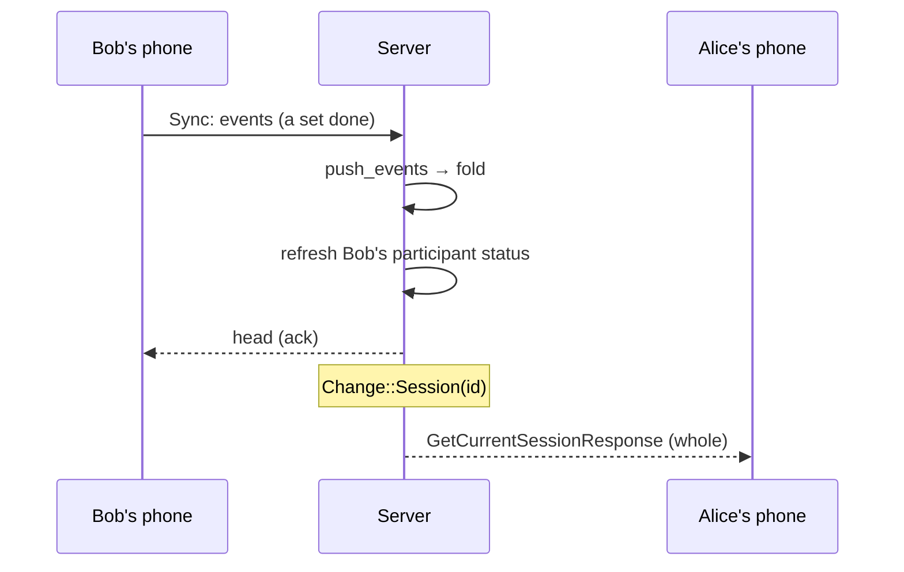

# Multiplayer Sessions

Two or more lifters share a *session* so each can see what the others are doing
and whose turn it is. A session is server state: membership, plus each
member's status built from their synced account. It is the one part of the
app that needs the network. Offline, you drop out of view and nothing else
breaks.

## The invariant

`user_current_session(user_id PRIMARY KEY, session_id, joined_at)` is the single
source of truth for "is this user in a group right now?". Because `user_id` is
the primary key, a user is structurally incapable of being in two sessions.

Everything else is derived:

If those disagree, `user_current_session` wins.

## Transitions

| Transition | Where |
|---|---|
| `JoinViaInvite`, `RespondJoinRequest`, `LeaveCurrentSession` | `src/server/multiplayer.rs` |
| Status refresh and leaving on `EndWorkout` | `after_push` in `src/server/sync.rs` |
| Status from the account | `participant_status` in `src/server/support.rs` |

## Joining

The invite token lives on the user, not the session — a stable personal
handle, rotatable via `RotateInviteToken`. Everyone gathers into the
*anchor's* session (the inviter, or whoever sent a join request), creating
one if they have none, so one host pulling in several people forms one
group. The joiner leaves any other session first.

Joining mid-workout attaches the in-progress workout to the session: the
server stamps its projected row at once, and the phone records it on the
account with a `SetWorkoutSession` event when the stream reports the session
(`recordSession`, wired in `app/lib/main.dart`). That is what "trained with"
on the summary reads.

## Session state comes down the Sync stream

There is no polling. Each phone holds one `SyncService.Sync` stream open
(see [local-first.md](local-first.md#sync)); the server sends the caller's
session and the requests to join them on it.

The server sends the session (whole, never a diff):

- when a `Change` concerning the caller is broadcast (`ServerDb::subscribe`):
  their membership, a session they are in, requests to join them;
- on connect, and re-checked every 20 s (`RESEND_EVERY`) as a backstop for a
  missed notification. A view identical to the last one sent is not sent
  again.

The server **excludes the caller** from the participants list; the app
renders itself from its own account and partners from this list.
`MultiplayerProvider` only reflects what `AccountSync` brings down, and makes
the online-only calls (join, leave, ask). Right after a join it asks once
with `GetCurrentSession` rather than waiting for the stream.

`SessionStatus.next_up_user_id`, `next_up_set`, `next_up_rest_until` and
`currently_lifting_user_id` are always empty; "who's up next" is computed
client-side from the participants. Treat them as dead.

## Join requests

`RequestJoinPartner` asks someone you have trained with before
(`have_trained_together`) to train together; they see it on their stream
and answer with `RespondJoinRequest`. A request expires from view after two
minutes (`JOIN_REQUEST_TTL_SECONDS`) and is deleted once answered.

## Training partners

`session_members` is never deleted: it records who trained together and backs
`GetTrainingPartners` (the FRIENDS list, for one-tap re-pairing) and
`GetSharedSessions`.

## Failure modes to know

- **A partner who goes offline keeps their last status.** It is refreshed
  only when their events arrive; there is no staleness marker.
- **Sessions are never garbage collected.** `session_participants_current`
  rows stay after a workout ends (by design, so the result stays on show)
  and `session_members` grows forever.
- **The broadcast is in-process.** A second backend instance would not hear
  the first one's changes.
