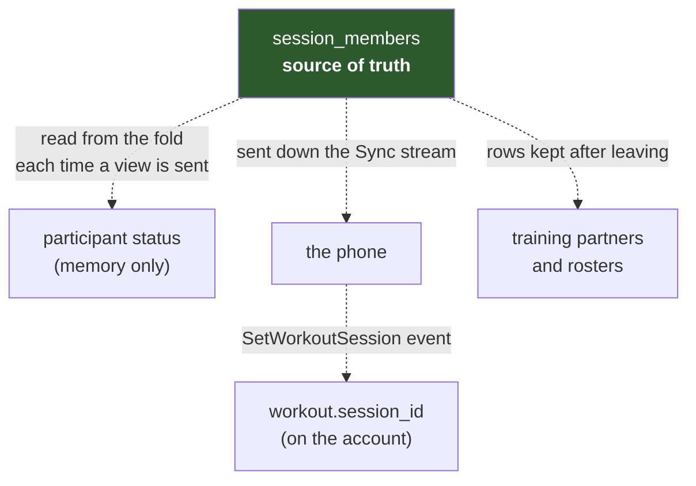
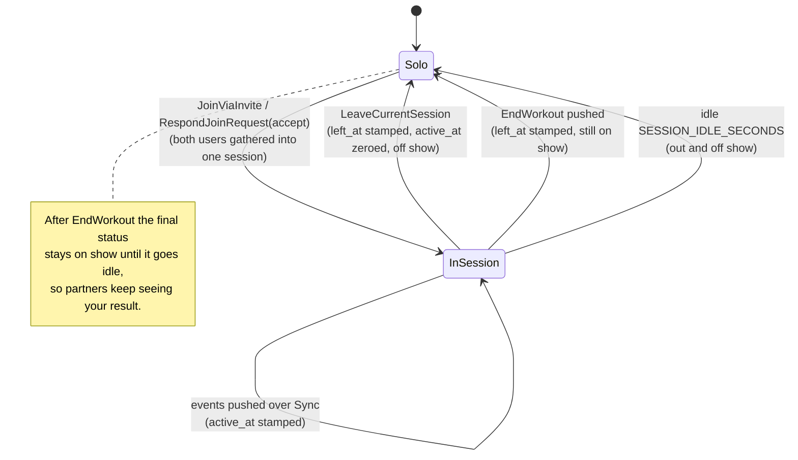
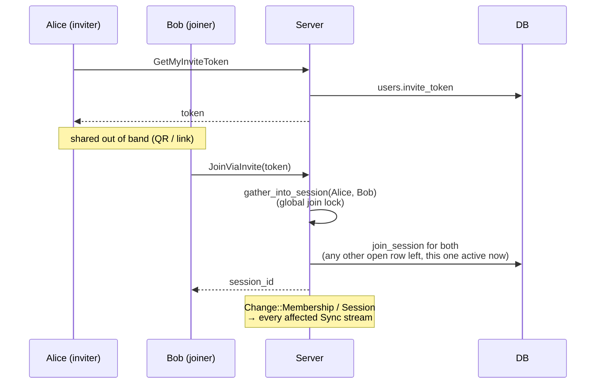
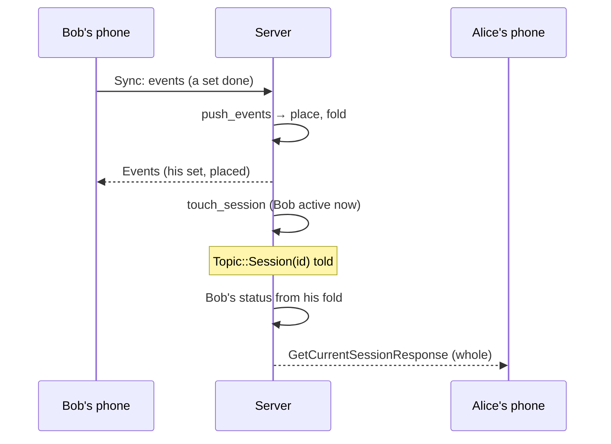

# Multiplayer Sessions

Two or more lifters share a *session* so each can see what the others are doing
and whose turn it is. A session is server state: membership is stored, and
each member's status is read from their synced account whenever it is sent.
It is the one part of the app that needs the network. Offline, you drop out
of view and nothing else breaks.

## The invariant

`session_members(session_id, user_id, joined_at, left_at, active_at)` is the
single source of truth for "is this user in a group right now?". The
user's current session is their row with `left_at = 0`, and a partial unique
index on `user_id WHERE left_at = 0` makes a second one impossible.
`active_at` is their last activity there (joining, or a synced write other
than heart rate); a member is on show to the others while it is younger
than `SESSION_IDLE_SECONDS` (3 h), and leaving zeroes it.

Everything else is derived:

A member's status (`participant_status`, `src/server/support.rs`) is never
stored: it is their workout under way, or else the last one to end since
they joined, as their own app shows it, read from their folded account.

## Transitions

| Transition | Where |
|---|---|
| `JoinViaInvite`, `RespondJoinRequest`, `LeaveCurrentSession` | `src/server/multiplayer.rs` |
| Activity and leaving on `EndWorkout` | `after_push` in `src/server/sync.rs` |
| Rows and the idle cut-off | `src/db/session.rs` |
| Status from the account | `participant_status` in `src/server/support.rs` |

## Joining

The invite token lives on the user, not the session — a stable personal
handle. Everyone gathers into the
*anchor's* session (the inviter, or whoever sent a join request), creating
one if they have none, so one host pulling in several people forms one
group. The joiner leaves any other session first.

Joining mid-workout attaches the in-progress workout to the session: the
phone records it on the account with a `SetWorkoutSession` event when the
stream reports the session (`recordSession`, wired in `app/lib/main.dart`).
That is what "trained with" on the summary reads.

## Session state comes down the Sync stream

There is no polling. Each phone holds one `SyncService.Sync` stream open
(see [local-first.md](local-first.md#sync)); the server sends the caller's
session and the requests to join them on it.

The server sends the session (whole, never a diff):

- when a change concerning the caller is told (`ServerDb::watch`, by user
  and by the session their pointer names): their membership, a session they
  are in, requests to join them;
- on connect, and re-checked every 20 s (`RESEND_EVERY`) as a backstop for a
  missed notification. A view identical to the last one sent is not sent
  again.

The server **excludes the caller** from the participants list; the app
renders itself from its own account and partners from this list.
`MultiplayerProvider` only reflects what `AccountSync` brings down, and makes
the online-only calls (join, leave, ask). Right after a join it asks once
with `GetCurrentSession` rather than waiting for the stream.

"Who's up next" is computed client-side from the participants.

## Join requests

`RequestJoinPartner` asks someone you have trained with before
(`have_trained_together`) to train together; they see it on their stream
and answer with `RespondJoinRequest`. A request expires from view after two
minutes (`JOIN_REQUEST_TTL_SECONDS`) and is deleted once answered. Requests
live in memory only (`JoinRequests`, `src/db/session.rs`): a restart drops
at most a question someone asks again.

## Training partners

`session_members` rows are kept after a member leaves (deleted only with the
account): they record who trained together and back
`GetTrainingPartners` (the FRIENDS list, for one-tap re-pairing) and
`have_trained_together`, and the historical rosters of `GetSessionRosters`.

## Failure modes to know

- **A partner who goes offline keeps their last status** until they go
  idle: it reflects only the events that have arrived; there is no
  staleness marker.
- **`session_members` grows forever.** Its rows are the record of who
  trained together; only deleting an account removes them.
- **Changes are told in process.** A second backend instance would not hear
  the first one's changes.
