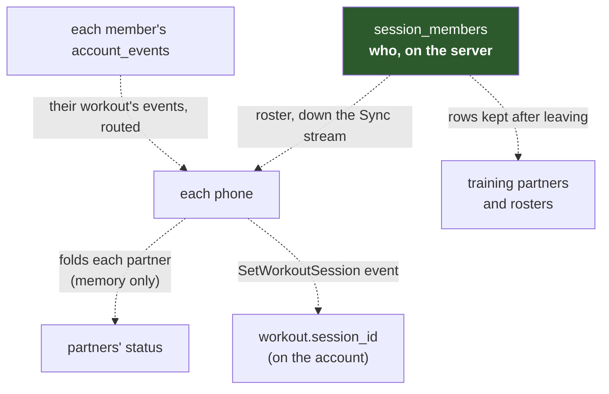
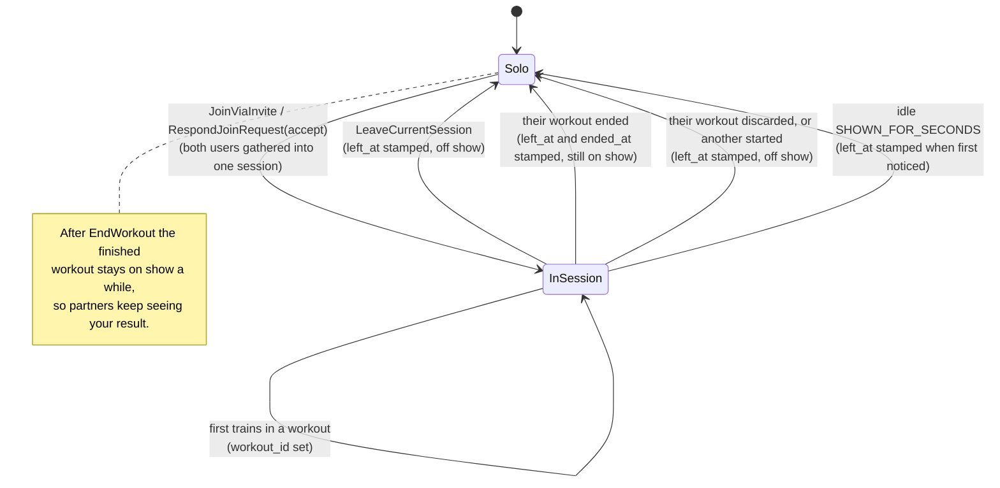
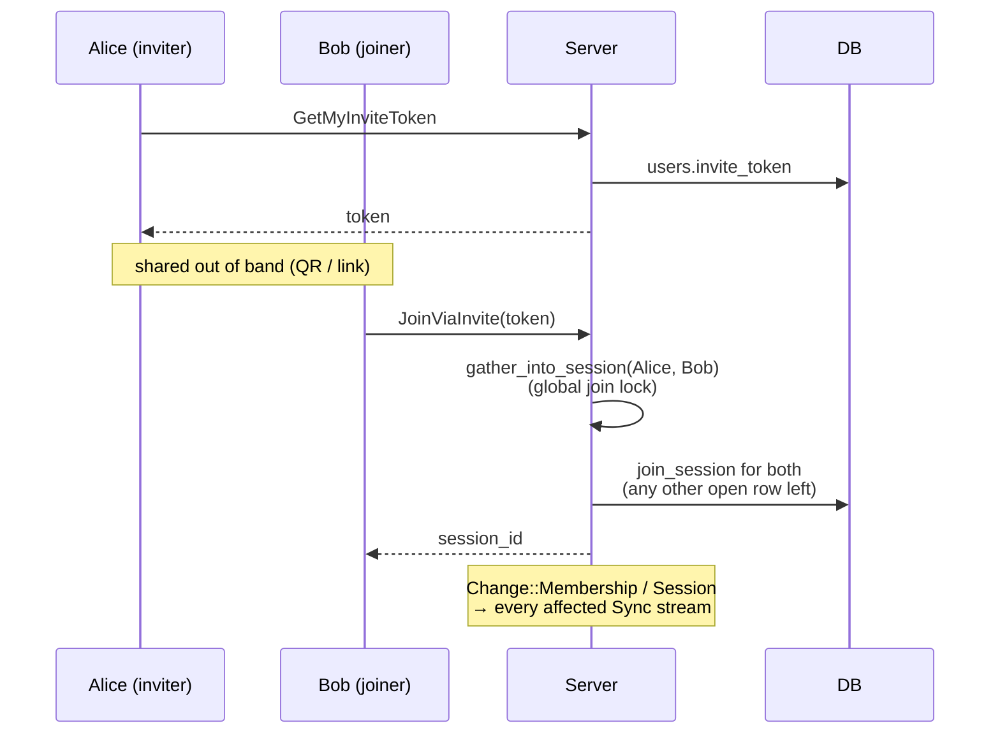
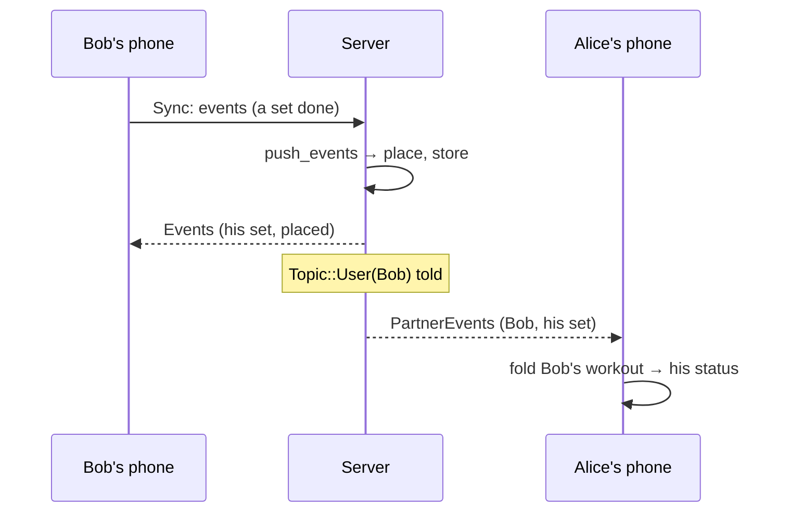

# Multiplayer Sessions

Two or more lifters share a *session* so each can see what the others are doing
and whose turn it is. The server only knows who is in which session; where
each member is up to, every phone folds for itself from the others' workout
events, which the server routes and never computes. It is the one part of the
app that needs the network. Offline, you drop out of view and nothing else
breaks.

## The invariant

`session_members(session_id, user_id, joined_at, left_at, ended_at,
workout_id)` is the single source of truth for "is this user in a group right
now?". The user's current session is their row with `left_at = 0`, and a
partial unique index on `user_id WHERE left_at = 0` makes a second one
impossible. Rows are written when someone joins, leaves, first trains in the
session or ends that workout — never per set. `ended_at` is when ending their
workout took them out: their finished workout stays on show to the others for
`SHOWN_FOR_SECONDS` (3 h, `schlift_core::session`).

**A member's part in a session is one workout**, `workout_id`: the first
they train in after joining (the one under way when they join, or the next
they start). It is set from the first of their pushed events that starts it,
puts it in the session (`SetWorkoutSession`) or does a set of it, as long as
that comes within `SHOWN_FOR_SECONDS` of joining (`ServerDb::follow_session`,
`src/db/session.rs`). A workout left open from earlier is not under way: one
with nothing in it for `SHOWN_FOR_SECONDS` before it is put in the session,
ended or thrown away stays the member's own, and ending or throwing it away
leaves them in the session for the next one they start. Only that workout's events go to the others — all of
them, late ones and catch-up after a reconnect included, until the member is
off the roster — and nothing of any workout before or after it. Ending it is
leaving.

Everything else is derived, and none of it on the server:

A partner's status is folded on the caller's phone
(`schlift_core::session::partner_status`): their workout under way, or else
the last one to end since they joined, from the events of that workout alone.
A workout carries everything it needs to fold — its name and unit are on its
`WorkoutStarted` — so the rest of their account is never needed, and never
sent. A partner is off show once their workout ended `SHOWN_FOR_SECONDS` ago,
or once it (or, before they have one, their joining) has gone that long
without an event (walked off without ending, or joined and never started).

## Transitions

Idle is measured on the member's workout, not on reads: they are out once
their workout in the session has had no event for `SHOWN_FOR_SECONDS`, or,
with none yet, once they joined that long ago. It is written (`left_at`) the
first time it is noticed — when their phone connects, someone joins them, they
join someone (so rejoining a session they went idle in is a fresh join), or
they push the event that would start training late — so a member who walked
off without ending, or never started, is never pulled back in by what they do
days later, and no one joining them later lands in the old group.

| Transition | Where |
|---|---|
| `JoinViaInvite`, `RespondJoinRequest`, `LeaveCurrentSession` | `src/server/multiplayer.rs` |
| Their workout set, ended, discarded or replaced | `follow_session` in `src/db/session.rs`, on every push |
| Rows and the idle cut-off | `get_user_current_session` in `src/db/session.rs` |
| A partner's status, on the phone | `schlift_core::session` |

## Joining

The invite token lives on the user, not the session — a stable personal
handle. Everyone gathers into the *anchor's* session (the inviter, or whoever
sent a join request), creating one if they have none, so one host pulling in
several people forms one group. The joiner leaves any other session first.

Joining mid-workout attaches the in-progress workout to the session: the
phone records it on the account with a `SetWorkoutSession` event when the
stream reports the session (`recordSession`, wired in `app/lib/main.dart`).
That is what "trained with" on the summary reads.

## The session comes down the Sync stream

There is no polling. Each phone holds one `SyncService.Sync` stream open (see
[local-first.md](local-first.md#sync)), and on it the server sends:

- **The roster** (`Session`): who else is in the caller's session, with when
  each joined and ended — on connect and whenever it changes (someone joins,
  leaves or ends; a profile changes). Whole, and only when different.
- **Each partner's workout in the session, as events** (`PartnerEvents`).
  When a partner first appears — on connect, or when they join — and again
  when their `workout_id` is first set, that workout so far (`workout_events`:
  back from their newest event to its `WorkoutStarted`, from
  `account_events`), marked `whole`; empty before they have one. Then each
  event of it as they record it: the stream watches every partner's account
  (`ServerDb::watch(Topic::User)`) and forwards only what concerns that one
  workout, so a member who ended still sends what comes late of it, and
  nothing of their next. Only workout facts go (`shared_with_partners`):
  never heart rate, templates, settings or history.

Per set, the server writes one event row and forwards it: no fold, no status,
nothing held but which stream watches whom. The phone keeps each partner's
events in memory (`Store::receive_partner`, never in the file), skips one it
already has, and asks the core for their status (`partner_status`);
`MultiplayerProvider` turns roster plus statuses into the participants the
screens show. The caller is never in their own roster: the app renders
itself from its own account.

"Who's up next" is computed client-side from the participants.

## Join requests

`RequestJoinPartner` asks someone you have trained with before
(`have_trained_together`) to train together; they see it on their stream and
answer with `RespondJoinRequest`. A request can be answered for two minutes
(`JOIN_REQUEST_TTL_SECONDS`); the phone stops showing it then, and it is
deleted once answered. Requests live in memory only (`JoinRequests`,
`src/db/session.rs`): a restart drops at most a question someone asks again.

## Training partners

`session_members` rows are kept after a member leaves (deleted only with the
account): they record who trained together and back `GetTrainingPartners`
(the FRIENDS list, for one-tap re-pairing) and `have_trained_together`, and
the historical rosters of `GetSessionRosters`. A past workout shows who you
trained with, not what they did: their workouts stay in their own accounts.

## Failure modes to know

- **A partner who goes offline stops updating** where they were, until they
  come back or go off show; there is no staleness marker.
- **Idle is noticed, not scheduled.** A member who has gone idle is written
  out the next time their phone connects, someone joins them, they join
  someone, or they push;
  until then the others' rosters still list them, and their phones show
  them off show.
- **`session_members` grows forever.** Its rows are the record of who trained
  together; only deleting an account removes them.
- **Changes are told in process.** A second backend instance would not hear
  the first one's changes.
