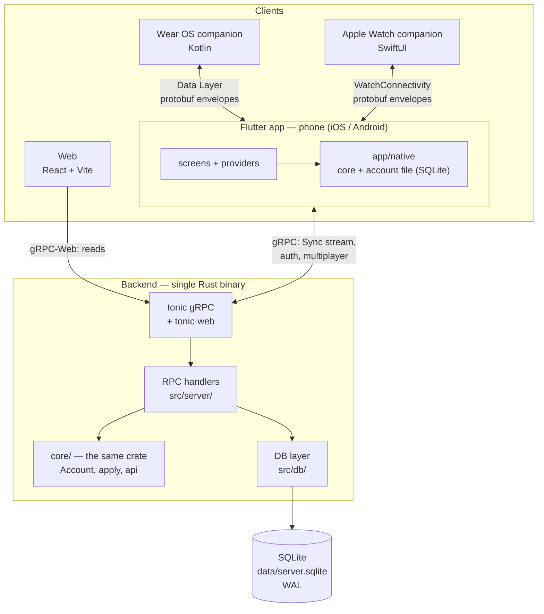
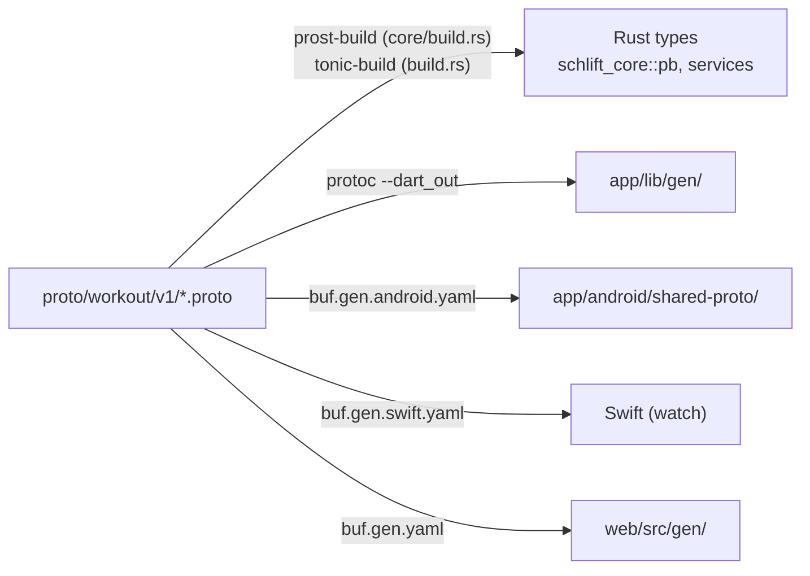
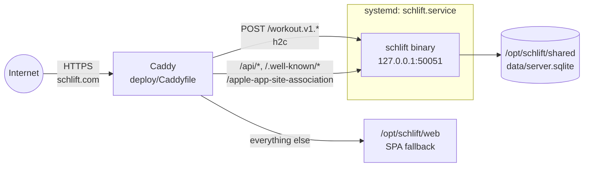

# System Overview

Schlift is a strength-training app. A user composes workout templates, logs
sets against prescribed targets, and can share a live session with other
lifters. The account lives on the phone and works fully offline: the Rust
core (`core/`) is linked into the app and runs every rule there. The server
keeps a synced copy for multiplayer, the web and analytics. The watch is a
remote control and sensor for the phone.

## Components



The watches never talk to the backend. They exchange protobuf envelopes with
the phone over the platform transport. The phone answers them from its own
account, so a watch works whenever the phone is reachable, network or not.

## Repository layout

```
core/               The domain, pure Rust (no IO): shared by phone and server
  src/account.rs    Account, Event, apply, fold
  src/api.rs        The app's RPCs answered from an Account (View / Call)
  src/projection.rs The account as SQL tables (phone file, server analytics)
  src/workout/      Workout planning + state reduction
  src/exercise_catalog.rs, exercise_progress.rs, volume.rs, …
  tests/api.rs      The API end to end
  examples/fuzz.rs  The invariant fuzzer
src/                Rust backend
  server/           gRPC handlers, one module per service
  db/               SQLite access: auth, sessions, the event store
app/                Flutter app
  native/           The core's host shim: account file, flutter_rust_bridge API
  rust_builder/     cargokit: builds app/native into the app
  lib/screens/      Full-page UI
  lib/widgets/      Reusable UI
  lib/providers/    App state (ChangeNotifier)
  lib/services/     The core doorway, sync, transport, platform integration
  lib/logic/        Pure functions (no Flutter imports)
  lib/gen/          Generated Dart (protobuf, flutter_rust_bridge) — do not edit
  android/wear/     Wear OS companion (Kotlin)
  ios/SchliftWatch/ Apple Watch companion (SwiftUI)
web/                React landing / privacy / account deletion
proto/workout/v1/   Protobuf contracts — source of truth
```

## Protobuf is the contract

`proto/workout/v1/` generates code for every client. The one other thing the
backend and the app share is the `core/` crate itself, which speaks these
messages: the app passes it request bytes and gets response bytes back.



Regenerate after editing a `.proto`:

```bash
make proto-all      # dart + android + swift
```

Rust regenerates automatically via `build.rs` on the next `cargo build`.

> **Caveat:** generated Dart is committed. If you edit a proto and forget to
> regenerate, the Dart side and the core will disagree silently until runtime.

## A write end to end

Completing a set, from tap to the server's copy:

```mermaid
sequenceDiagram
    participant U as User
    participant P as WorkoutProvider
    participant N as app/native Store
    participant C as core (api + apply)
    participant Y as AccountSync
    participant S as Server Sync

    U->>P: tap "done, 5 reps"
    P->>N: call("AppendWorkoutMutations", bytes)
    N->>C: Call::append_workout_mutations
    C->>C: record Event (apply through the reducer)
    N->>N: write event + projected rows to the file
    C-->>P: GetWorkoutResponse (the new state)
    P->>P: notifyListeners()
    Note over P: on screen; no network involved
    N-->>Y: writes stream fires
    Y->>S: SyncRequest{events: outbox, zstd}
    S->>S: push_events: store, fold, project
    S-->>Y: head (ack)
    Y->>N: acked(head) — outbox shrinks
```

The answer the app shows is the core's answer, computed on the phone. Sync
happens afterwards and never blocks a screen. See
[local-first.md](local-first.md).

## Deployment

Production is bare metal: a systemd-managed binary behind Caddy.



Server layout (see `deploy/README.md`):

```
/opt/schlift/
  current -> releases/<git-sha>    # ExecStart target
  releases/
  shared/                          # WorkingDirectory
    data/server.sqlite
    schlift.env                    # EnvironmentFile
```

Deployment is push-to-`main` via `.github/workflows/backend-deploy.yml`: an
ARM64 GitHub runner builds the binary, a self-hosted runner on the server
installs it into a new release directory and restarts the unit.

`docker-compose.yml` + `nginx.conf` are a **separate local/container path**, not
what production runs. Don't assume changes to one apply to the other.

The backend is a single binary with an embedded SQLite file — no external
database, no cache, no queue. See `deploy/` and `docs/releasing.md`.

App releases are tag-triggered: push a `v*` tag to build signed Android/Wear and
iOS artifacts. The version comes from the tag; `app/pubspec.yaml` stays a
`0.0.0+1` placeholder.

## Scale assumptions

The architecture assumes a small user base:

- One SQLite file, one write connection. All writes serialise.
- Folded accounts are cached in process memory (at most 256), so the backend
  is single-instance. So are in-flight WebAuthn challenges.
- Multiplayer updates go out over each phone's Sync stream from an
  in-process broadcast; no external queue.
