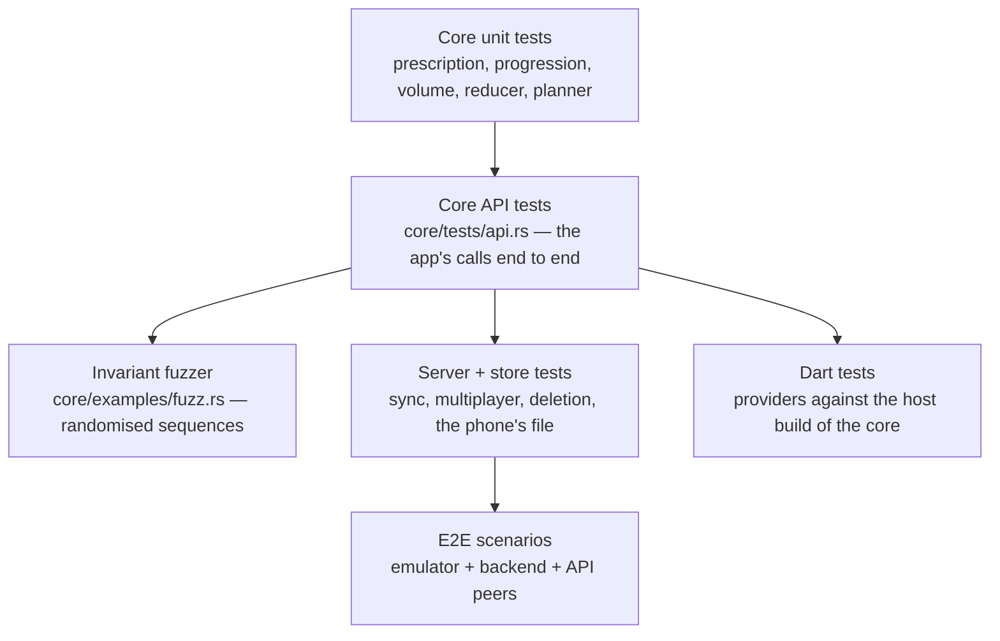

# Testing

The rules live in one place, the Rust core, so that is where most of the
testing is. Each layer catches something the others cannot.



```bash
cargo test --workspace --all-targets   # core + server
make test-app                          # host build of app/native, then flutter test
make fuzz-api                          # randomised sequences, random seed
make fuzz-api-ci                       # the fixed-seed run CI uses
make e2e                               # emulator scenarios
```

## Core unit tests — the engine

Pure and fast, inline in their modules under `core/src/`:

- `exercise_catalog.rs` — every exercise is classified (the scan is pinned,
  so a `_ =>` fallback cannot quietly misfile a new lift), and the
  prescription table is asserted per class.
- `exercise_progress.rs` — the progression cases: a cleared 5×5 adds a
  step, rep advance follows the worst set, load bump at the top of the
  range, hold on a miss, 10% deload on the third running, bodyweight
  rep-only, performed-weight basis, kg/lb snapping, overrides.
- `volume.rs` — the 7-day window, primary/secondary weighting, and the
  suggestion's deficit scoring and tie-break.
- `workout/reducer.rs`, `workout/planning.rs` — set transitions, rest,
  calibration rungs (climb, settle, re-settle); warmup ladders and plate
  snapping.
- `template_library.rs`, `onboarding.rs`, `progress.rs`, `recovery.rs`,
  `weight_units.rs`.

## Core API tests — the seams between calls

`core/tests/api.rs` drives the account through `Call` and `View` exactly as
the app does: onboard → home → start-from-template → complete → end →
tracker advanced exactly once → next home reflects it. The layoff deload
(applied at start, never written), manual overrides and the kg path live
here, because they only appear **between** two calls.

**Every test also checks that replaying its recorded events rebuilds exactly
the same account** — the property the phone and the server both rely on.

## Invariant fuzzer

`core/examples/fuzz.rs` runs the core in-process, as the phone does, with
several simulated users driving randomised but realistic sequences —
onboard, start from a template or an exercise list, start and complete sets,
send retired ratings (which must change nothing), skip warmups, delete and edit done sets,
add/adjust/remove/reorder exercises, end the workout (sometimes twice).

After **every mutation** it re-reads the workout and asserts, among others:

| Invariant | Catches |
|---|---|
| Completed sets reference an existing proposed set, at most one each | Orphans, double completion |
| `workout_order` is unique among live sets | The "sets jump around" class of bug |
| `next_up_set` is one of the workout's sets and not already done | Bad next-up derivation |
| No snapshot carries an `effort_prompt`; `RateExercise` changes nothing | The retired ratings coming back |
| At most six calibration rungs per exercise | Runaway ramps |
| A done set has `ended_at`, wasn't started after it ended, rests after it ended | Time faults |
| Weights finite and non-negative, reps non-negative | Arithmetic and rounding faults |
| No active workout after `EndWorkout`; a re-fired `EndWorkout` moves no tracker | Leaks, double progression |

And after each user: **replaying the event log rebuilds the account**.

```bash
make fuzz-api                                   # random seed
make fuzz-api FUZZ_USERS=20 FUZZ_SESSIONS=25    # heavier
cargo run --release -p schlift-core --example fuzz -- --seed 42   # replay a failure
```

A failure groups violations by invariant and prints the seed to reproduce it.
Exit status is non-zero, so it gates CI (`make fuzz-api-ci`, the `fuzz` job
in `tests.yml`).

**Validate the validator.** "No violations" only means something if the
fuzzer can fail. When adding an invariant, break the code deliberately and
confirm it trips.

## Server tests

- `src/server/sync_tests.rs` — over a real server on a local port: pushed
  events fold into the same account, a resent batch is skipped and a gap
  waits, a second device's different log is refused, workouts are projected,
  the pull is the whole log, a partner's progress arrives on the stream, a
  heartbeat is answered, a stranger is turned away.
- `src/server/multiplayer_tests.rs` — the session roster and
  training-together history through the real handlers.
- `src/db/auth.rs` — account deletion clears every table with a `user_id`
  column (discovered from the schema, so a new table can't be missed).
- `src/server/auth.rs` — the `test-auth` gate on `TestLogin`, both branches.
- `app/native/src/store.rs` — the phone's file: a reopened file is the same
  account, someone else's file is refused, the outbox is what the server
  hasn't acked, a fresh install restores from the server's log, an export
  opens as the same account.

## Dart tests — against the real core

There is no Dart copy of the rules and no parity fixtures. The Dart tests run
the real core: `app/test/support/provider_harness.dart` loads the host build
of `app/native` from `target/debug/` and gives each test an in-memory
account. So `cargo build -p schlift_native` must run first — `make test-app`
does it, and so does CI before `flutter test`.

- `test/providers/workout_provider_test.dart` — the provider as a view over
  the core: a start lays out the blocks, done/undo taps, skipped warmups,
  ending moves the tracker and the home shows it, the session is recorded
  on the workout, an adjusted weight moves the pending sets.
- `test/logic/` — display helpers. `test/screenshots/` — real screens
  ([`docs/testing/app-harness.md`](../testing/app-harness.md)).

## E2E scenarios

`make e2e` runs the real app on an emulator against a local backend
([`docs/testing/e2e-scenarios.md`](../testing/e2e-scenarios.md)). Partners are
*API peers* (`app/integration_test/support/api.dart`) that act like phones:
each has its own in-memory core, records events on it and pushes them over
`Sync`. A peer logged in as the app's own user only reads — one phone
records an account, and the server refuses a second.

## Where coverage is thin

- **Wearable protocol** is untested end to end; the watch companions have no
  automated tests.
- **The fuzzer is single-account.** Multiplayer is covered by the server
  tests and e2e scenarios, not by randomised sequences.
