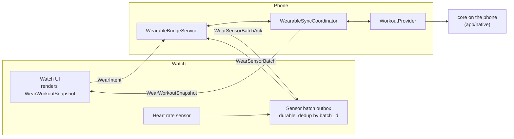
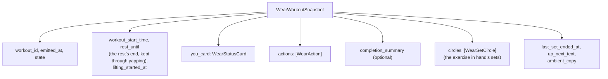
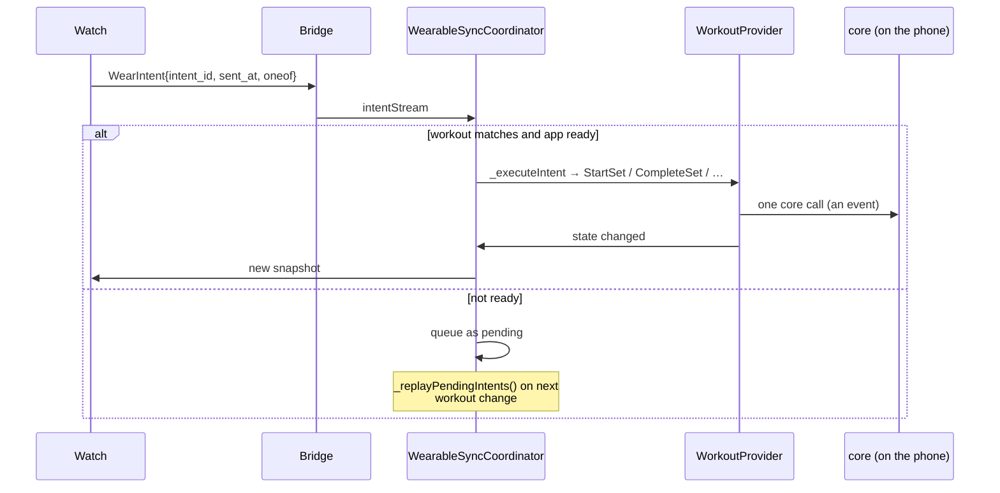
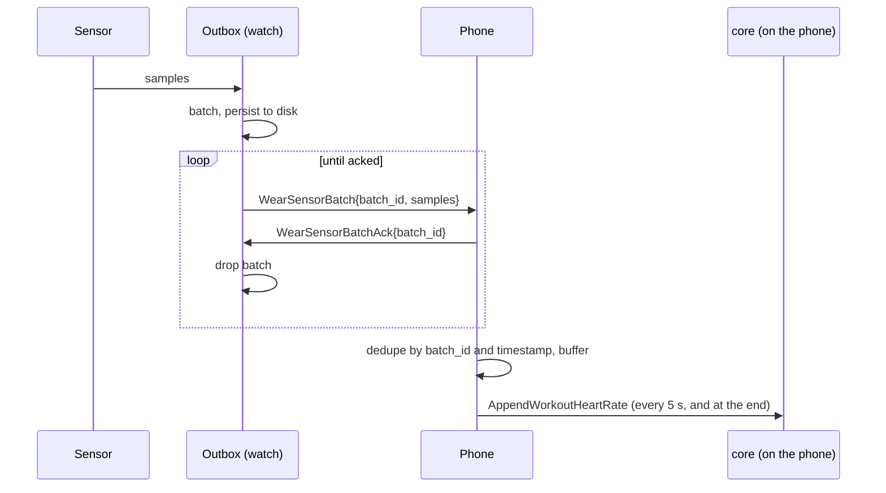

# Wearable Companions

Wear OS and Apple Watch apps act as a remote control and heart-rate sensor. They
**never talk to the backend** — everything goes through the phone, which
answers from the account it holds (see [local-first.md](local-first.md)), so
the watch works with no network as long as the phone is in reach.

## Topology



The phone is authoritative. The watch holds no workout state of its own — it
renders whatever snapshot it was last given and sends intents back.

## Transport

One abstract interface, two platform implementations:

| Platform | Transport | Native code |
|---|---|---|
| Wear OS | Data Layer API | `app/android/app/src/main/kotlin/.../wearbridge/`, `app/android/wear/` |
| watchOS | `WatchConnectivity` | `app/ios/Runner/WearBridge/`, `app/ios/SchliftWatch/` |

`WearableBridgeService` (`app/lib/services/wearable_bridge_service.dart`) is the
Dart-side abstraction; `PlatformWearableBridgeService` implements it over one
`MethodChannel` plus two `EventChannel`s (intents, sensor batches).
`NoopWearableBridgeService` is used where no watch exists, so the rest of the app
never branches on platform.

Payloads are protobuf messages from `proto/workout/v1/wearable.proto`, so the
same contract is generated for Dart, Kotlin and Swift.

## Snapshot: phone → watch

`WearWorkoutSnapshot` is a fully-rendered view model, not raw domain state:



A `WearStatusCard` carries `state_label`, `exercise_name`, `set_line`
("Set 2 of 3"), `weight_text` / `unit_text` / `reps_text` (the set in the
user's unit; the watch never formats a weight), the plates for the weight
and a `display_set` — strings the watch prints directly. Each
`WearSetCircle` is a set as the phone's circle draws it: its number and its
state (pending, next, lifting, full, short, zero, skipped). A `WearAction`
carries its own `label` and `set_id`.

This keeps watch logic minimal and means UI changes usually need no watch
release. The cost is that snapshots are chunky and must be republished on every
state change. `WearableSyncCoordinator._publishSnapshot({force})` rebuilds via
`WearableSnapshotBuilder` whenever the workout changes.

Timers are sent as **absolute Unix timestamps** (`rest_until`,
`lifting_started_at`), not durations, so the watch counts down against its own clock without drifting as
messages are delayed. When the countdown reaches zero the watch flips to
yapping on its own (pink, counting up from `rest_until`, labelled with the
snapshot's `yapping_label`) until the next snapshot arrives.

The watch has one face for every live state: the phone's status box stacked
for the wrist. From the top: the exercise's set circles, the status band
(stage, UP NEXT! when you lift next in a session, its timer; the rest drains
the band from `last_set_ended_at` to `rest_until`), the exercise and set, the
weight (tap for the plates) × the reps in the set's circle, then heart rate,
workout length and the time. A tap on any circle is a `TapSetIntent`: the
phone does what a tap on its own circle does (start, done, a rep off, undone),
so the watch knows no workout rules. The rep circle taps the set in hand.
Done (on `ALL_DONE`, with `END_WORKOUT`) and Idle (no snapshot) are their own
screens. Hardware keys (the crown) never act on the face.

Always-on draws the same face dimmed: grey lines and text on black, nothing
filled. It is redrawn about once a minute, so rest is shown in whole minutes
(the words are `ambient_copy`) and when it ends, with the redraws lined up to
the rest's minutes so the count turns over on time.

Wear OS draws it in `WearScreens.kt` (`FaceScreen`); watchOS in
`FaceScreen.swift` and `ContentView+WorkoutComplete.swift`.

## Intents: watch → phone



Intent types: `TapSetIntent` (a tap on a set's circle), `StartSetIntent`
and `CompleteSetIntent` (the rep circle when no circle is in hand),
`EndWorkoutIntent`.

Every intent carries a client-generated `intent_id` for dedupe, because the
platform transports can deliver more than once. `CompleteSetIntent` also carries
`completed_at` and `StartSetIntent` `started_at` — **the time of the tap** —
so a delayed delivery records when you actually started or finished the set,
not when the message arrived.

Intents arriving while the phone app isn't ready are queued and replayed rather
than dropped.

## Heart rate



The outbox (`WatchSensorBatchOutbox.swift`, `WearSensorBatchOutbox.kt`) is
**durable** — batches survive the watch app being killed and are retried until
acked. This is why heart-rate data survives a watch app crash mid-workout.

Sample timestamps are Unix **milliseconds** (`HeartRateSample.sampled_at`), while
most other timestamps in the system are seconds. The phone writes heart rate
into the account in batches (one `heart_rate` event per batch, not per
sample); the projected `workout_heart_rate_samples` table has a row per
sample, and the events sync to the server like any other.

`HeartRateAvailability` distinguishes `AVAILABLE` / `ACQUIRING` / `UNAVAILABLE`,
so the UI can show "finding your heart rate" rather than a misleading zero.

## Clock skew

`getWatchClockSync()` returns a `WatchClockSync` with the watch's clock reading
plus send/receive timestamps, and computes:

```
roundTripMs              = receivedAtMs - sentAtMs
estimatedPhoneMidpointMs = sentAtMs + roundTripMs / 2
deltaMs                  = watchTimeMs - estimatedPhoneMidpointMs
```

A simple midpoint estimate — it assumes a symmetric round trip. Good enough to
correct sample timestamps by a known offset; not a substitute for NTP.

## Ending a workout

Ending from the phone is the awkward case: the phone **cannot** stop the watch's
`HKWorkoutSession` directly. `endWatchWorkout(workoutId)` sends a dedicated
guaranteed-delivery command that the watch acts on. On platforms where the OS
already stops tracking reliably this is a no-op.

This is why the watch keeps a lock so that a late-arriving snapshot cannot
restart an ended session — a stale snapshot must not resurrect a workout the
user finished on their phone.

## Building and running

```bash
make watch-setup        # one-time: generate Xcode project bits
make watch-build        # build the watchOS app
make watch-sim          # run in the watch simulator
make run-wear           # Wear OS on a connected device/emulator
make run-wear-logs      # tail Wear OS logs
```

Wear OS emulator pairing is fiddly under WSL2 — see
[`docs/android_dev.md`](../android_dev.md).

Regenerate wearable protos for the native sides after editing the proto:

```bash
make proto-android      # Java for Wear OS
make proto-swift        # Swift for watchOS
```
