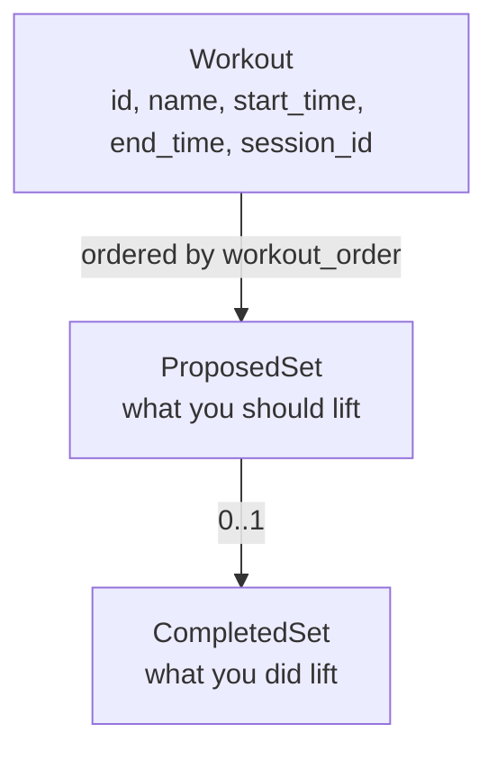
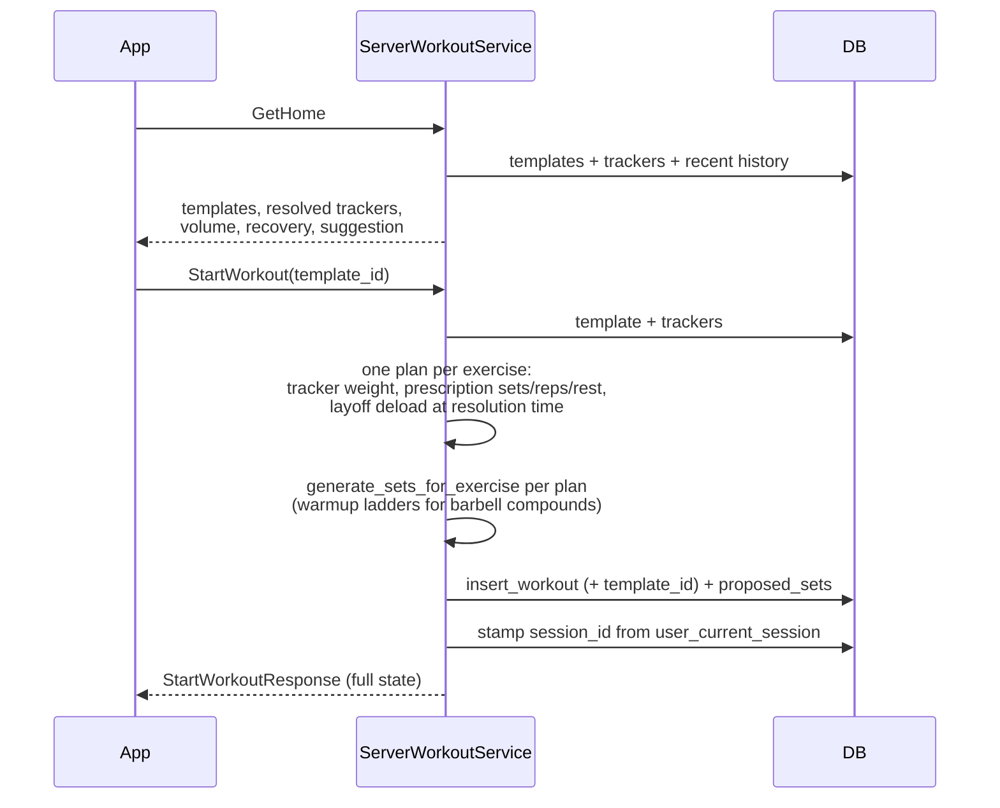
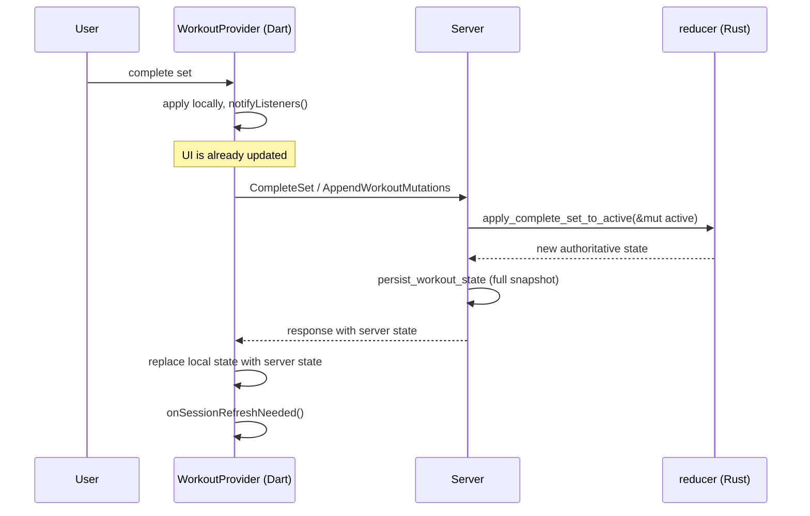
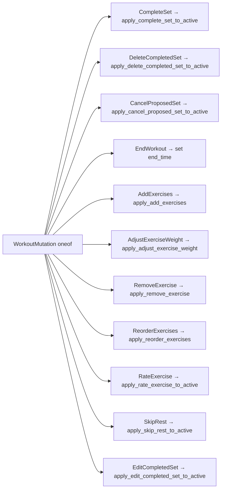
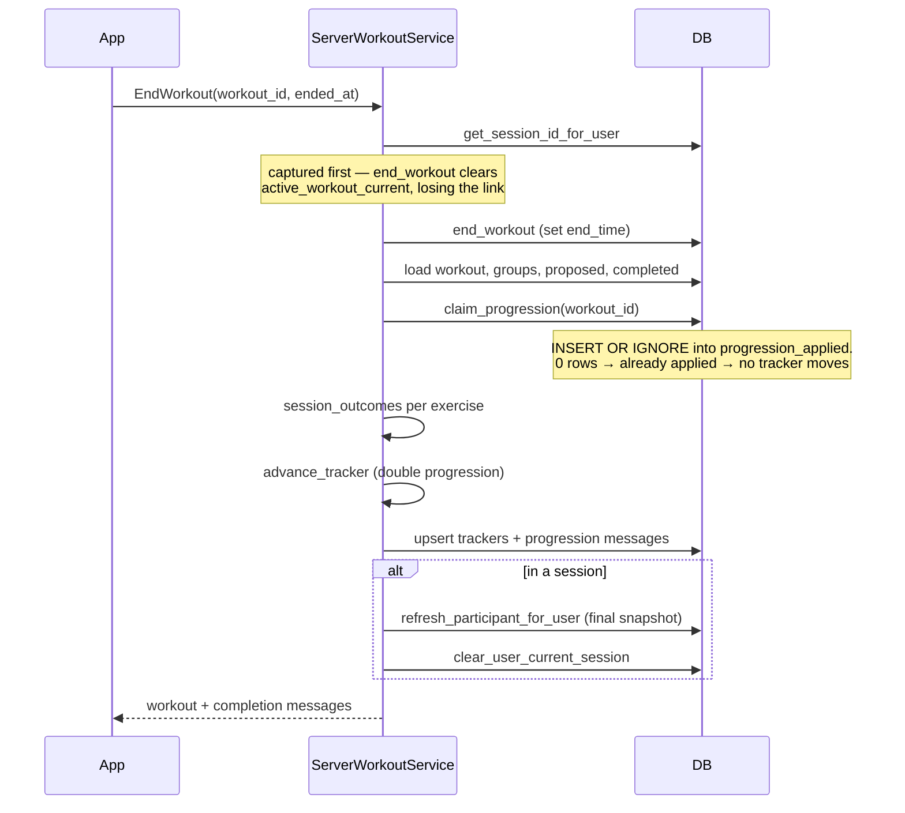

# Workout Lifecycle

This is where most of the system's complexity lives. A workout goes from a
*template* (an ordered exercise list) to an *active workout* (what you're
actually doing) to a *completed workout* (which advances the trackers).

## The loop

The cycle closes on `EndWorkout`: each exercise's outcome advances its
tracker, and the next start from any template resolves the new numbers.

## Objects

A workout is an ordered flat list of `ProposedSet`s; each set carries its
exercise. "The sets for one exercise" is a *derived* block (grouped by
exercise), computed where a card or sheet needs it — never stored. There is
no group or superset structure.

`generate_sets_for_exercise` (`src/workout/planning.rs`) prescribes one
exercise's block: the warmup ladder (where prescribed) then the working
sets.

## Set state machine

A set is pending, lifting, done or cancelled (an exercise removed
mid-workout). There is no status enum:
state is derived from which rows exist and from the workout's one lifting
marker (`Workout.lifting_set_id` / `lifting_started_at`).

On the phone a set is a **circle** with a number in it (StrongLifts' whole
interface): tap the up-next circle to start the set, tap it again when it
is done (every rep), and once more for each rep missed. The tap after zero
undoes the set. A finding-weight rung stops at zero instead, since the plan
it settled hangs off it.

```mermaid
stateDiagram-v2
    [*] --> Pending: generate_sets_for_exercise
    Pending --> Lifting: StartSet<br/>(sets the workout's lifting marker)
    Lifting --> Done: CompleteSet<br/>(inserts CompletedSet: started_at, ended_at, rest_until; clears the marker)
    Pending --> Done: CompleteSet<br/>(never started: started_at = 0)
    Done --> Done: EditCompletedSet<br/>(a tap per missed rep; rest recomputed)
    Done --> Done: RateExercise<br/>(a rung's "how many were left")
    Pending --> Cancelled: RemoveExercise<br/>(its undone sets, soft delete)
    Done --> Pending: DeleteCompletedSet<br/>(the tap after zero)
    Done --> [*]
    Cancelled --> [*]
```

| State | How you detect it |
|---|---|
| Pending | `ProposedSet` exists, `cancelled = 0`, no matching `CompletedSet` |
| Lifting | `Workout.lifting_set_id` names it and it isn't done |
| Done | Matching `CompletedSet` |
| Cancelled | `ProposedSet.cancelled = 1` |

The workout's state comes from the lifting marker, then from one moment —
when the last set was done — and that set's prescribed rest:

| State | When | Timer |
|---|---|---|
| **Ready** | No set done yet: the first set is up | none |
| **Lifting** | A set is started and not done | counts up from `lifting_started_at` (orange) |
| **Resting** | The last done set's rest is still running | counts down to `rest_until` (blue) |
| **Yapping** | That rest has run out; the next set isn't started | counts up from `rest_until` (pink) |
| **All done** | Nothing left to do | none |

The reducer's `workout_state_snapshot` derives this plus the
`effort_prompt`; the app mirrors it offline (`WorkoutProvider`) and re-derives
when a rest runs out, so resting turns into yapping on the device clock. The
snapshot keeps `rest_until` through yapping so the count-up survives a reload.
The summary splits the time between sets three ways
(`compute_workout_summary`): `lifting_seconds` from each start to its Done,
`resting_seconds` for the prescribed rest, `yapping_seconds` from the rest's
end to the next set's start. The completed screen shows them, and the
heart-rate chart shades yapping pink.

Any set can be done in any order, and warmups are never removed. An
undone warmup is behind you (`is_passed_warmup`) once it is skipped —
"Skip" on the warmup row sends `SkipWarmups`, which sets `ProposedSet.skipped` on
the exercise's undone warmups — or once one of the exercise's working sets
is done. They stay in the plan, but nothing
waits on them: they are not up next, they don't keep the exercise open (the
last working set still gets the short end-of-exercise rest), and they don't
hold the workout off ALL_DONE. Up next (`compute_next_up_set`) carries on
with the exercise of the latest done set while it has sets left, then the
first open set in plan order.

Each exercise's header shows what it's set to (weight × reps) and a pencil
for its sheet. Changing weight or reps there applies to the rest of the
workout (`AdjustExerciseWeight`, with `target_reps`) and to the account's
tracker (`SetExerciseTracker`, with `target_reps`), so next time starts from
it too. An exercise already in the workout can't be added again.

The live workout page lists every exercise full width, its sets as
circles in two rows, labelled down the left edge: WARMUP, ending in "Skip"
while any is open, and WORKING. A warmup behind you shows as a
dash and can still be done. Up next is always the rule above, the same on
the server and the phone; the way to do a different set is to start it (the
lifting marker is the server's record of the choice). Unfinished exercises drag into a new order. The banner under
it has no buttons: a status box per partner (three in view, the rest
scroll) and yours at the bottom. During an account's first workout a line
on top says what to tap next (`FirstWorkout`, per account on the device).

### Effort and calibration

Working sets are not rated in the app: progression reads the reps
(`advance_tracker`'s double progression — all reps on every set moves the
weight or the rep target, a miss repeats, three hard sessions running is a
planned 10% deload). The reducer still opens `effort_prompt` after a
working set; unanswered, it resolves to *right* at the next mutation
(`resolve_stale_effort`) or at `EndWorkout`.

A loaded exercise with no performed history starts as a **calibration
ramp** instead of a warmup ladder plus working sets: one 5-rep rung
(`ProposedSet.calibration = 1`) at the catalog opener (or 60% of the
onboarding seed). After each rung the app asks how many more reps were in
the tank — 0–1 (hard), 2–3 (right), 4+ (easy) — and the answer decides what
is appended (`record_effort`): 4+ adds the next rung, 2–3 makes this the
working weight, 0–1 takes the previous rung; then the prescription's
working sets minus one. Six rungs is the cap. On a watch the rung's finish
is the answer: three Done buttons, each carrying it as
`CompleteSetRequest.effort`. Rungs count as warmups for volume and
summaries. The design record is
[`docs/plans/one-tap-sets.md`](../plans/one-tap-sets.md).

## Starting a workout

A start with an explicit `exercises` list (the "empty workout" path) runs
through the same prescription; mid-workout changes go through the four
per-exercise ops: `AddExercises`, `AdjustExerciseWeight`, `RemoveExercise`,
`ReorderExercises`.

## Optimistic mutations

The app does not wait for the server to update the UI. `WorkoutProvider` keeps a
local `ActiveWorkout`, applies the same transition the server will apply, and
reconciles when the response lands.

The same logical transition therefore exists **twice**: in Rust
(`src/workout/reducer.rs`) and in Dart (`WorkoutProvider`). They must agree. If
they diverge, the UI flickers as the optimistic result is replaced by a
different server result.

### Batched mutations

`AppendWorkoutMutations` takes a list of mutations and applies them in order —
used when the app has been offline or has queued watch intents.

Every mutation first runs `resolve_stale_effort` against its own timestamp,
so an unanswered question never outlives the rest it belonged to.

Each mutation carries a client-generated `event_id` for dedupe and an optional
`client_created_at` so a queued action keeps its original timestamp rather than
the time it was flushed.

After applying mutations the server calls `persist_workout_state`, which writes
the whole workout back rather than diffing. Simple, and it means a partial
failure can't leave half-applied state — at the cost of rewriting every row on
every set.

## Ending a workout

Two ordering constraints worth knowing, both already commented in the source:

1. **Session id is read before `end_workout`**, because ending the workout
   deletes `active_workout_current` and the session link becomes unreachable.
2. **The participant blob is refreshed before leaving the session**, so peers
   still polling see your finished workout rather than a cleared slot.

Progression is idempotent via the `progression_applied` ledger — a retried
`EndWorkout` cannot move a tracker twice. Covered by
`end_workout_is_idempotent` in `src/server/workout_tests.rs` and a fuzz
invariant.

## Crash recovery

There is no event replay. On reconnect the app calls `GetActiveWorkout`, which
looks up `active_workout_current` and reloads the full workout with
`load_workout_full`. State survives because every mutation persists a complete
snapshot.

Every `ProposedSet` field is persisted, so recovery is lossless.

## Where the logic lives

| Concern | File |
|---|---|
| Warmup generation, plate snapping | `src/workout/planning.rs` |
| State transitions | `src/workout/reducer.rs` |
| Next-up-set derivation | `src/progress.rs` |
| Prescription + progression + volume | `src/exercise_catalog.rs`, `src/exercise_progress.rs`, `src/volume.rs` |
| Client-side mirror of all the above | `app/lib/providers/workout_provider.dart`, `app/lib/logic/` |
