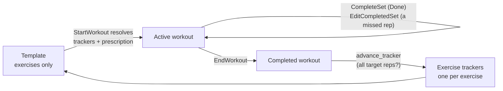
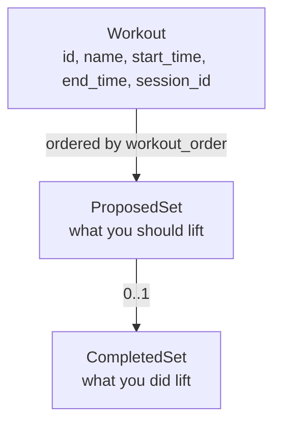
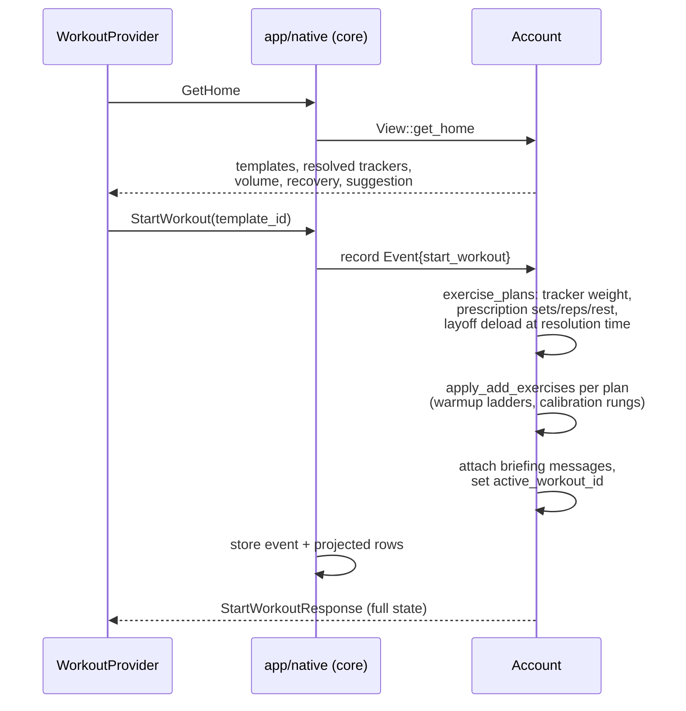
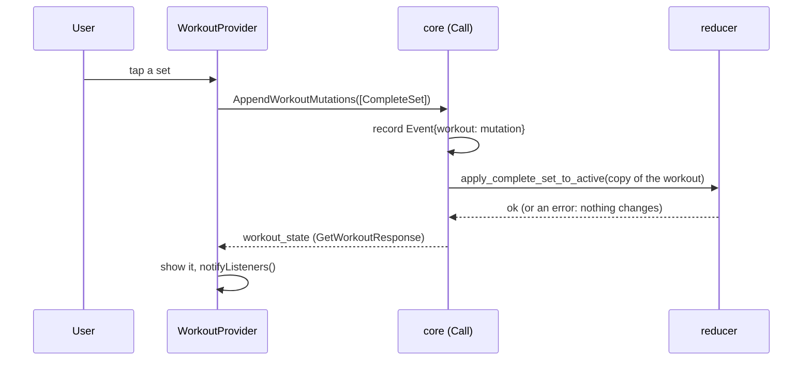
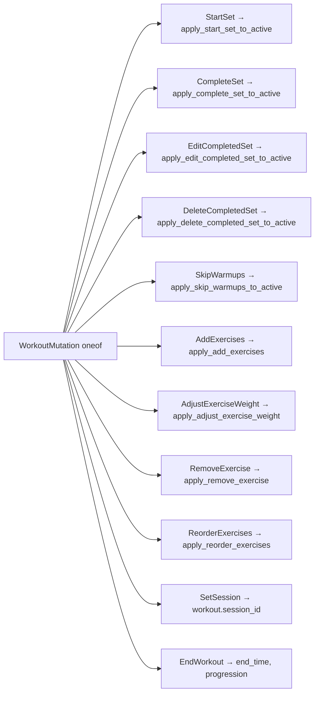
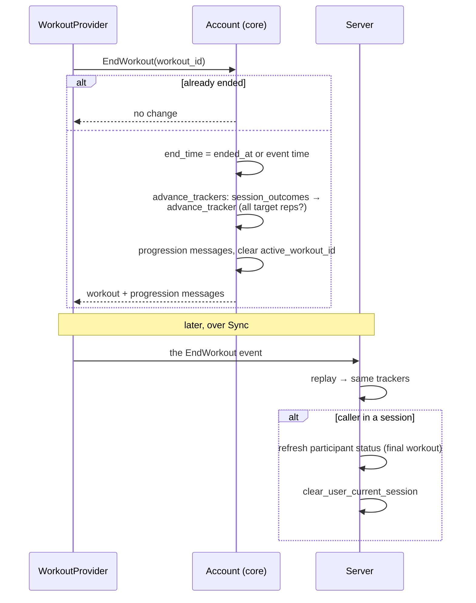

# Workout Lifecycle

This is where most of the system's complexity lives. A workout goes from a
*template* (an ordered exercise list) to an *active workout* (what you're
actually doing) to a *completed workout* (which advances the trackers).

All of it runs in the core (`core/`) on the phone: each step is an event in
the account's log, applied by `Account::apply` (`core/src/account.rs`), and
the server replays the same events with the same code when they sync. See
[local-first.md](local-first.md).

## The loop

The cycle closes on `EndWorkout`: each exercise's outcome advances its
tracker, and the next start from any template resolves the new numbers.

## Objects

A workout is an ordered flat list of `ProposedSet`s; each set carries its
exercise. "The sets for one exercise" is a *derived* block (grouped by
exercise), computed where a card or sheet needs it — never stored. There is
no group or superset structure.

`generate_sets_for_exercise` (`core/src/workout/planning.rs`) prescribes one
exercise's block: the warmup ladder (where prescribed) then the working
sets.

## Set state machine

A set is pending, lifting, done or cancelled (an exercise removed
mid-workout). There is no status enum:
state is derived from which rows exist and from the workout's one lifting
marker (`Workout.lifting_set_id` / `lifting_started_at`).

On the phone a set is a **circle** with a number in it (StrongLifts' whole
interface): tap the up-next circle to start the set, tap it again when it
is done (every rep), and once more for each rep missed. The tap after zero
undoes the set. A finding-weight rung stops at zero instead, since the plan
it settled hangs off it.

```mermaid
stateDiagram-v2
    [*] --> Pending: generate_sets_for_exercise
    Pending --> Lifting: StartSet<br/>(sets the workout's lifting marker)
    Lifting --> Done: CompleteSet<br/>(inserts CompletedSet: started_at, ended_at, rest_until; clears the marker)
    Pending --> Done: CompleteSet<br/>(never started: started_at = 0)
    Done --> Done: EditCompletedSet<br/>(a tap per missed rep; rest recomputed)
    Pending --> Cancelled: RemoveExercise<br/>(its undone sets, soft delete)
    Done --> Pending: DeleteCompletedSet<br/>(the tap after zero)
    Done --> [*]
    Cancelled --> [*]
```

| State | How you detect it |
|---|---|
| Pending | `ProposedSet` exists, `cancelled = 0`, no matching `CompletedSet` |
| Lifting | `Workout.lifting_set_id` names it and it isn't done |
| Done | Matching `CompletedSet` |
| Cancelled | `ProposedSet.cancelled = 1` |

The workout's state comes from the lifting marker, then from one moment —
when the last set was done — and that set's prescribed rest:

| State | When | Timer |
|---|---|---|
| **Ready** | No set done yet: the first set is up | none |
| **Lifting** | A set is started and not done | counts up from `lifting_started_at` (orange) |
| **Resting** | The last done set's rest is still running | counts down to `rest_until` (blue) |
| **Yapping** | That rest has run out; the next set isn't started | counts up from `rest_until` (pink) |
| **All done** | Nothing left to do | none |

The reducer's `workout_state_snapshot` derives this (its `effort_prompt` is
retired and always empty). A snapshot is one instant, so when the rest it shows runs
out `WorkoutProvider` asks the core again (`_reloadWhenRestEnds`), and
resting turns into yapping on the device clock. The
snapshot keeps `rest_until` through yapping so the count-up survives a reload.
The summary splits the time between sets three ways
(`compute_workout_summary`): `lifting_seconds` from each start to its Done,
`resting_seconds` for the prescribed rest, `yapping_seconds` from the rest's
end to the next set's start. The completed screen shows them, and the
heart-rate chart shades yapping pink.

Any set can be done in any order, and warmups are never removed. An
undone warmup is behind you (`is_passed_warmup`) once it is skipped —
"Skip" on the warmup row sends `SkipWarmups`, which sets `ProposedSet.skipped` on
the exercise's undone warmups — or once one of the exercise's working sets
is done. They stay in the plan, but nothing
waits on them: they are not up next, they don't keep the exercise open (the
last working set still gets the short end-of-exercise rest), and they don't
hold the workout off ALL_DONE. Up next (`compute_next_up_set`) is the
first open set in plan order: the order is the person's (they drag
exercises into it), so whatever is on top is next.

Each exercise's header shows what it's set to (weight × reps) and a pencil
for its sheet. Changing weight or reps there applies to the rest of the
workout (`AdjustExerciseWeight`, with `target_reps`) and to the account's
tracker (`SetExerciseTracker`, with `target_reps`), so next time starts from
it too. An exercise already in the workout can't be added again.

The live workout page lists every exercise full width, its sets as
circles in two rows, labelled down the left edge: WARMUP, ending in "Skip"
while any is open, and WORKING. A warmup behind you shows as a
dash and can still be done. Up next is always the rule above, computed by
the core; the way to do a different set is to start it (the lifting marker
is the account's record of the choice). Unfinished exercises drag into a new order. The banner under
it has no buttons: a status box per partner (three in view, the rest
scroll) and yours at the bottom. During an account's first workout a line
on top says what to tap next (`FirstWorkout`, per account on the device).

### Progression and calibration

Nothing is rated. One signal drives everything: did every working set hit
its target reps (`core/src/exercise_progress.rs`, which has the full table
and the sources).

| Class | Prescription | Progression |
|---|---|---|
| Barbell compounds | 5×5 (deadlift 3×5) | every rep → one step up next time |
| Other loaded work | 3×8–12 | every rep → rep target +1; at 12 → one step up, back to 8 |
| Bodyweight | 3×5–15 | every rep → rep target +1 |
| Core | 3×10–20 | as other loaded work |

A missed rep holds weight and target; three missed sessions running take
the weight down 10% (`MISSES_BEFORE_DELOAD`). Time away from an exercise
lowers the weight offered at the next start — 90% after 3 weeks, 80% after
6 (Bosquet et al. 2013) — without writing the tracker
(`layoff_adjusted_weight`). A barbell never goes under the empty bar.

A loaded exercise with no performed history starts as a **calibration
ramp** instead of a warmup ladder plus working sets: one 5-rep rung
(`ProposedSet.calibration = 1`) at the catalog opener (or 60% of the
onboarding seed). Its Done decides what is appended (`would_append`): all
five reps adds the next rung, about 10% heavier (at least one step); a
missed rep, or the sixth rung, appends the full prescription of working
sets at 90% of the heaviest rung done in full
(`CALIBRATION_SETTLE_FRACTION`). Tapping a rep off a rung re-settles it
while what it appended is still untouched (`resettle_rung`). Rungs count
as warmups for volume and summaries. `RateExercise` from an old app is
accepted and does nothing.

## Starting a workout

The workout's id is the event's id, and every set id derives from it
(`core/src/ids.rs`), so the server's replay builds the same workout. A start
with an explicit `exercises` list (the "empty workout" path) runs through the
same prescription; mid-workout changes go through the four per-exercise ops:
`AddExercises`, `AdjustExerciseWeight`, `RemoveExercise`, `ReorderExercises`.

## Every change is an event

`WorkoutProvider` holds no rules. Each action is one call into the core, and
what's on screen is the core's answer:

`Account::mutate_workout` changes a copy of the workout and puts it back only
if the whole mutation applied, so an event is all or nothing. A batch
(`AppendWorkoutMutations` with several) records one event per mutation; one
that can't apply is skipped and the rest still land.

Times come from the event (`at`, the phone's clock when it was made), or from
the request where it carries one (`CompleteSetRequest.completed_at`, a watch
tap's time). The fold never reads a clock.

## Ending a workout

Progression runs once: an `EndWorkout` on a workout that already has an
`end_time` changes nothing, so a repeated end cannot move a tracker twice.
The fuzzer checks this (`a re-fired EndWorkout moved a tracker`).

On the server, the participant status is rebuilt with the just-ended
workout before the user leaves the session, so partners keep seeing the
finished workout rather than an empty slot.

## Crash recovery

A write is in the account file before the app is answered. On a restart the
phone folds the file's log back into the account, and `GetActiveWorkout`
answers from it. Nothing depends on the network: an app killed mid-set
reopens on the same set, synced or not.

## Where the logic lives

| Concern | File |
|---|---|
| Warmup generation, plate snapping | `core/src/workout/planning.rs` |
| State transitions | `core/src/workout/reducer.rs` |
| Next-up-set derivation | `core/src/progress.rs` |
| Prescription + progression + volume | `core/src/exercise_catalog.rs`, `core/src/exercise_progress.rs`, `core/src/volume.rs` |
| Events, start, end, progression, messages | `core/src/account.rs`, `core/src/messages.rs` |
| The RPCs the app calls | `core/src/api.rs` |
| Showing it | `app/lib/providers/workout_provider.dart` (no rules) |
