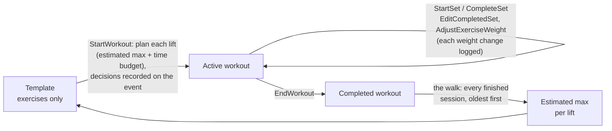
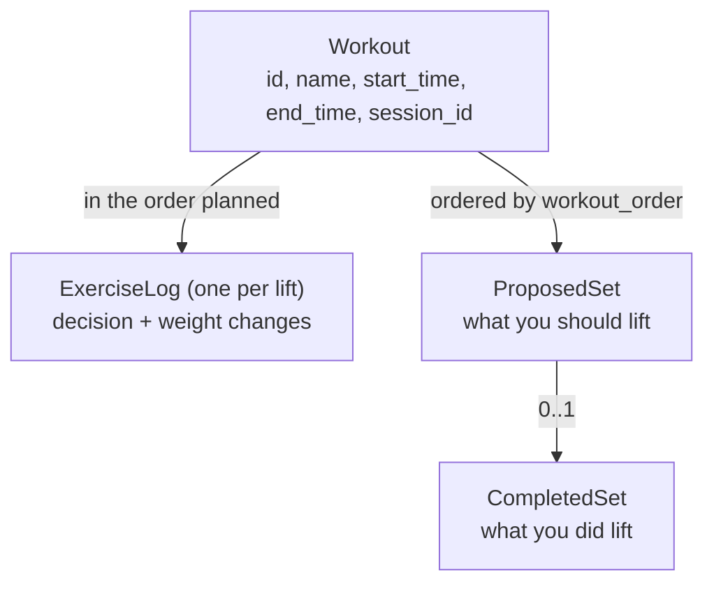
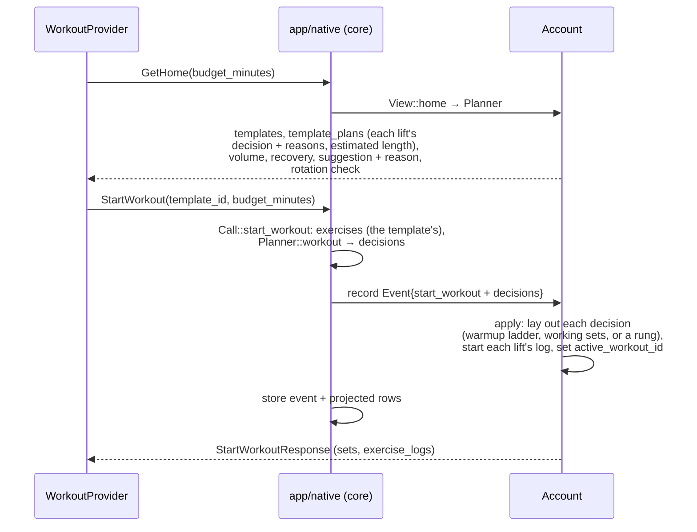
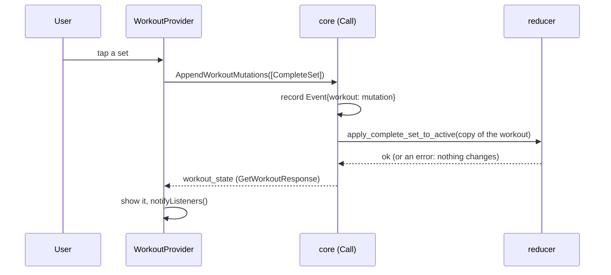
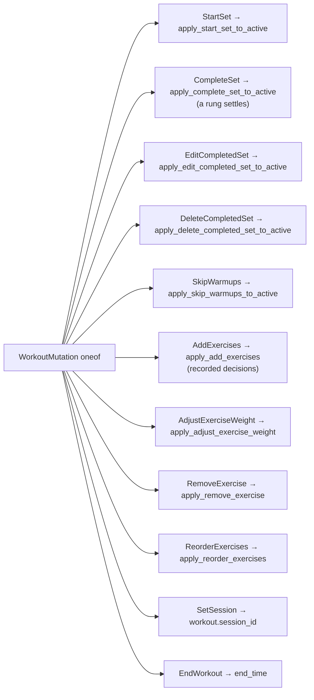
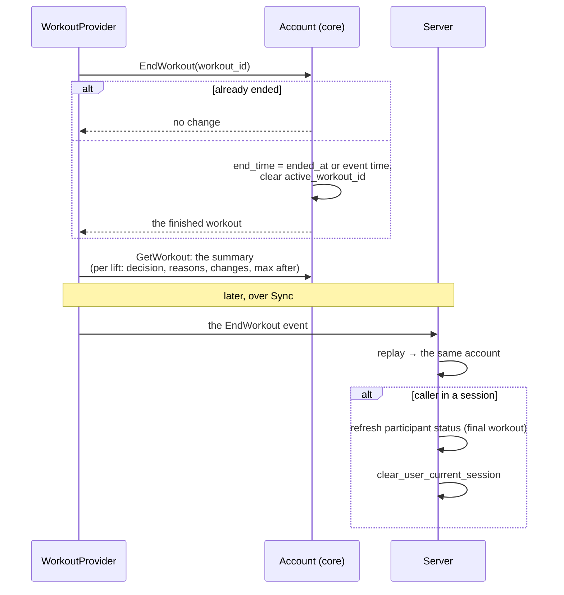

# Workout Lifecycle

This is where most of the system's complexity lives. A workout goes from a
*template* (an ordered exercise list) to an *active workout*, planned in
full the moment it starts, to a *completed workout*, which the next plan
reads.

All of it runs in the core (`core/`) on the phone: each step is an event in
the account's log, applied by `Account::apply` (`core/src/account.rs`), and
the server replays the same events with the same code when they sync. See
[local-first.md](local-first.md).

## The loop

Nothing is stored between workouts but the workouts themselves (and the
user's overrides). When a workout starts, `core/src/plan.rs` walks each
lift's finished sessions to its estimated max and plans the lift from it,
in the time the user has. The full rules, with their sources, are in
[`docs/plans/planned-at-start.md`](../plans/planned-at-start.md).

## Objects

A workout is an ordered flat list of `ProposedSet`s; each set carries its
exercise. "The sets for one exercise" is a *derived* block (grouped by
exercise), computed where a card or sheet needs it — never stored. There is
no group or superset structure. A workout has each lift once.

Beside the sets, each lift has an `ExerciseLog`: the `ExerciseDecision` it
was laid out from (sets, reps, weight, rest, warmups, rep range, the max it
was planned from, the budget, its estimated seconds and the reasons), then
every `WeightChange` since. `block_sets` (`core/src/workout/planning.rs`)
lays a decision out: the warmup ladder (heavy lifts) then the working sets,
or a calibration ramp's first rung.

## Planning a workout

`Planner` (`core/src/plan.rs`) gathers the account's history once and plans
any number of lifts at one moment. It is pure: the same account, time and
budget always give the same decisions.

### Each lift's estimated max

Every lift has an **estimated max**, the most the user could lift once (for
a bodyweight lift a **rep max**, the most reps in one set). The **walk**
works it out from the lift's finished sessions in order
(`session_outcomes` in `core/src/exercise_progress.rs` reduces a workout to
what each lift did). A set shows the Epley estimate with one rep in reserve
when it hit its target (none when it fell short) and half a rep of fatigue
for each set before it.

| Session | The max after it |
|---|---|
| every working rep hit | the higher of the max before and what the session shows with one more rep on every set |
| a rep missed | the most any working set shows, never more than the max before |
| stopped early | unchanged |
| a miss rushed | unchanged |

A session **stopped early** when working sets of that lift were left
undone: the lift was removed, or the workout ended first. A miss done
before the previous set's rest had run out is **rushed** (`rushed` on
`SessionOutcome`): excused, left out of the sets judged, and the max
holds; every set was still done, so it is not stopping early. A lighter
weight the user chose shows less than the max, so it holds it.

**Time off** comes from the gap between sessions: 21 days or more since the
lift was last done cuts the max to 90%, 42 or more to 80%. Inside the walk
it is the gap to the next session; at the start of a workout, the gap to
now, recorded in the decision (`TIME_OFF`).

An **override** (the template editor's sheet: a weight and reps, and
optionally sets; `SetOverride`) is converted to the max that prescribes it
and takes its place in the walk by time: a new starting point the sessions
after it build on. Until a session follows it, the lift is planned exactly
as set (the max from its sets, or from 3 when it names none). Reps of 0
removes it. A bodyweight lift can carry weight through an override.

A lift **never done** starts from its starting weight (the strength slider
at onboarding, or imported history) and runs the calibration ramp (below).
A bodyweight lift never done starts at the bottom of its range.

### Classes, sets, reps and weight

| Class | Lifts | Reps | Rest | Warmups |
|---|---|---|---|---|
| Heavy | barbell compounds | 5–8 | 3:00 | 40/55/70/85% ladder |
| Standard | every other loaded lift | 8–12 | 2:00 | none |
| Bodyweight | bodyweight lifts and core | 5–15 | 1:30 | none |

(`lift_class` / `class_rules` in `core/src/exercise_catalog.rs`.)

**Sets come from the time budget** (60 minutes by default, changed in
5-minute steps on Home before starting). Every lift gets 2 sets; then one
set at a time, up to 5, to the lift whose primary muscle is furthest below
10 hard sets this week counting the sets planned so far (ties to the
earlier lift), until the lift that should get the next set doesn't fit
(`allocate`). Sets an override names are kept as they are. If two sets
each don't fit, Home says how long the workout needs instead.

Each template plan also carries **the longest it gets** (`max_seconds`):
the same costs with every lift whose sets are the budget's to give at 5,
fixed sets as they are (`Planner::max_seconds`). When the budget is at or
past it, more time buys nothing: Home's card says so beside the estimate
and turns + off. The budget is shared by every template and is not moved
when the selection changes; the card shows the selected template's cap.

What things cost (`Costs`): a working set 40 s plus its class's rest, a
heavy lift's warmups 4 minutes, moving between lifts 2 minutes — or the
user's own medians over the last four weeks once there are ten samples of a
kind, learned from set timestamps. A lift's `estimated_seconds` is its own
share: its sets, its warmups or ramp, and the move to it.

**Reps and weight come from the max** (`choose`): stay at the last weight
for as many reps as the max covers there; past the top of the range, one
weight step up; short of the bottom, the heaviest weight the max covers at
the bottom; with no last weight (after the ramp, an override, time off),
the heaviest weight the max covers at the bottom. Weights snap to what can
be loaded (plate maths, the equipment's steps, never under the empty bar).

### The decision and its reasons

Each `ExerciseDecision` carries its `reasons`. The first compares the plan
with the lift's last session, in the terms the user sees — the weight and
reps — whenever there is a last session to compare with (not after an
override, or when the last session was a ramp alone):

| Reason | When |
|---|---|
| `WEIGHT_UP` / `WEIGHT_DOWN` | Heavier or lighter than last time (`before`, `after`: the weights) |
| `REPS_UP` / `REPS_DOWN` | The same weight, more or fewer reps |
| `SAME_AS_LAST` | The same weight and reps |

with its `cause`: every rep hit (`HIT`), a rep missed (`MISSED`), stopped
early (`STOPPED_EARLY`), a rushed miss (`RUSHED`), time off (`TIME_OFF`),
or the number of sets (`SETS`, when last time's number of sets would have
moved the plan another way — more sets making it lighter, say — or when
the max held after stopping early or a rushed miss and the plan moved
anyway, which only the sets can have done), and last time's reps and sets
beside this plan's. The steps that set the max follow, in the order they
applied:

| Reason | When |
|---|---|
| `MAX_UP` | Every rep last time: the max nudged up |
| `MAX_FROM_MISS` | A missed set reset the max to what it showed (names the set) |
| `HELD` | Stopped early or a rushed miss (`cause` says which), or the user lowered the weight |
| `TIME_OFF` | 3 or 6 weeks away: the max cut (days off) |
| `FIRST_TIME` | Never done: the ramp finds the max |
| `USER_SET` | The user's own weight and reps, from when they set it |
| `SETS_FROM_TIME` | This many sets: the budget, and which muscles are behind |

Screens lead with the comparison, so the line beside a weight says why
that weight moved; a `HELD` max is not shown beside a weight that moved
(`app/lib/logic/plan_text.dart`).

Home, the template editor and the exercise page show the same decisions:
`GetHome` plans every lift (`plans`, each lift on its own) and every
template (`template_plans`, with the workout's estimated length and the
longest it gets) at now in
the chosen budget, exactly as a start at that moment would record them.
The template editor plans the list on screen the same way
(`GetTemplatePlan`), so a saved template reads as its Home card does.

## Picking a workout: the rotation and the suggestion

Every template is either **in rotation** (`WorkoutTemplate.in_rotation`)
or a **favourite**. The workouts picked at onboarding start in rotation;
a library template added later, or one the user makes, starts as a
favourite. The template editor's switch and the Home card's menu move a
template between the two; it is saved through `SaveTemplate`, and a
library template saved only to change this keeps following the library.
Home shows the rotation's chips first and the favourites after a divider.

`GetHome` suggests one rotation template (`core/src/volume.rs`,
`suggest_template`), fresh each time from history, never stored:

1. A muscle has **recovered** when its window has passed since the start
   of the last workout that trained it (`core/src/recovery.rs`: 48 h for
   chest, back, quads, hamstrings and glutes, 36 h for shoulders and arms,
   24 h for calves and core). Home's recovery chips read the same.
2. A template whose first lift's primary muscle is still recovering is
   left out.
3. A template's score is the sum, over its distinct primary muscles that
   have recovered, of how far each is below 10 hard sets this week.
4. Every template within 20% of the best score is tied. The tie goes to
   the template started least recently (never started first).
5. When no template left in scores above 0, the suggestion is the one
   started least recently (the **fallback**). When every rotation
   template is left out, it is the one whose first lift's muscle recovers
   soonest (`first_lift_recovering`).

Favourites are never suggested; with nothing in rotation there is no
suggestion. The answer is structured (`SuggestionReason`): the suggested
template's rested muscles that are behind (sets this week, target), the
muscles the rotation trains that are behind but still recovering (hours
left), whether it is the fallback, and the first lift's muscle when every
template was left out. Home words it under the template's name
(`app/lib/logic/rotation_text.dart`).

The score adds muscles up, so a short template whose muscles a bigger one
also trains (StrongLifts A inside Full Body, StrongLifts B beside Lower)
seldom comes within 20% of it and can go weeks unsuggested; the rotation
check's overlap warning names a pair that shares most of its lifts.

`GetHome` also checks the rotation (`core/src/rotation.rs`,
`RotationCheck`): one lap of it, each template once at three working sets
a lift, counted as the week is (primary 1.0, secondary 0.5). Three sets a
lift, not the planner's, so the check describes the rotation and not this
week's history or budget. It warns of a **gap** (a muscle nothing in
rotation trains), an **overlap** (two templates sharing over 70% of the
smaller one's lifts) and **too few** (under two templates in rotation). The Edit sheet shows the lap's bars and the warnings.

## Starting a workout

The decisions are made once, when the event is recorded, and the event
carries them. Folding it lays the sets out from the decisions alone; it
never runs the planner, so a change to the rules never changes a workout
already started, and the server's replay builds exactly the phone's
workout. A start or an add that names a lift without its decision is
refused.

The workout's id is the event's id, and every set id derives from it
(`core/src/ids.rs`). A start with an explicit `exercises` list (the "empty
workout" path) is planned the same way. Mid-workout changes go through the
four per-exercise ops: `AddExercises` (the added lifts planned in the
workout's budget around the lifts still in it, which keep their
decisions), `AdjustExerciseWeight`, `RemoveExercise`, `ReorderExercises`.

## During the workout

### Set state machine

A set is pending, lifting, done or cancelled (an exercise removed
mid-workout). There is no status enum: state is derived from which rows
exist and from the workout's one lifting marker (`Workout.lifting_set_id` /
`lifting_started_at`).

On the phone a set is a **circle** with a number in it: tap the up-next
circle to start the set, tap it again when it is done (every rep), and once
more for each rep missed. The tap after zero undoes the set. A calibration
rung stops at zero instead, since what it appended hangs off it.

```mermaid
stateDiagram-v2
    [*] --> Pending: laid out from the decision
    Pending --> Lifting: StartSet<br/>(sets the workout's lifting marker)
    Lifting --> Done: CompleteSet<br/>(inserts CompletedSet: started_at, ended_at, rest_until; clears the marker)
    Pending --> Done: CompleteSet<br/>(never started: started_at = 0)
    Done --> Done: EditCompletedSet<br/>(a tap per missed rep; rest recomputed)
    Pending --> Cancelled: RemoveExercise<br/>(its undone sets, soft delete)
    Done --> Pending: DeleteCompletedSet<br/>(the tap after zero)
    Done --> [*]
    Cancelled --> [*]
```

| State | How you detect it |
|---|---|
| Pending | `ProposedSet` exists, `cancelled = 0`, no matching `CompletedSet` |
| Lifting | `Workout.lifting_set_id` names it and it isn't done |
| Done | Matching `CompletedSet` |
| Cancelled | `ProposedSet.cancelled = 1` |

The workout's state comes from the lifting marker, then from one moment —
when the last set was done — and that set's rest:

| State | When | Timer |
|---|---|---|
| **Ready** | No set done yet: the first set is up | none |
| **Lifting** | A set is started and not done | counts up from `lifting_started_at` (orange) |
| **Resting** | The last done set's rest is still running | counts down to `rest_until` (blue) |
| **Yapping** | That rest has run out; the next set isn't started | counts up from `rest_until` (pink) |
| **All done** | Nothing left to do | none |

The reducer's `workout_state_snapshot` derives this. A snapshot is one
instant, so when the rest it shows runs out `WorkoutProvider` asks the core
again (`_reloadWhenRestEnds`), and resting turns into yapping on the device
clock. The snapshot keeps `rest_until` through yapping so the count-up
survives a reload. The summary splits the time between sets three ways
(`compute_workout_summary`): `lifting_seconds` from each start to its Done,
`resting_seconds` for the set's rest, `yapping_seconds` from the rest's end
to the next set's start. The completed screen shows them, and the
heart-rate chart shades yapping pink.

Any set can be done in any order, and warmups are never removed. An
undone warmup is behind you (`is_passed_warmup`) once it is skipped —
"Skip" on the warmup row sends `SkipWarmups`, which sets
`ProposedSet.skipped` on the exercise's undone warmups — or once one of the
exercise's working sets is done. They stay in the plan, but nothing waits
on them: they are not up next, they don't keep the exercise open (the last
working set still gets the short end-of-exercise rest), and they don't hold
the workout off ALL_DONE. Up next (`compute_next_up_set`) is the first open
set in plan order: the order is the person's (they drag exercises into it),
so whatever is on top is next.

### The weight log

Each lift's log records every change to its weight, with its cause:

| Cause | Made by |
|---|---|
| `USER_ADJUST` | The user changed it, on the phone or the watch (`AdjustExerciseWeight`, or a weight typed during the ramp) |
| `CALIBRATION_STEP` | The ramp's next rung |
| `CALIBRATION_SETTLED` | The ramp done: the working weight set |
| `CORRECTION` | A logged set fixed (`EditCompletedSet` with a different weight) |

Weight never drops during a workout on its own. Someone who misses reps
rests and tries again; someone who is cooked lowers the weight.

Each exercise's header shows what it's set to (weight × reps) and a pencil
for its sheet. Changing weight or reps there applies to the rest of this
workout only (`AdjustExerciseWeight`, with `target_reps`); the next plan
walks what was actually lifted. An exercise already in the workout can't be
added again.

The live workout page lists every exercise full width, its sets as circles
in two rows, labelled down the left edge: WARMUP, ending in "Skip" while
any is open, and WORKING. A warmup behind you shows as a dash and can still
be done. When a lift comes up its reason is shown. Up next is always the
rule above, computed by the core; the way to do a different set is to start
it (the lifting marker is the account's record of the choice). Unfinished
exercises drag into a new order. The banner under it has no buttons: a
status box per partner (three in view, the rest scroll) and yours at the
bottom. During an account's first workout a line on top says what to tap
next (`FirstWorkout`, per account on the device).

### The calibration ramp

A loaded lift never done is planned as a ramp (`decision.calibration`):
one 5-rep rung (`ProposedSet.calibration = 1`) at 60% of its starting
weight, never under the catalog opener. Its Done decides what is appended
straight after it (`would_append`):

- every rep → the next rung, about 10% heavier (at least one step),
  logged `CALIBRATION_STEP`;
- a missed rep, or the sixth rung → the decision's working sets, at the
  weight and reps the max that rung shows gives (a missed rung is a set to
  failure), logged `CALIBRATION_SETTLED`.

Tapping a rep off a rung settles it again while what it appended is still
untouched (`resettle_rung`). Typing a weight while a rung is pending ("I
know my weight") replaces the pending rungs with the working sets at that
weight. Rungs count as warmups for volume and summaries; the walk reads the
ramp to give the lift its first max.

## Every change is an event

`WorkoutProvider` holds no rules. Each action is one call into the core,
and what's on screen is the core's answer:

`Account::mutate_workout` changes a copy of the workout and puts it back
only if the whole mutation applied, so an event is all or nothing. A batch
(`AppendWorkoutMutations` with several) records one event per mutation; one
that can't apply is skipped and the rest still land.

Times come from the event (`at`, the phone's clock when it was made), or
from the request where it carries one (`CompleteSetRequest.completed_at`, a
watch tap's time). The fold never reads a clock.

## Ending a workout

Ending changes nothing but the workout's end: the session becomes part of
the history the next plan walks. An `EndWorkout` on a workout that already
has an `end_time` changes nothing; the fuzzer checks that a re-fired end
changes no plan.

The summary shows, per lift, what was planned and why, the weight changes,
and the max after the session (the walk through it).

On the server, the participant status is rebuilt with the just-ended
workout before the user leaves the session, so partners keep seeing the
finished workout rather than an empty slot.

## Crash recovery

A write is in the account file before the app is answered. On a restart the
phone folds the file's log back into the account, and `GetActiveWorkout`
answers from it. Nothing depends on the network: an app killed mid-set
reopens on the same set, synced or not.

## Where the logic lives

| Concern | File |
|---|---|
| The plan: the walk, time off, overrides, set allocation, reps and weight, reasons | `core/src/plan.rs` |
| What a session says about a lift (hit, missed, stopped early, rushed) | `core/src/exercise_progress.rs` |
| Classes, muscles, plate snapping, steps | `core/src/exercise_catalog.rs` |
| Laying out decisions, warmups, the ramp's appends, the per-exercise ops | `core/src/workout/planning.rs` |
| State transitions, the weight log entries | `core/src/workout/reducer.rs` |
| Next-up-set derivation | `core/src/progress.rs` |
| Weekly hard sets per muscle, the suggestion | `core/src/volume.rs` |
| Per-muscle recovery windows | `core/src/recovery.rs` |
| The rotation check | `core/src/rotation.rs` |
| Events, start, add, end, overrides | `core/src/account.rs` |
| The RPCs the app calls; Home's plans | `core/src/api.rs` |
| Showing it | `app/lib/providers/workout_provider.dart` (no rules) |
