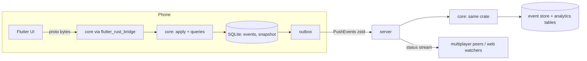

# Local-first: the Rust core on the phone

Status: **in progress.** Phase 1 done (the `core/` crate); Phase 2 next.

## Goal

The app works fully offline: every screen, every write, the whole workout.
Only multiplayer needs the network. Workouts sync to the cloud, compressed,
and the server can still run analytics on them. There is **one**
implementation of every rule — Rust — running on the phone and on the
server. No Dart mirror, no parity fixtures.

## Ground rules

- **One recording device per account.** Exactly one phone writes an
  account's history. The web (and anyone watching) only reads. No merge
  logic, no CRDTs, no clocks: the device's sequence number orders
  everything.
- **The account is a fold of events.** Every write the user makes is an
  event. State is `fold(apply, events)`. The same `apply` runs on the phone
  (to show it now) and on the server (to check it and to build the
  analytics tables).
- **Intents, not rows, are what sync.** We sync the event log, not table
  changes, so rules can change and history can be recomputed (SQLite's
  session/changeset CDC was considered and rejected for exactly that: it
  ships results, ties both ends to one schema forever, and can't replay).

## Decisions (2026-10-30)

- **Existing accounts are kept.** Their history, templates, trackers and
  settings are converted into events once, by a throwaway script run
  against production — not by migration code left in the repo.
- **One branch, one release.** All phases land on `feat/local-first` and
  ship together; production stays on 0.11.0 until then.
- **The web is read-only:** history, progress, summaries, admin analytics,
  and watching a live workout — all from synced data.

## Shape

### `core` crate

Pure Rust, no tonic, no sqlx, no IO. Owns the domain:

- `Account` — settings, profile, templates, trackers, the active workout,
  finished workouts (with their summaries), coaching messages.
- `Event` — one variant per write: StartWorkout, the workout mutations
  (StartSet, CompleteSet, …), EndWorkout, SaveTemplate, DeleteTemplate,
  ReorderTemplates, SetExerciseTracker, CompleteOnboarding, UpdateSettings,
  UpdateProfile.
- `apply(&mut Account, &Event, now) -> Result<(), CoreError>`.
- Queries: home, workout view, history, progress, exercise detail,
  summaries — all pure functions of `&Account`.

Everything that is logic today in `core/src/workout`, `core/src/progress.rs`,
`core/src/exercise_progress.rs`, `core/src/volume.rs`, `core/src/recovery.rs`,
`core/src/onboarding.rs`, `core/src/exercise_catalog.rs`, `core/src/weight_units.rs`,
`core/src/template_library.rs`, and the logic still inside `src/server/*.rs`
handlers (start-from-template planning, layoff deload, end-of-workout
progression, home/suggestion) moves here.

### The phone

- The app calls the core in-process: `core.call(method, request_bytes) ->
  response_bytes`, using the **existing proto messages**. The Dart service
  layer swaps its transport for local methods; screens barely change.
- Storage: SQLite (`rusqlite`, inside the core's host shim) with two tables:
  `events(seq, bytes)` and `snapshot(seq, bytes)`. The `Account` lives in
  memory, rebuilt from the latest snapshot plus the events after it.
- Outbox: events not yet acknowledged by the server. Pushed whenever there
  is a connection, in order, idempotent by `seq`.
- At workout end the workout is sealed: its events are compacted into one
  zstd-compressed blob plus a summary, and that is what the server keeps
  long term.

### The server

- Auth, accounts and sessions stay server-side.
- `PushEvents(after_seq, events)` — appends, replays through `core::apply`
  (rejecting anything that doesn't apply), acks the new head.
- `PullAccount` — the snapshot and events for a fresh install / reinstall.
- Analytics tables (workouts, sets, summaries, trackers) are projections of
  the event store, rebuilt by replay whenever a rule changes.
- The web reads those projections, and the live view of an active workout
  is the server's fold of the events pushed so far.

### Multiplayer

Unchanged in spirit: a session's status comes from each member's synced
events, folded by the same core on the server, and streamed to the other
members. Pushing promptly while online is what makes it live. Offline,
you drop out of the session and nothing else breaks.

## Phases

1. **Extract `core`.** Cargo workspace; the pure modules move into
   `core/`; the server depends on it. No behaviour change.
2. **Account + events.** `Account`, `Event`, `apply`, the queries; the
   handler logic moves into the core. The server stores events and serves
   every RPC from the fold.
3. **Core on the phone.** flutter_rust_bridge, on-device SQLite, the local
   `call` transport. Delete the Dart optimistic layer and every Dart copy of
   domain logic.
4. **Sync.** PushEvents / PullAccount, the outbox, sealing.
5. **Delete** the per-RPC write endpoints and the server-only read paths
   the phone no longer needs.
