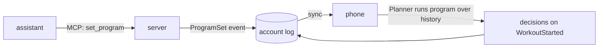

# Programs as config

**Status: proposal.** Nothing here is built.

The app records what you lift. *What it tells you to lift* is set by a
**program**: a config document stored in the account. An assistant (an
LLM) writes it once through an authorised MCP connection, and the app then
plans every workout from it with no further prompting. The rules built into
the core today stop being the rules. They become one built-in program, the
default.

## What we already have, and what changes

The log already does most of this. Decisions are recorded on
`WorkoutStarted`, and the fold lays them out and never plans
([local-first.md](../architecture/local-first.md)). So changing *who
decides* changes nothing already recorded. Replay stays exact.

What changes is the planner (`core/src/plan.rs`). Today it is one
hard-coded policy: the Epley walk, class rules, time-off cuts, the warmup
ladder and the set allocation from the time budget. It becomes an
**interpreter** that runs the account's current program.



## The program document

The program is JSON with a versioned schema. It is validated when it is
written and stored whole on the event.

```json
{
  "schema": "schlift.program/v1",
  "name": "Strength block, winter",
  "notes": "3 days a week, bad left shoulder, wants a bigger deadlift.",
  "defaults": {
    "progression": { "kind": "estimated_max" },
    "rest_seconds": 120,
    "warmups": "none"
  },
  "lifts": {
    "squat": {
      "progression": {
        "kind": "linear", "sets": 3, "reps": 5, "increment_lb": 5,
        "deload": { "after_failed_sessions": 3, "factor": 0.9 }
      },
      "warmups": "ladder", "rest_seconds": 180
    },
    "bench_press": {
      "progression": { "kind": "double", "sets": 3, "rep_range": [8, 12], "increment_lb": 5 }
    },
    "deadlift": {
      "progression": {
        "kind": "percent_wave",
        "training_max": { "from": "estimated_max", "factor": 0.9 },
        "cycle": [
          [{ "pct": 0.65, "reps": 5 }, { "pct": 0.75, "reps": 5 }, { "pct": 0.85, "reps": 5, "amrap": true }],
          [{ "pct": 0.70, "reps": 3 }, { "pct": 0.80, "reps": 3 }, { "pct": 0.90, "reps": 3, "amrap": true }],
          [{ "pct": 0.75, "reps": 5 }, { "pct": 0.85, "reps": 3 }, { "pct": 0.95, "reps": 1, "amrap": true }]
        ],
        "advance": "per_session", "cycle_increment_lb": 10
      },
      "warmups": "ladder"
    },
    "overhead_press": {
      "progression": {
        "kind": "formula",
        "sets": "3",
        "reps": "if(last.all_hit, min(last.reps + 1, 10), last.reps)",
        "weight": "if(last.all_hit and last.reps >= 10, last.weight + 2.5, last.weight)",
        "why": "Reps climb to 10, then weight goes up 2.5 and reps restart."
      }
    }
  },
  "workout": { "sets_from": "time_budget" },
  "rotation": { "kind": "recovery_volume", "weekly_sets_target": 10 }
}
```

Lift keys are the catalog's names (`EXERCISE_SQUAT` becomes `squat`). A
lift the program doesn't name uses `defaults`.

### Built-in progressions

Each one is a pure function: (the lift's finished sessions, its params, now)
to (sets, reps, weight, rest, warmups, reasons). Like today, nothing is
stored between workouts. Each progression's state comes from walking the
lift's history. For example, "which week of the wave am I in" is a count of
sessions since the program was set.

| Kind | What it does |
|---|---|
| `estimated_max` | Today's planner, unchanged: the walk, the rep range, time-off cuts, the calibration ramp |
| `fixed` | Exactly these sets × reps × weight, every time |
| `linear` | Fixed sets × reps. Add weight after a session where every rep was hit. Deload after N failed sessions |
| `double` | Rep range. Add reps until every set hits the top, then add weight and drop to the bottom |
| `percent_wave` | Percentages of a training max, cycling by session or week. The training max goes up each cycle |
| `rpe` | Target reps at an RPE, with the weight taken from the estimated max |
| `formula` | The assistant's own rule, as expressions (below) |

Every progression shares the existing mechanics: plate snapping, equipment
steps, the empty bar, the warmup ladder, the calibration ramp for a lift
with no history, the set state machine and the weight log.

### `formula`: progressions the assistant prescribes

A formula is a small expression language evaluated in the core, so the
phone and the server get the same answer:

- arithmetic, comparisons, `and`/`or`/`not`, `if(c, a, b)`, `min`, `max`,
  `round`, `floor`, `snap(weight)` (to what loads);
- read-only variables: `last.weight`, `last.reps`, `last.sets`,
  `last.all_hit`, `last.missed_sets`, `sessions` (the count under this
  program), `consecutive_fails`, `days_off`, `max` (the estimated max),
  `week`, `bodyweight`;
- no loops, no state, no clock, no I/O, and an evaluation-step limit.

A formula that fails to parse, names an unknown variable or can give a
non-finite or negative result on its validation inputs is refused when it
is written. If it still fails at plan time (for example, on an unforeseen
history), that lift falls back to `defaults` and the decision says so in
its reasons. A workout never fails to start.

### What moves out of code into the default program

These constants become fields of `core/programs/default.json`, which is
compiled into the core and used whenever an account has no program:

- the class rep ranges, rest times and warmups (`class_rules`)
- the time-off thresholds and cuts (`time_off_factor`)
- the warmup ladder's percentages
- the weekly hard-set target (10) and the 20% suggestion tie band
- the recovery windows per muscle (`recovery.rs`)
- the set allocation (2 sets minimum, 5 maximum)

**Phase 1's test:** with the default program, every planner test,
`progression_scenarios.rs` and the fuzzer give exactly what they give
today.

## In the log

A new fact:

```rust
/// The account's program, as written. The latest one plans.
pub struct ProgramSet {
    pub program: String,        // the document, as validated (JSON)
    pub author: String,         // "app", "default", or "mcp:<client name>"
    pub note: String,           // the assistant's own one-line why
}
```

- The program's id is the event's id. `ExerciseDecision` gains
  `program_id` and `rule` (the progression kind, or `fallback`). These are
  new fields, so old events read them as empty, meaning the built-in
  rules. Every recorded decision then names the program that made it.
- **Replay:** the fold lays out recorded decisions as it does today. A new
  program never rewrites a past workout.
- **Re-simulation:** because the planner is pure, any program can be run
  over the recorded history ("what would this have told me for the last 8
  weeks"). The MCP's `simulate_program` does this. It is the "replay" an
  assistant needs to check a program before writing it.
- Reverting is a new `ProgramSet` holding an older program. The log is
  only ever added to.
- **Compatibility:** an older app folds `ProgramSet` as `Unknown` and
  would go on planning with the built-ins. So the MCP's write is switched
  off until `MIN_APP_VERSION` is the app that knows the fact (see
  AGENTS.md).

## The MCP

The MCP is served by the existing binary on the axum side, at `/mcp`
(Streamable HTTP).

### Auth

Auth follows the MCP authorisation spec (OAuth 2.1). The server is its
own authorisation server:

- `/.well-known/oauth-protected-resource` and
  `/.well-known/oauth-authorization-server`
- dynamic client registration and PKCE
- a consent page on the web: sign in with your passkey, see the client's
  name and what it asks for, approve.

Scopes are `history:read` and `program:write`. Grants are server-owned,
so they are plain columns in a new table, `mcp_grants`. It has `user_id`
referencing `users(id) ON DELETE CASCADE`, client, scopes, a hashed
refresh token, created and last used. It is added as a new
`migrate.rs` step. Every tool resolves the user from the token itself,
like `authed_user_id`.

The app's Settings gets **Connected assistants**: who is connected, what
they last did, and Revoke.

### Tools

| Tool | Scope | Does |
|---|---|---|
| `get_profile` | read | Units, equipment and plates, bodyweight, onboarding answers |
| `list_exercises` | read | The catalog: key, muscles, load style, class |
| `get_history` | read | Finished workouts (sets, reps, weights, misses, timings), filterable by lift and date |
| `get_program` | read | The current program, its author and note, and earlier versions |
| `list_progressions` | read | Every built-in kind with a JSON Schema for its params, and the formula variables, so the assistant can find out what it may write |
| `validate_program` | read | Errors and warnings for a draft, without writing it |
| `simulate_program` | read | Runs a draft over the recorded history and forward N sessions under stated assumptions (all hit, miss every third…), and returns the prescriptions |
| `set_program` | write | Validates, then records `ProgramSet`. The server places it and streams it to the phones |

The MCP never records training: sets and workouts are recorded only by the
app. The assistant writes the plan and the app records what happened.

## Phases

1. **Default program.** `Program` type and schema. Move the constants into
   `default.json`. The planner reads them. Output is identical to today.
2. **The fact and the built-ins.** Add `ProgramSet`, `program_id`/`rule` on
   decisions, and `fixed`, `linear`, `double`, `percent_wave`, `rpe`. Add
   it to `stored_events.json`. The app shows the program in Settings.
3. **Formula.** Parser, evaluator, step limit, validation inputs, fuzzing.
4. **MCP.** OAuth, grants table, consent page, the tools, Connected
   assistants in the app.
5. **Release.** Ship the app that knows `ProgramSet`, raise
   `MIN_APP_VERSION`, then turn on `set_program`.

## Open questions

1. **Keep today's planner as the default, or drop it?** Proposed: keep it
   as the `estimated_max` built-in and the default program, so nobody's
   plan changes until they connect an assistant.
2. **How far does the program reach?** Per-lift progression for sure. Are
   the time budget, the set allocation and the rotation suggestion also
   the program's (as sketched), or do they stay fixed app behaviour?
3. **Custom exercises.** The catalog is a fixed enum of 77 lifts. Should a
   program be able to define new ones? That is a bigger change, to the
   proto and to every screen that shows a lift.
4. **Formula in v1?** Or ship built-ins with params first and add `formula`
   once the assistant has shown what it reaches for?
5. **Should the assistant write templates too**, or only the program?
