# End-to-end scenarios

A single framework for exercising real user journeys against the real stack:
the actual Flutter app running on an Android emulator, talking to a real backend
over gRPC. Every step captures a full-resolution screenshot and a structured log
entry, and the run produces an auditable HTML report.

It replaces the earlier headless widget-test harness, which rendered with missing
fonts and couldn't reach the backend. This one drives the app exactly as a person
would, so what you see in the report is what a user would see.

## Why this shape

- **Real app, real backend.** Scenarios run under Flutter's `integration_test`
  binding via `flutter drive`, on the emulator. Real gRPC round-trips, timers and
  animations resolve naturally — no fake-async, no mocked services.
- **Multiplayer without a second phone.** A scenario is *also* a gRPC client. It
  can log in additional users ("API peers") that act like phones: each records
  events on its own in-memory core and pushes them over `Sync`. The real app
  sees them on its Sync stream, because the backend can't tell an API peer
  from another phone. One real app instance + API-driven peers.
- **Dev login.** Scenarios authenticate through the app's existing `kDebugMode`
  dev-login field (backed by the `test-auth` backend feature), so no passkey/
  WebAuthn automation is needed.

```mermaid
flowchart LR
  subgraph Host
    D[flutter drive<br/>test_driver/integration_test.dart]
    R[scripts/build_e2e_report.py]
    H[test_screenshots/report.html]
  end
  subgraph Emulator
    A[Real Schlift app]
    S[Scenario<br/>integration_test/*_test.dart]
  end
  B[(Backend<br/>--features test-auth)]

  D -->|installs & runs| S
  S -->|taps, types, screenshots| A
  A -->|gRPC| B
  S -->|API peers: login, join, log sets| B
  S -->|screenshots| D
  S -->|E2E&#124; step log on stdout| D
  D --> R --> H
```



## Running

```bash
make e2e                      # bring up backend+emulator, run every scenario, build report
make e2e SCENARIO=multiplayer # only scenarios whose filename contains "multiplayer"
make e2e-up                   # just bring up backend + emulator + adb reverse
make e2e-run                  # run scenarios (world already up)
```

The report lands at `app/test_screenshots/report.html` (screenshots are embedded,
so it's a single self-contained file).

## The scenarios

The live-workout model is one-tap sets (`docs/plans/one-tap-sets.md`): Done
logs the ready set as prescribed and starts the rest; the rest offers Fewer
reps / Skip rest; nothing is rated; all done is End workout. A
brand-new user's first session of a loaded lift is a calibration ramp
("Finding weight": 5-rep rungs until a rep is missed), not warmups + working sets, so scenarios that need
the warmup ladder seed a session through the API first.

| File | What it proves |
| --- | --- |
| `smoke_test.dart` | The app boots on the emulator, reaches the backend, shows login. |
| `login_tabs_test.dart` | The NEW USER and SIGN IN tabs render their copy. |
| `solo_onboarding_test.dart` | A new user dev-logs in and is routed to onboarding. |
| `solo_onboarding_full_test.dart` | The whole onboarding flow (marker → unit → strength → bodyweight → templates) → home with START. |
| `solo_workout_test.dart` | START opens the live bar on a calibration rung; Done logs it; "How was that?" is asked and Right appends the working sets. |
| `solo_workout_finish_test.dart` | Done, then End workout through the confirm dialog → the summary with Duration / Volume / Sets / Rest. |
| `solo_workout_full_test.dart` | Plays an entire workout (Done / Skip rest / Right, bounded) to "All sets complete"; the backend holds exactly one completion per set; ends on the summary. |
| `skip_warmups_test.dart` | With API-seeded history the next session opens with warmups; "Skip" on the warmup row marks them skipped (none removed), up next moves to the first working set, and a skipped warmup can still be done. |
| `crash_recovery_test.dart` | Done, then a cold relaunch resumes the live workout with the set still recorded. |
| `workout_backend_sync_test.dart` | A set logged with Done is in the backend's active workout. |
| `workout_home_after_finish_test.dart` | Sets completed in the app (rung answered Right, then the working sets), ended from the UI: the summary and the backend's tracker agree on the calibrated weight. |
| `multiplayer_peer_test.dart` | An API peer joins; the app shows the 2-person session. |
| `multiplayer_leave_test.dart` | The app tracks a peer joining *and* leaving in real time. |
| `multiplayer_workout_progress_test.dart` | A peer joining mid-workout shows on the workout screen; the app user's own workout stays intact. |
| `join_request_test.dart` | A train-together request must be approved from the app's banner. |
| `training_partners_test.dart` | Training-together history is durable (backend + the FRIENDS list in the multiplayer sheet). |
| `history_with_partner_test.dart` | A group workout shows "with <name>" in History. |
| `history_graphs_test.dart` | Progress and History render over API-seeded sessions. |
| `exercise_detail_test.dart` | The per-lift detail view and its Top weight / Est. 1RM toggle. |
| `settings_shot_test.dart` | Captures the Settings screen. |
| `store_shots_test.dart` | The store slides (home, progress, detail, history, a working set ready, resting, the Heart tab, the completed screen). The capture half of `make store-capture`; on the unseeded e2e backend it onboards `demo` / `demo-live` and seeds a thin history over the API so the same script runs. |

## Native permission dialogs

Some app paths request OS permissions through native dialogs (Health Connect,
notifications, exact alarms). A native dialog pauses the Flutter surface, which
hangs an integration_test — it can only drive the Flutter view, not system UI.
Scenarios avoid them by opting out of the prompts before launch, via small,
production-safe seams:

- The permissions screen (and the notification, Health and exact-alarm
  prompts behind its button) only appears after `PermissionsService.load()`,
  which `main()` calls and `Scenario.launch()` does not.
- `HealthService.suppressPermissionPrompts = true` — makes the Health request
  a no-op, in case a test does reach it. Default false in production.

`Scenario.launch()` handles both, so scenarios never touch them directly.

## Writing a scenario

A scenario is an `integration_test` widget test that scripts a `Scenario`
(`integration_test/support/scenario.dart`). The `Scenario` wraps the app and
gives you expressive actions plus screenshot + logging:

```dart
testWidgets('solo — new user is routed to onboarding', (tester) async {
  final s = Scenario(binding, tester, 'solo_onboarding');

  await s.launch();                       // pump the real app
  await s.devLogin('alice_${...}');       // dev-login + dismiss passkey notice
  expect(await s.waitForText('Choose your colour and creature'), isTrue);
  await s.shot('Landed on onboarding');   // screenshot + report step
  await s.report();                       // flush the step log
});
```

Key `Scenario` methods:

| Method | Purpose |
| --- | --- |
| `launch()` | Convert the surface (required before capture) and pump the app. |
| `devLogin(name)` | Dev-login; a new account lands on onboarding, a returning one on home. |
| `completeOnboarding()` | Walk onboarding with the defaults, skip the tutorial, land on home. No-op for a returning user. |
| `skipTutorial()` | Dismiss the first-run walkthrough if it is showing. |
| `startWorkoutFromHome()` | Tap START and wait for the bar's Done. |
| `liftSet(missed:)` | Start the up-next set on its circle, finish it, tap off missed reps. |
| `endWorkoutAndWaitForSummary()` | End workout → confirm dialog → "Session snapshot". |
| `tap(finder)` / `tapText(label)` | Scroll into view, then tap. |
| `typeInto(field, text)` | Focus and enter text. |
| `waitForText(text)` / `mustSee(text)` | Poll until text appears (backend round-trips are async); `mustSee` throws with what *was* on screen. |
| `expectVisible` / `isVisible` | Assert / query on-screen text. |
| `scroll(dy)` | Drag the nearest scrollable. |
| `shot(title, note:)` | Screenshot + record a report step. |
| `note(title, detail:)` | Record a checkpoint with no screenshot. |
| `run(body)` | Wrap the scenario: any failure prints a loud block + FAILURE shot, and the report is always emitted. |
| `report()` | Emit the step log (only when not using `run`). |

Labels come from the generated copy (`copy.workout.done`, `copy.onboarding.next`,
…), so a wording change in `app/copy.yaml` does not silently break a scenario.

### API peers and backend assertions

`s.api` is a gRPC client to the same backend. Use it to drive peers or assert
state:

```dart
final bob = await s.api.login('bob_${...}');   // an API-only user
final aliceToken = /* login as the app user via api to fetch their token */;
await bob.joinViaInvite(await alice.inviteToken());  // pull the app user into a session
```

One phone records an account, so a peer logged in as the app's own user only
reads: once it adopts the app's workout (`adoptActiveWorkout`) a write
throws. Reads pull the account's log into the peer's core and answer from it,
exactly as a reinstalled phone would.

See `integration_test/support/api.dart` for `Peer` (invite/join, start workout,
complete sets, end workout, leave session, add library templates, training
partners and join requests). `completeAllWorkingSets()` / `doWorkout()` answer a
calibration rung "Right" on the way through, so a seeded session leaves the
tracker performed and the user's next session gets the warmup ladder;
`hasPerformed(exercise)` tells you which world you are in.

## How the report survives the run

`integration_test` will deliver **either** screenshots (via `onScreenshot`) **or**
`reportData` back to the driver — never both in one run. And `flutter drive`
uninstalls the app on teardown, wiping any file the app wrote. So the step log
rides the one channel that always survives: **stdout**. `Scenario.report()`
prints one short `E2E|...` line per step; `flutter drive` echoes those into its
log; `run_e2e.sh` tees each scenario's output to `test_screenshots/<name>.drive.log`;
and `build_e2e_report.py` parses the `E2E|` lines and pairs them with the PNGs
that `onScreenshot` wrote.

## Files

| Path | Role |
| --- | --- |
| `app/integration_test/*_test.dart` | Scenarios. |
| `app/integration_test/support/scenario.dart` | The `Scenario` orchestrator. |
| `app/integration_test/support/api.dart` | gRPC `Api` + `Peer` (API peers). |
| `app/test_driver/integration_test.dart` | Host driver — writes screenshots. |
| `scripts/run_e2e.sh` | Runs scenarios, tees logs, builds the report. |
| `scripts/build_e2e_report.py` | Parses `E2E|` lines + PNGs → `report.html`. |
| `make/e2e.mk` | `make e2e` / `e2e-up` / `e2e-run`. |

## Prerequisites

- Android SDK + an `emulator-5554` AVD (`make android-phone-avd-create`).
- The backend builds with the `test-auth` feature (dev login). `make e2e-up`
  starts it via `agent-backend-start`.
- Bundled offline fonts (`app/assets/google_fonts/`) so text renders without a
  network font fetch.

## Emulator stability

Under WSL2 the headless emulator's default renderer (`-gpu swiftshader_indirect`
in the Makefile) segfaults in its RenderThread while the app renders —
within seconds on the login screen with emulator 37.2.x, and reliably before
`solo_workout_full` gets through a workout. `run_e2e.sh` reports that as
`FLAKE`, not a test failure. `-gpu guest` is no escape: the API 34 image
does not support it and the emulator silently falls back to SwiftShader.
What ran the whole suite was the host GL path, which under WSL2 resolves to
Mesa llvmpipe (software, but not SwiftShader):

```bash
make e2e-up \
  ANDROID_EMULATOR_HEADLESS_ARGS="-no-window -no-audio -no-boot-anim -gpu host -camera-back none -camera-front none" \
  ANDROID_EMULATOR_EXTRA_ARGS="-feature -Vulkan"
for k in window_animation_scale transition_animation_scale animator_duration_scale; do
  adb -s emulator-5554 shell settings put global $k 0
done
adb -s emulator-5554 shell settings put system haptic_feedback_enabled 0
```

(`.tmp/agent-android/logs/lift_api34.log` says which renderer it got:
look for `Graphics Adapter`.) Software rendering is slow — the first launch
after install takes a few seconds to paint — so gates poll rather than
assume. If the emulator still dies on a heavily loaded host, re-run the
flaked scenarios with `make e2e-run SCENARIO="<name> <name>"` after
`make e2e-up`; the report builder merges every scenario's latest log. After
a crash the app is not uninstalled, so the next launch comes up signed in as
the previous scenario's user: `devLogin` signs that session out, and
`adb uninstall com.brensch.schlift.debug` before the re-run is cleaner.

The harness also mutes the rest-over sound (`Scenario` swaps in a silent
`SoundProvider` after each pump) and the drive log carries one `E2E> …` line
per tap and screenshot, so a run that dies before the step log is printed
still says how far it got.
