# End-to-end scenarios

A single framework for exercising real user journeys against the real stack:
the actual Flutter app, built for Linux and run headless at a phone's size,
talking to a real backend over gRPC. Every step captures a full-resolution screenshot and a structured log
entry, and the run produces an auditable HTML report.

It drives the app exactly as a person would, so what you see in the report
is what a user would see.

## Why this shape

- **Real app, real backend.** Scenarios run under Flutter's `integration_test`
  binding, inside the app. Real gRPC round-trips, timers and animations
  resolve naturally — no fake-async, no mocked services.
- **Built once, run many at once.** Every scenario is compiled into one Linux
  binary; each runs as its own process of it, with its own home directory,
  on a headless X server, side by side. No emulator, no build per scenario.
- **Multiplayer without a second phone.** A scenario is *also* a gRPC client. It
  can log in additional users ("API peers") that act like phones: each records
  events on its own in-memory core and pushes them over `Sync`. The real app
  sees them on its Sync stream, because the backend can't tell an API peer
  from another phone. One real app instance + API-driven peers.
- **Dev login.** Scenarios authenticate through the app's existing `kDebugMode`
  dev-login field (backed by the `test-auth` backend feature), so no passkey/
  WebAuthn automation is needed.

```mermaid
flowchart LR
  E[build/e2e/main.dart<br/>every scenario] -->|flutter build linux, once| X[one binary]
  X -->|E2E_SCENARIO=a| A[app + scenario a]
  X -->|E2E_SCENARIO=b| B2[app + scenario b]
  X -->|…| C[…]
  A & B2 & C -->|gRPC| B[(Backend<br/>--features test-auth)]
  A & B2 & C -->|screenshots + E2E&#124; log| R[scripts/build_e2e_report.py]
  R --> H[test_screenshots/report.html]
```



## Running

```bash
make e2e                      # backend up, every scenario, the report
make e2e SCENARIO=multiplayer # only scenarios whose filename contains "multiplayer"
make e2e-up                   # just the backend
make e2e-run                  # run scenarios (backend already up)
make e2e-run E2E_JOBS=4       # how many run at once (default: half the cores)
```

The report lands at `app/test_screenshots/report.html` (screenshots are embedded,
so it's a single self-contained file); each scenario's output is
`app/test_screenshots/<name>.log`.

## The scenarios

The live workout is sets as circles
([workout-lifecycle.md](../architecture/workout-lifecycle.md)): tap the
up-next circle to start a set, tap it when done, once more per missed rep;
all done is End workout. A calibration rung done in full asks "How many
more could you have done?" in a dialog over the list; that dialog holds the
rung's own circle, so a rep missed on a full rung is tapped off there. Every workout is planned when it starts. A
brand-new user's first session of a loaded lift is a calibration ramp
(5-rep rungs until a rep is missed, then the working sets from the max it
found), not warmups + working sets, so scenarios that need the warmup
ladder seed a session through the API first.

| File | What it proves |
| --- | --- |
| `smoke_test.dart` | The app boots, reaches the backend, shows login. |
| `login_tabs_test.dart` | The NEW USER and SIGN IN tabs render their copy. |
| `solo_onboarding_test.dart` | A new user dev-logs in and is routed to onboarding. |
| `solo_onboarding_full_test.dart` | The whole onboarding flow (marker → unit → strength → bodyweight → templates) → home with START. |
| `solo_workout_test.dart` | START opens the live workout on a calibration rung; a full rung climbs to the next and asks how many more, a rep tapped off on the dialog's circle settles the working weight. |
| `solo_workout_finish_test.dart` | Done, then End workout through the confirm dialog → the summary with Duration / Volume / Sets / Rest. |
| `solo_workout_full_test.dart` | Plays an entire workout on its circles (bounded by actions, as the ramp grows the plan) to "All sets complete"; the backend holds exactly one completion per set; ends on the summary. |
| `skip_warmups_test.dart` | With API-seeded history the next session opens with warmups; "Skip" on the warmup row marks them skipped (none removed), up next moves to the first working set, and a skipped warmup can still be done. |
| `discard_workout_test.dart` | A workout under way thrown away from the link under it, behind its prompt, leaves home; a finished one thrown away from its summary in History leaves History empty. |
| `crash_recovery_test.dart` | Done, then a cold relaunch resumes the live workout with the set still recorded. |
| `workout_backend_sync_test.dart` | A set logged with Done is in the backend's active workout. |
| `workout_home_after_finish_test.dart` | A first session calibrated and finished in the app, ended from the UI: the summary shows the calibrated weight and the next plan builds on it. |
| `multiplayer_peer_test.dart` | An API peer joins; the app shows the 2-person session. |
| `multiplayer_leave_test.dart` | The app tracks a peer joining, then the app user leaving, in real time. |
| `multiplayer_workout_progress_test.dart` | A peer joining mid-workout shows on the workout screen; the app user's own workout stays intact. |
| `join_request_test.dart` | A train-together request must be approved from the app's banner. |
| `training_partners_test.dart` | Training-together history is durable (backend + the FRIENDS list in the multiplayer sheet). |
| `history_with_partner_test.dart` | A workout trained in the app while in a session records it, and History shows "with <name>". |
| `history_graphs_test.dart` | Progress and History render over API-seeded sessions. |
| `exercise_detail_test.dart` | The per-lift detail view: the estimated max, its trend and a row per session. |
| `settings_shot_test.dart` | Captures the Settings screen. |
| `store_shots_test.dart` | The store slides (home, progress, detail, history, a working set ready, resting, the Heart tab, the completed screen). The capture half of `make store-capture`; on the unseeded e2e backend it onboards `demo` / `demo-live` and seeds a thin history over the API so the same script runs. |

## Phone-only plugins

The app is built for Linux here, where some phone plugins don't exist: the
health store (Health Connect, Apple Health), toasts, passkeys, the watch
bridge, the QR scanner. The app treats each as absent off the phones —
`HealthService` reads and writes nothing, `showToast` shows nothing, the
watch bridge is a no-op — so nothing a scenario does reaches a missing
plugin. Dev login replaces passkeys. The permissions screen only appears
after `PermissionsService.load()`, which `main()` calls and
`Scenario.launch()` does not.

## Writing a scenario

A scenario is an `integration_test` widget test that scripts a `Scenario`
(`integration_test/support/scenario.dart`). The `Scenario` wraps the app and
gives you expressive actions plus screenshot + logging:

```dart
testWidgets('solo — new user is routed to onboarding', (tester) async {
  final s = Scenario(binding, tester, 'solo_onboarding');

  await s.launch();                       // pump the real app
  await s.devLogin('alice_${...}');       // dev-login + dismiss passkey notice
  expect(await s.waitForText('Choose your colour and creature'), isTrue);
  await s.shot('Landed on onboarding');   // screenshot + report step
  await s.report();                       // flush the step log
});
```

Key `Scenario` methods:

| Method | Purpose |
| --- | --- |
| `launch()` | Pump the app at the phone's size (1080 × 2337 at 420 dpi), ready to screenshot. |
| `devLogin(name)` | Dev-login; a new account lands on onboarding, a returning one on home. |
| `completeOnboarding()` | Walk onboarding with the defaults, skip the tutorial, land on home. No-op for a returning user. |
| `skipTutorial()` | Dismiss the first-run walkthrough if it is showing. |
| `startWorkoutFromHome()` | Tap START and wait for the bar's Done. |
| `liftSet(missed:, rungAnswer:)` | Start the up-next set on its circle, finish it, tap off missed reps. A full calibration rung's question is answered `rungAnswer` (0–1 by default: the ramp ends); missed reps on a rung are tapped on the dialog's circle, then OK. |
| `startWorkoutInApp` / `finishWorkoutInApp` / `doWorkoutInApp` | A workout through the app's own account (overrides set, every working set done, ended). |
| `endWorkoutAndWaitForSummary()` | End workout → confirm dialog → "Session snapshot". |
| `tap(finder)` / `tapText(label)` | Scroll into view, then tap. |
| `typeInto(field, text)` | Focus and enter text. |
| `waitForText(text)` / `mustSee(text)` | Poll until text appears (backend round-trips are async); `mustSee` throws with what *was* on screen. |
| `waitForSessionOf(n)` / `waitForSolo()` | Poll the header's multiplayer badge: `n` people, or no count at all. |
| `waitForAppToCatchUp(peer)` | After a peer signed in as the app's own user seeded history, wait until the app has pulled all of it. |
| `expectVisible` / `isVisible` | Assert / query on-screen text. |
| `scroll(dy)` | Drag the nearest scrollable. |
| `shot(title, note:)` | Screenshot + record a report step. |
| `note(title, detail:)` | Record a checkpoint with no screenshot. |
| `run(body)` | Wrap the scenario: any failure prints a loud block + FAILURE shot, and the report is always emitted. |
| `report()` | Emit the step log (only when not using `run`). |

Labels come from the generated copy (`copy.workout.done`, `copy.onboarding.next`,
…), so a wording change in `app/copy.yaml` does not silently break a scenario.

### API peers and backend assertions

`s.api` is a gRPC client to the same backend. Use it to drive peers or assert
state:

```dart
final bob = await s.api.login('bob_${...}');   // an API-only user
final aliceToken = /* login as the app user via api to fetch their token */;
await bob.joinViaInvite(await alice.inviteToken());  // pull the app user into a session
```

A peer logged in as the app's own user only reads, so what the app shows is
the app's own doing: once it adopts the app's workout (`adoptActiveWorkout`) a write
throws. Reads pull the account's log into the peer's core and answer from it,
exactly as a reinstalled phone would.

The one exception is seeding history before the app does anything: a peer
as the app's user can `doWorkout` while the app sits idle on a screen. The
app pulls those events when its stream next reports the server's head (its
heartbeat, every 5 s), and until then it can show the account mid-seed — a
seeded workout half done, live. Follow a seed with
`s.waitForAppToCatchUp(peer)`. A workout that must carry the app's session
(trained with someone) has to be done in the app (`doWorkoutInApp`): the
phone records the session on its workout, a peer's write does not.

See `integration_test/support/api.dart` for `Peer` (invite/join, start workout,
complete sets, end workout, leave session, add library templates, training
partners and join requests). `doWorkout()` sets an override per lift (its
weight, reps and sets) and completes every working set at its target, so a
seeded session leaves the lift performed and the user's next session gets
the warmup ladder; `hasPerformed(exercise)` (from the lift's plan) tells
you which world you are in.

## Screenshots and the report

A screenshot is taken inside the app: `Scenario.shot` renders the app's root
boundary to a PNG at the phone's pixel ratio and writes it to `E2E_OUT`
(`app/test_screenshots/`), so it needs nothing from the display and is the
same size as a phone's. The step log is printed: `Scenario.report()` prints
one short `E2E|...` line per step, `run_e2e.sh` writes each scenario's output
to `test_screenshots/<name>.log`, and `build_e2e_report.py` parses the `E2E|`
lines and pairs them with the PNGs. The binary exits 0 when its scenario
passed, 1 when it failed.

## Files

| Path | Role |
| --- | --- |
| `app/integration_test/*_test.dart` | Scenarios. |
| `app/integration_test/support/scenario.dart` | The `Scenario` orchestrator. |
| `app/integration_test/support/api.dart` | gRPC `Api` + `Peer` (API peers). |
| `scripts/run_e2e.sh` | Writes the one entry point, builds it, runs the scenarios side by side, builds the report. |
| `scripts/build_e2e_report.py` | Parses `E2E|` lines + PNGs → `report.html`. |
| `make/e2e.mk` | `make e2e` / `e2e-up` / `e2e-run`. |

## Prerequisites

- Flutter's Linux build tools (`clang`, `cmake`, `ninja-build`,
  `libgtk-3-dev`) and Xvfb (`apt install xvfb`; `XVFB=` names another).
- The backend builds with the `test-auth` feature (dev login). `make e2e-up`
  starts it via `agent-backend-start`.
- Bundled offline fonts (`app/assets/google_fonts/`) so text renders without a
  network font fetch.

Each scenario gets `E2E_TIMEOUT` seconds (default 300). The harness mutes the
rest-over sound (`Scenario` swaps in a silent `SoundProvider` after each pump),
and each log carries one `E2E> …` line per tap and screenshot, so a run that
dies before the step log is printed still says how far it got.
